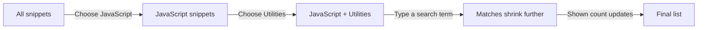
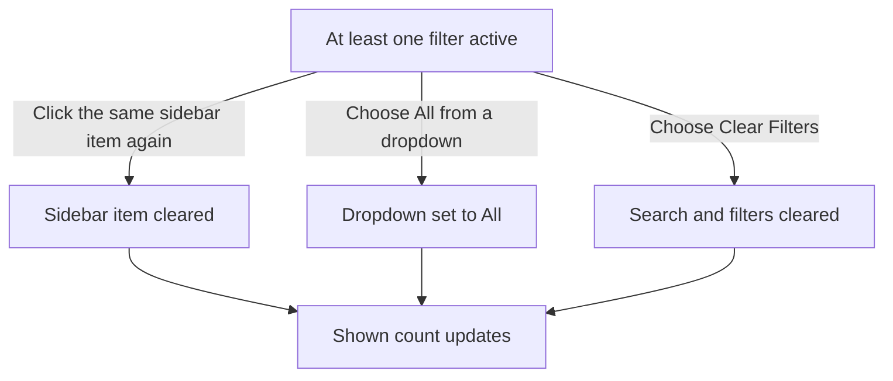

# Search and filter

Find any saved snippet quickly with CodeKnit's search and filter tools. Narrow your library by search term, language, category, tag, favorites, and more, alone or in combination.

This feature is for anyone who has saved more than a handful of snippets and wants to stop scrolling through a long list. Search and filters are the fastest way to reach the exact piece of code you need.

## Search across titles, descriptions, tags, and code

Type a word or phrase into the **Search snippets** box at the top of the page. CodeKnit looks for matches in each snippet's title, description, tags, and code content. Results update as you type, there's no need to press Enter or wait for a page to load.

The same search term also appears in the **Filter** box on the toolbar above your snippet list, so you can refine your search from either place.

Search happens entirely on your device, so it feels instant even with a large library and works whether you're online or not.

Any active filters stay applied while you search. For example, if you've already filtered to JavaScript and then search for "debounce," you'll see only JavaScript snippets that mention debounce.

## Narrow results from the sidebar

The sidebar gives you two filter groups:

- **Categories**, shows every category in your library, each with a count of how many snippets use it. Choose a category to show only snippets in that category.
- **Languages**, lists the four supported languages: JavaScript, Python, SQL, and Markdown. Choose one to show only snippets written in that language.

Choosing the same category or language again clears that filter and returns the list to all categories or all languages.

The sidebar also includes **Favorites**, which behaves like a filter. Choose **Favorites** to see only starred snippets. You can still combine Favorites with a language, category, tag, or search term.

## Refine with the filter bar

The filter bar above your snippet list gives you dropdown controls for:

- **Language**, choose **All languages** or a specific language
- **Category**, choose **All categories** or one of your saved categories
- **Tag**, choose **All tags** or a specific tag
- **Sort**, choose **Recently Added**, **Oldest First**, or **A–Z**

You can use any combination of these controls at the same time. Choosing **JavaScript** and **Utilities** shows only JavaScript snippets in the Utilities category. Adding another tag or typing a search term narrows the list even further.

Figure: How filters combine to narrow your snippet list

## Watch the result count

The number of snippets currently displayed appears just above the filter bar, labeled **shown**. It updates immediately whenever you search, choose a filter, or clear one.

If no snippets match your current search and filters, you'll see a "No snippets match" message with a **Clear filters** action.

## Clear filters and start over

You have a few ways to reset:

- Choose the same sidebar language or category again to clear that one filter.
- Choose **All languages**, **All categories**, or **All tags** in the filter bar to clear that one filter.
- Choose **Clear Filters**, it appears on the toolbar whenever a search, language, category, or tag filter is active, to reset all of those in one go. Your sort preference stays as-is.

Figure: Ways to clear active filters

> [!NOTE]
> Filters reset when you refresh or reopen CodeKnit. Your grid or list layout preference is remembered, but active filters and search terms start fresh.

## Sort and arrange your results

The **Sort** dropdown controls the order of your snippet list. Choose **Recently Added** for newest first, **Oldest First** for the reverse, or **A–Z** to order alphabetically by title.

Next to the sort control, you can switch between **Grid view** and **List view**. Grid view shows snippets as cards with a preview of the code; list view stretches each snippet into a wider row.

## What search and filter can't do

- **No advanced search operators**, you can't use regular expressions or fuzzy matching. Search looks for the exact characters you type.
- **Categories are manual**, CodeKnit only filters by categories you have assigned to snippets. There's no automatic tagging or classification.
- **No saved searches**, you can't save a filter combination or create smart collections that update themselves. Each session starts fresh.
- **No search across external files**, only your snippet library is searched, and the search happens on your device.

## Related

- Learn how categories and tags work: [Snippet Organization](doc:8367ddb8-1051-4848-a093-3b4352805aa4)
- See how filters connect to the bigger picture: [How Snippets and Filters Work Together](doc:5aa23d07-2c0d-44f6-8a85-df82ca070b77)
- Mark snippets as favorites: [Favorites](doc:b66c5560-9b68-42eb-922d-a8aecab0dfcb)
- Explore the rest of your library: [Snippet Library](doc:9f431e10-b005-4cc0-80b1-0af4acdcb3d8)
- Get oriented with the home screen: [Dashboard](doc:0cccb845-62f3-4e2b-b0ca-c7d768eaf700)
