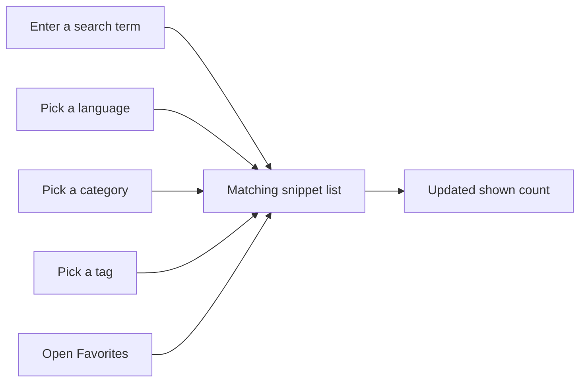
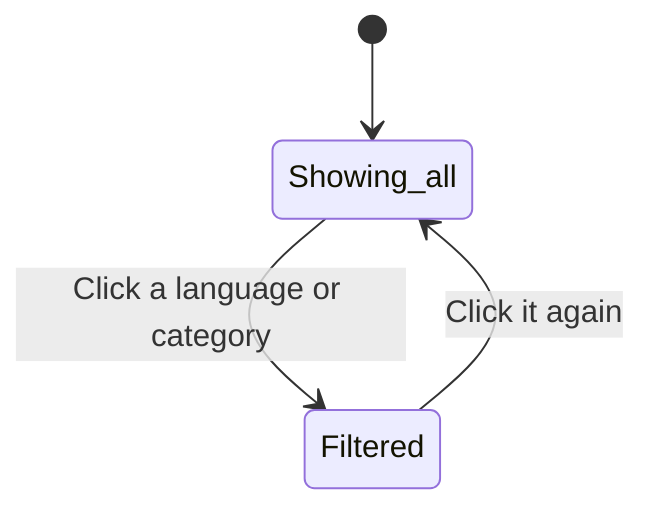

# Search and filter

Search and Filter is how you find the right snippet among everything you've saved. You can type a search term, choose a language, pick a category, select a tag, or open Favorites, and combine these filters to narrow results to exactly what you need.

## Who it's for

This feature helps anyone with a growing snippet library. As you save more snippets, scrolling through the full list becomes less practical. Search and Filter lets you jump directly to matching snippets by describing what you're looking for.

## Search box

The search box sits at the top of the page and accepts any text. It looks through snippet titles, descriptions, tags, and the code itself. Results update instantly as you type.

> [!NOTE]
> Search happens entirely on this device, so results appear immediately with no waiting.

For example, type`debounce` to find any snippet with "debounce" in its title, description, tags, or code.

## Filtering by language

The sidebar lists the available languages: **JavaScript**, **Python**, **SQL**, and **Markdown**. Each language has a colored dot. Click a language to show only snippets in that language. Click the same language again to return to showing all languages.

You can also choose a language from the **Language** dropdown in the filter bar.

## Filtering by category

The sidebar lists all your categories, each with a count of how many snippets it contains. Click a category to see only snippets assigned to that category. Click it again to clear the filter.

You can also choose a category from the **Category** dropdown in the filter bar.

## Filtering by tag

The filter bar includes a **Tag** dropdown that lists every tag you've used. Choose one to show only snippets with that tag.

## Favorites

Click **Favorites** in the sidebar to show only starred snippets. This view still works with your other search and filter choices, so you can search within favorites.

## Combining filters

All of these filters work together. For example, choose **JavaScript** as the language and **Utilities** as the category to see only JavaScript snippets assigned to Utilities. Add a search term such as`fetch` to narrow the results even further.

Figure: How filter choices combine into one result list

## Understanding the shown count

Next to the section heading, you see a label such as **18 shown**. This number updates every time you change a search term or filter, so you always know how many snippets currently match.

## Sorting results

The filter bar includes a **Sort** dropdown with these options:

- **Recently Added**
- **Oldest First**
- **A–Z**

Sorting applies to the current filtered list.

## Clearing filters

When you have an active search term or filter, a **Clear Filters** button appears in the filter bar. Click it to reset the search box, language, category, and tag all at once. Your sort preference stays as it is.

Clicking a sidebar language or category again also clears just that one filter.

Figure: Toggling a sidebar filter on and off

## When there are no matches

If nothing matches your search and filters, you see a **No snippets match** message with a suggestion to try a different search term or loosen your filters, plus a **Clear filters** button.

## View style

The filter bar also includes a toggle for **Grid view** and **List view**. Grid view shows snippets as cards in columns; List view shows them in a single column. Your choice is remembered for next time.

## Benefits

- **Fast results**: searches run instantly on this device.
- **Combinable filters**: layer search, language, category, tag, and favorites together.
- **Live counts**: see exactly how many snippets match at a glance.
- **One-click clear**: reset all filters at once when you're done.

## Boundaries

Search and Filter is designed for speed and simplicity, so a few advanced capabilities are not available.

- Search only looks through snippets stored in this browser on this device. Snippets on another device or in a different browser are not included.
- Search is exact text matching. It does not support fuzzy matching or advanced search pattern syntax, so type words as they appear.
- Categories are only available when assigned. CodeKnit does not create categories automatically; assign a category when you create or edit a snippet.
- There are no saved searches or smart collections. If you often use the same multi-filter view, you'll re-select those filters each time.

## Related

- [How Snippets and Filters Work Together](doc:5aa23d07-2c0d-44f6-8a85-df82ca070b77)
- [Favorites](doc:b66c5560-9b68-42eb-922d-a8aecab0dfcb)
- [Snippet Organization](doc:8367ddb8-1051-4848-a093-3b4352805aa4)
- [Snippet Library](doc:9f431e10-b005-4cc0-80b1-0af4acdcb3d8)
