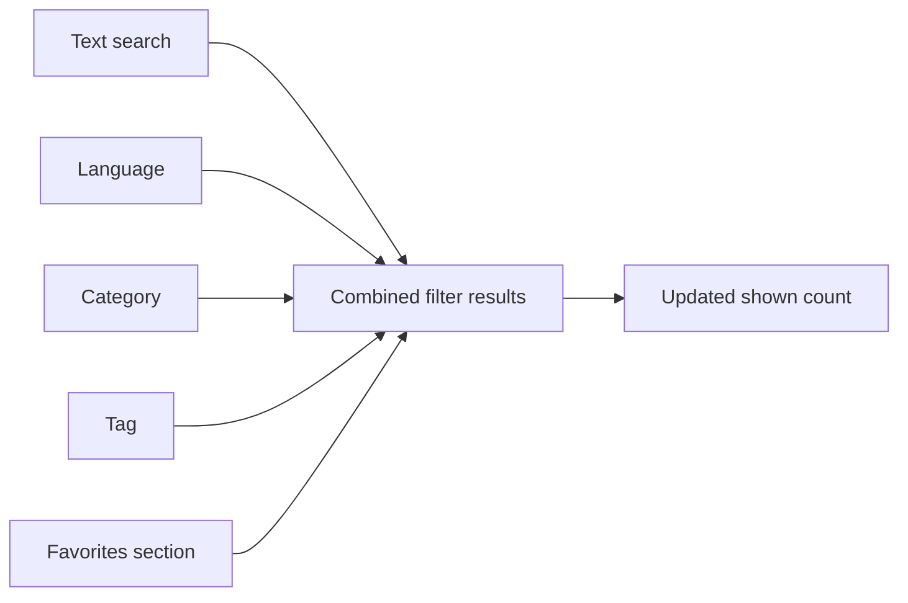
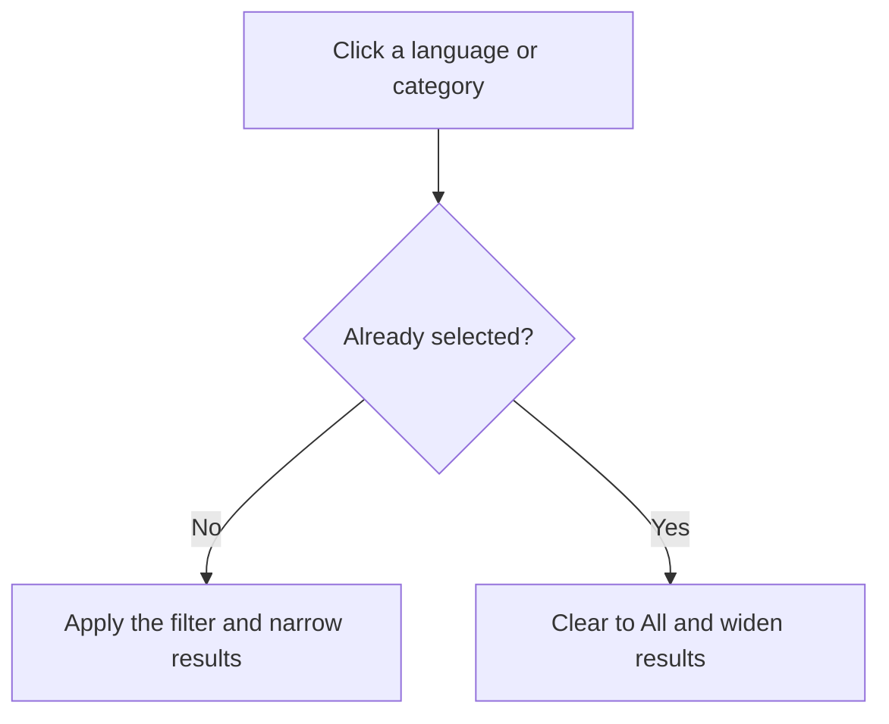

# Search and filter

Search and Filter helps you find the right snippet quickly, even as your library grows. Instead of scrolling through every saved snippet, you can combine a text search with language, category, tag, and favorites filters. Results update as you type and select, and the number of matching snippets is always visible.

## Search by text

Use the search box at the top of the page, or the one in the filter bar above your results, to find a snippet by entering part of its title, description, code, or tags. As you type, the snippet list narrows immediately to show only matching entries.

The search box says **Search snippets, tags, or code...** You don't need to remember exact wording; any matching text helps.

## Filter by language

The sidebar includes a **Languages** list. Clicking a language such as **JavaScript**, **Python**, **SQL**, or **Markdown** shows only snippets saved in that language. Click the same language again to return to showing all languages.

You can also choose a language from the **Language filter** dropdown in the filter bar. The **All languages** option clears the language filter.

## Filter by category

The sidebar lists the categories used in your library, with a count of snippets in each category. Clicking a category shows only snippets assigned to that category. Click the selected category again to clear it.

Categories are created when you save snippets, so the list reflects your own library. If no snippets match a category yet, it won't appear in the sidebar.

## Filter by tag

The filter bar includes a **Tag filter** dropdown that lists every tag you've used. Selecting a tag shows only snippets labeled with that tag. Tags appear with a`#` symbol in the list, such as`#react` or`#utility`.

Select **All tags** to remove the tag filter.

## Filter by favorites

Click **Favorites** in the sidebar to show only snippets you've starred. Favorites works alongside your other filters, so you can favorite-filter first and then search or apply language, category, and tag filters to narrow the results even further.

## Combining filters

Filters work together rather than replacing one another. For example, you can select **JavaScript** as the language, **Utilities** as the category, and type a word from the code. The result set includes only snippets that match all active filters at once.

Figure: How search and filters combine into one result set

## Toggling filters on and off

Language and category filters in the sidebar behave as toggles. Clicking an item applies the filter; clicking the same item again clears it. Clicking a different item switches to that filter instead.

Figure: What happens when you click a language or category filter

## Shown count and clearing filters

Above the snippet list, the label **shown** tells you how many snippets currently match. This number updates automatically as you apply or remove filters.

When any text, language, category, or tag filter is active, the **Clear Filters** button appears in the filter bar. Selecting it removes all active filters and returns you to the full library. Your sort choice is kept.

If no snippets match your current filters, you'll see an empty state with a suggestion to try different terms or loosen your filters, along with a quick way to clear them.

## Sorting results

The filter bar also includes a **Sort** control with three options:

- **Recently Added**, newest snippets first
- **Oldest First**, oldest snippets first
- **A–Z**, alphabetical by title

Sorting affects the order of results and works independently from the other filters.

## Benefits

- **Fast full-text search**, searches run locally in your browser against the snippets saved on your device, so results feel immediate.
- **Combinable filters**, language, category, tag, favorites, and text all work together to narrow large libraries.
- **Real-time result counts**, the **shown** count updates as you adjust filters, so you always know how many matches you have.
- **Easy reset**, one **Clear Filters** action returns you to the full library.

> [!NOTE]
> Search and filtering happen only in your browser. Nothing is sent to a server, so filtering is fast and your snippets stay private on your device.

## Limits and boundaries

- **Client-side only**, search covers only your locally saved snippets. It doesn't search external sources.
- **No advanced matching**, search is direct text matching. There's no regex or fuzzy matching.
- **Categories and tags are manual**, snippets are only categorized or tagged when you choose those values. Nothing is assigned automatically.
- **No saved searches or smart collections**, you can't bookmark a filter combination for later use. Each search starts fresh.

## Related

- [How Snippets and Filters Work Together](doc:5aa23d07-2c0d-44f6-8a85-df82ca070b77)
- [Snippet Library](doc:9f431e10-b005-4cc0-80b1-0af4acdcb3d8)
- [Snippet Organization](doc:8367ddb8-1051-4848-a093-3b4352805aa4)
- [Favorites](doc:b66c5560-9b68-42eb-922d-a8aecab0dfcb)
