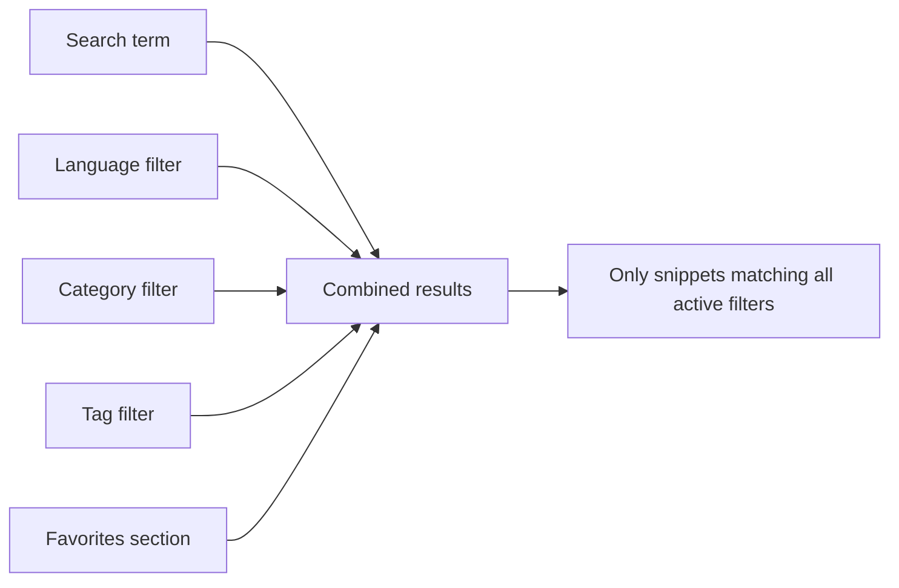
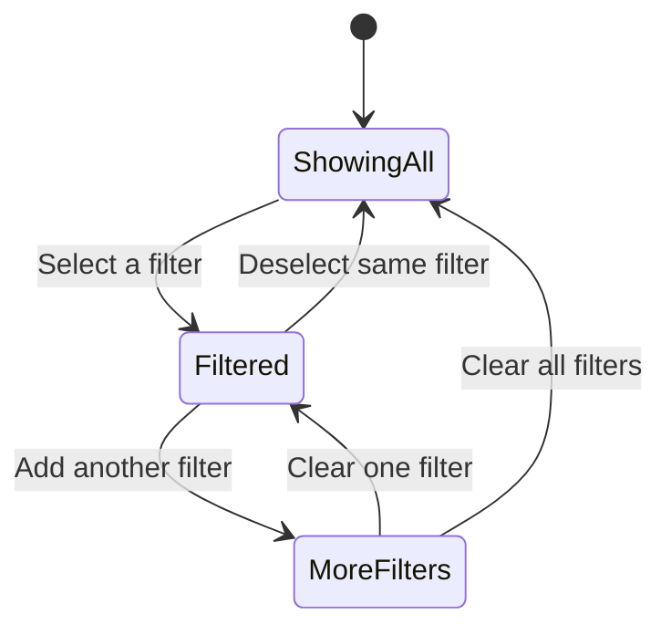

# Search and filter

Quickly find any snippet in your CodeKnit library by typing a search term or combining filters for language, category, tags, and favorites. Filters work together to narrow your results, and the number of matching snippets updates as you go.

## Who this is for

Search and Filter helps you when your snippet library grows and you need to find a specific reusable piece of code without scrolling through every card. You can search for text, then narrow by language, category, tag, or favorites.

## Find snippets with search

Use the search box at the top of the page to look through your snippets. The placeholder reads **Search snippets, tags, or code...**. You can search by:

- Snippet title
- Description
- Tags
- Code content

Results update immediately as you type. The **shown** count above the snippet list tells you how many snippets match your current search and filters.

> [!NOTE]
> Search works entirely on your device. It searches the snippets stored in this browser, so no internet connection is needed.

## Filter by language

The sidebar lists every available language under **Languages**. Each language has a colored dot and a name, such as **JavaScript**, **Python**, **SQL**, and **Markdown**.

- Click a language in the sidebar to show only snippets written in that language.
- Click the same language again to clear that language filter.
- You can also open the **Language filter** dropdown in the filter bar above the snippet list and choose **All languages** or a specific language.

The dot colors match the language badges you see on snippet cards, making it easy to recognize languages at a glance.

## Filter by category

The sidebar also lists every category you have created under **Categories**. Each category shows a count of how many snippets belong to it.

- Click a category to see only snippets in that category.
- Click the same category again to clear it.
- The **Category filter** dropdown in the filter bar offers the same choices plus **All categories**.

Categories are assigned when you save or edit a snippet. Learn more in [Snippet Organization](doc:8367ddb8-1051-4848-a093-3b4352805aa4).

## Filter by tags

Use the **Tag filter** dropdown in the filter bar to show snippets that carry a specific tag. Tag names appear with a`#` symbol, such as`#react` or`#utility`.

Tags work alongside other filters, so you can combine a tag with a language or category to narrow results further.

## Show favorites only

Click **Favorites** in the sidebar to see only your starred snippets. The **Favorites** menu item displays a star icon and the total number of starred snippets.

You can star any snippet from its card or detail view by selecting the star icon. Once starred, the snippet appears in the **Favorites** section until you remove the star.

To learn more about starring snippets, see [Favorites](doc:b66c5560-9b68-42eb-922d-a8aecab0dfcb).

## Combine filters for precise results

All active filters work together. If you type`debounce`, select **JavaScript** as the language, choose **Utilities** as the category, and pick a tag such as`performance`, you see only snippets that match every one of those conditions.

Figure: How filters combine to narrow results

The **shown** count updates each time you add or remove a filter. If no snippets match, an empty state appears with the message **No snippets match** and a **Clear filters** button to help you start over.

Figure: Toggling sidebar filters on and off

## Sort your results

Use the **Sort** dropdown in the filter bar to change the order of matching snippets:

- **Recently Added** shows newest snippets first
- **Oldest First** shows oldest snippets first
- **A–Z** orders snippets alphabetically by title

## Clear filters and try again

When you have an active search term or any selected filter, a **Clear Filters** button appears in the filter bar. Click it to reset:

- Search term
- Language filter
- Category filter
- Tag filter

Your sort order and layout choice stay as they are. If your filters produce no results, the empty state also offers a **Clear filters** button.

## Boundaries and tips

- Search matches exact text only. It does not support fuzzy spelling corrections or advanced pattern matching.
- Categories are assigned manually when you create or edit a snippet. CodeKnit does not auto-categorize snippets.
- Filters are not saved as presets or smart collections. You can reapply them any time, but CodeKnit does not remember a saved search.
- Search only sees snippets stored on the current device. Snippets from another browser or device are not included.

## Related

- [How Snippets and Filters Work Together](doc:5aa23d07-2c0d-44f6-8a85-df82ca070b77)
- [Snippet Library](doc:9f431e10-b005-4cc0-80b1-0af4acdcb3d8)
- [Snippet Organization](doc:8367ddb8-1051-4848-a093-3b4352805aa4)
- [Favorites](doc:b66c5560-9b68-42eb-922d-a8aecab0dfcb)
