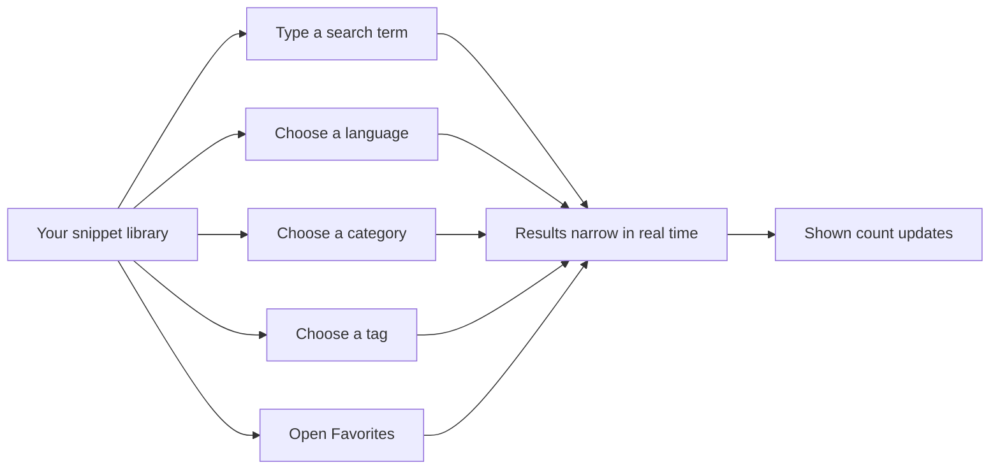
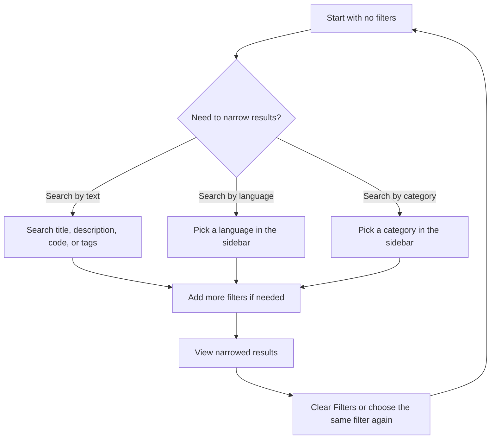

# Search and filter

Search and Filter helps you find any snippet in your library quickly. Instead of scrolling through everything you've saved, you can search for text, narrow results by language or category, add a tag filter, show only favorites, and sort the results.

## What you can do

### Search for text

Use the search box at the top of the page to find snippets by title, description, code content, or tags. Type a word, phrase, or piece of code, and the results update as you type.

### Filter by language

Choose a language from the sidebar to show only snippets saved in that language. CodeKnit supports JavaScript, Python, SQL, and Markdown. Selecting the same language again returns the list to all languages.

### Filter by category

The sidebar lists your categories and shows how many snippets each category contains. Choose a category to see only snippets assigned to that category. Choose it again to clear it. Categories are assigned when you create or edit a snippet.

### Filter by tag

Use the **Tag** selector under the search bar to show only snippets that have a specific tag. Tags are more flexible than categories because a single snippet can have several tags, so the same snippet can appear under multiple tag filters.

### Show only favorites

Open **Favorites** in the sidebar to display only snippets you have starred. The favorites filter applies together with any other search, language, category, or tag filter you have active.

### Sort results

Sort the displayed snippets by **Recently Added**, **Oldest First**, or **A–Z**.

## Building a multi-filter search

Filters combine naturally. For example, if you search for "debounce" with **JavaScript** selected in the sidebar and the **Utilities** category selected, you see only JavaScript snippets in Utilities that match "debounce." Add a tag filter or switch to **Favorites**, and the results narrow further.

Figure: Search and filters narrow your results

Figure: Choosing and clearing filters

## Real-time result counts

The **shown** count near the top of the results updates as soon as your search or filters change, so you always know how many snippets match. Sidebar badges also show live totals for **All Snippets**, **Favorites**, and **Recently Used**, and each category shows its own count.

## Clearing filters

When a search term or any filter is active, a **Clear Filters** button with an X appears. Selecting it resets the search, language, category, and tag filters while keeping your current sort choice.

You can also clear an individual filter by selecting the same option again. For example, if **Python** is selected in the sidebar, selecting **Python** again returns the list to all languages.

## How filters work within each section

Search and filters apply in all main sections, with a few section-specific behaviors:

- **Dashboard** and **All Snippets** show your full library with all filters available.
- **Favorites** automatically adds a favorites-only filter on top of your other selections.
- **Recently Added** sorts by newest and shows the 10 most recent matches.
- **Recently Used** shows snippets you have copied, ordered by the most recently copied.

> [!NOTE]
> Search matches the exact text you type. CodeKnit does not support advanced regular expressions or fuzzy matching. Searches run locally in your browser on the snippets saved on that device.

## Limits to keep in mind

- Categories must be assigned to snippets manually when you create or edit them. CodeKnit does not generate categories from your code.
- There are no saved searches or smart collections. You can reconstruct the same search each time, but you cannot save it for later reuse.

## Related

- [Snippet Library](doc:9f431e10-b005-4cc0-80b1-0af4acdcb3d8)
- [Snippet Organization](doc:8367ddb8-1051-4848-a093-3b4352805aa4)
- [Favorites](doc:b66c5560-9b68-42eb-922d-a8aecab0dfcb)
- [How Snippets and Filters Work Together](doc:5aa23d07-2c0d-44f6-8a85-df82ca070b77)
- [Dashboard](doc:0cccb845-62f3-4e2b-b0ca-c7d768eaf700)
