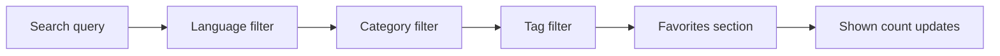

# Search and filter

Search and filter in CodeKnit helps you find the right snippet quickly. You can search by text, narrow results by language, category, tag, and favorite status, and see the matching count update as you go. Filters work together so you can combine them for precise lookups.

## Who it's for

Search and filter is for anyone who keeps a growing library of code and Markdown snippets. If you have more than a handful of snippets, these tools help you avoid scrolling through everything to find the one you need.

## Search across your library

Type a search term in the search box at the top of the page or in the **Filter** box above the snippet list. CodeKnit searches the text of your snippets, including:

- Title
- Description
- Code content
- Tags

Search happens entirely on your device, so results appear instantly as you type. You do not need an internet connection to search your own library.

## Filter by language, category, tag, and favorite

The sidebar and filter toolbar provide filters that narrow your snippet list:

- **Language**: Choose from the four supported languages, JavaScript, Python, SQL, and Markdown.
- **Category**: Choose from categories you have assigned to snippets. Each category in the sidebar shows the number of snippets in it.
- **Tag**: Choose a tag from the **Tag** filter in the toolbar.
- **Favorites**: Select **Favorites** in the sidebar to show only starred snippets.

Clicking a language or category in the sidebar applies that filter. Clicking the same language or category again clears it and returns you to **All**.

## Combine filters to narrow results

Filters work together. You can apply a search term, a language, a category, a tag, and the Favorites section at the same time. For example, selecting **JavaScript** as the language and **Utilities** as the category shows only JavaScript snippets that are also in the Utilities category.

The following diagram shows how filters are applied in order to narrow your snippet list.

Figure: Search and filter flow

You can add or remove filters in any order. The visible snippet list updates immediately with the combined result.

## View the live result count

As you search and filter, the **shown** count above the snippet list updates to show how many snippets currently match. This makes it easy to see the effect of each filter and to know when your combination has narrowed the results enough.

## Clear filters when you're done

When any search term or filter is active, a **Clear Filters** button appears in the filter toolbar. Select it to remove your search term and reset language, category, and tag back to **All**. Your chosen sort order stays the same.

## Sort results

You can order your filtered results by:

- **Recently Added**
- **Oldest First**
- **A–Z**

Sorting works alongside search and filters, so you can arrange the matching snippets however you prefer.

## What search and filter can't do

- Search is limited to the snippets saved on your device. It does not search online resources.
- Search does not support advanced regular expressions or fuzzy matching.
- Categories and tags must be assigned to each snippet manually. CodeKnit does not create them automatically.
- There are no saved searches or smart collections. Filters apply to the current session and can be cleared when you are done.

## Related

- [Snippet Library](doc:9f431e10-b005-4cc0-80b1-0af4acdcb3d8)
- [Favorites](doc:b66c5560-9b68-42eb-922d-a8aecab0dfcb)
- [Snippet Organization](doc:8367ddb8-1051-4848-a093-3b4352805aa4)
- [How Snippets and Filters Work Together](doc:5aa23d07-2c0d-44f6-8a85-df82ca070b77)
- [Product Overview](doc:ca8f433d-53d1-475b-a3a5-29b24f1ba173)
