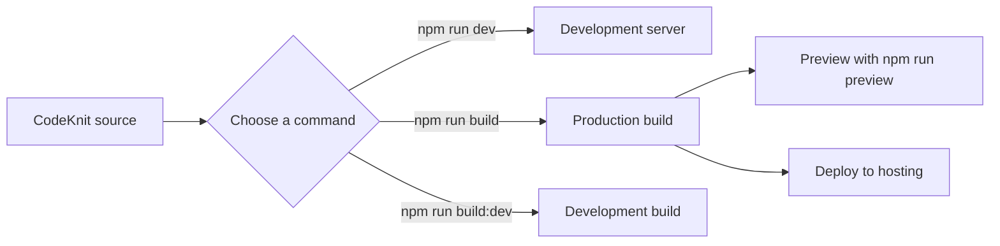
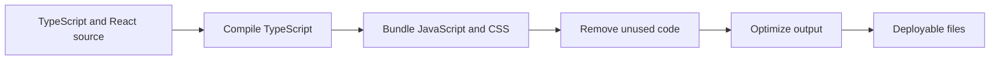

# Site building and bundling

Site Building & Bundling turns the CodeKnit source into a fast, optimized website you can run locally or deploy to production. It is for developers who set up the app on their own machine and for site administrators who prepare it for release.

## What you can do

- Start a local development server that refreshes automatically while you work
- Create an optimized production build that loads quickly for visitors
- Create a development-mode build that is easier to debug
- Preview the production build locally before deploying it
- Check code quality, formatting, and tests

## Development and production paths

The same source can take three paths depending on the command you choose. Each serves a different purpose.

Figure: Development and production build paths

- The **development server** gives you fast feedback with automatic refresh. It is not meant for public visitors.
- The **production build** applies optimizations and produces the output you deploy.
- The **development build** skips some optimizations so the result behaves more like the development server.

## What happens during a production build

Figure: Production build steps

During a production build, the site compiles TypeScript, bundles all JavaScript and CSS together, removes unused code, and optimizes the output. The result is a set of deployable files.

> [!NOTE]
> The project declares its modules as side-effect-free, which lets the bundler safely drop code that is never used and keeps the final files smaller.

## Related

- [Product Overview](doc:ca8f433d-53d1-475b-a3a5-29b24f1ba173)
- [System Requirements and Installation](doc:1016cd5f-d53c-46d7-a74a-15b623ef5387)
- [How to build production site](doc:23e09652-4772-4f32-a5b7-0121a8bc4853)
