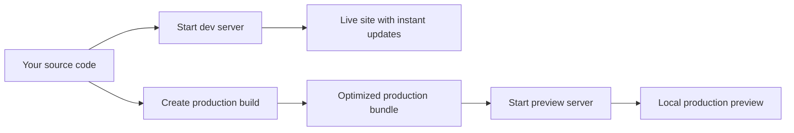
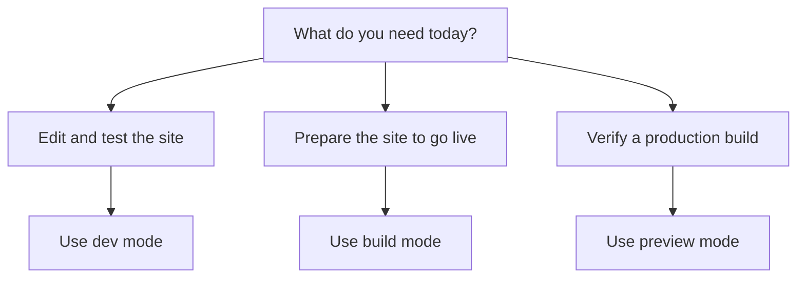

# Site building and bundling

Site Building & Bundling turns your CodeKnit project into a working website. It covers the main moments of preparing a site: running it while you work, creating an optimized version for production, and testing that production version before you publish.

## Who it's for

This feature is for developers and site administrators who need to:

- Run the site on their own machine during development
- Prepare an optimized bundle to deploy
- Verify the production output locally before it goes live

## How the build flow works

The same source code feeds either live development or a production bundle. From the bundle, you can launch a local preview to check the result.

Figure: Development and production build flow

## Choosing a mode

The command you choose depends on what you need to do with the site.

Figure: Choose a site mode

## Benefits

- **One-command builds**, bundling for production is a single command, with no manual tooling setup required.
- **Fast development**, the development server updates the site as you make changes.
- **Optimized output**, the production command compiles and bundles the site rather than serving source files directly.
- **Safe testing**, the preview command lets you check the exact production bundle on your own machine before release.

## Key options and boundaries

The build is powered by Vite 8.1.5, and the project pins the Rolldown bundler to version 1.2.1. The site is built with TanStack Start, React, TypeScript, and Tailwind CSS, and the build is configured to understand these parts out of the box.

- The development command does not produce a deployable bundle. Use the production build command for anything you plan to publish.
- The preview command serves the most recent production build. Run the production build command again after making changes, then preview again to see the latest result.
- Local setup requires Node.js and npm; the recommended way to install both is with nvm.

## Related

- [System Requirements and Installation](doc:1016cd5f-d53c-46d7-a74a-15b623ef5387)
- [Product Overview](doc:ca8f433d-53d1-475b-a3a5-29b24f1ba173)
- [Logging & Diagnostics](doc:42850ad2-ae64-43c4-930f-731595c051ed)
