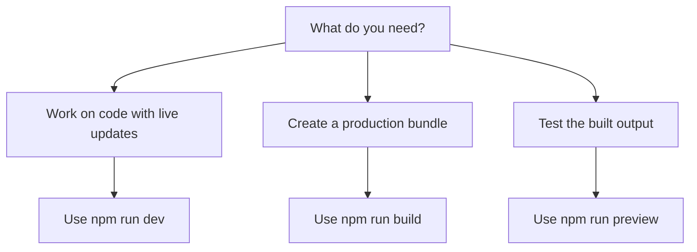
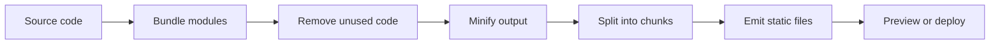

# Site building and bundling

This page describes how the site is compiled and bundled for production. It is for developers who want to prepare a release build, test that build locally, or run the project during development.

The build toolchain compiles TypeScript and React source into an optimized set of files you can serve to visitors. It runs on Vite 8 and uses Rolldown under the hood to combine, minify, and split your code into efficient bundles. The project pins Rolldown to version 1.2.1 so builds use a consistent, known bundler version.

## What you can do

The build tooling supports four main developer workflows:

| Command | Purpose |
|---|---|
|`npm run dev` | Start the live development server with fast refresh while you work |
|`npm run build` | Create an optimized production build |
|`npm run build:dev` | Create a development-mode build for debugging |
|`npm run preview` | Serve the production build locally to test it before it goes live |

These commands cover the full cycle from writing code to verifying that the final output works.

Figure: Choosing the right build command

## How the build works

The build process turns your source into output that a server can deliver efficiently.

Figure: Production build flow

During a production build, the toolchain performs several optimizations:

- **Bundling** combines related modules so the browser makes fewer requests.
- **Tree shaking** removes code that is never imported or used. The project enables this optimization sitewide.
- **Minification** shortens variable names and strips whitespace to reduce file size.
- **Code splitting** emits separate chunks so visitors download only the parts they need.

## Limits and considerations

- A production preview only reflects the most recent build; change your source and run the build again to see updated output.
- The Rolldown bundler is pinned to version 1.2.1, so builds are consistent, but you cannot pick an arbitrary different bundler without changing the project configuration.
- Builds run in a Node.js environment and require the dependencies listed in the project to be installed first.

## Related guides

- [How to build production site](doc:23e09652-4772-4f32-a5b7-0121a8bc4853)
- [How to minify JavaScript bundles](doc:0ca83aab-42b1-494a-8fef-9f7fbf81dc7f)
- [How to enable faster build mode](doc:c4b28fd3-840d-4199-8d25-b0db7d1b0e49)
- [CSS Optimization](doc:9c358234-bd9b-41b5-8c0e-dc1b8be5ce61)
