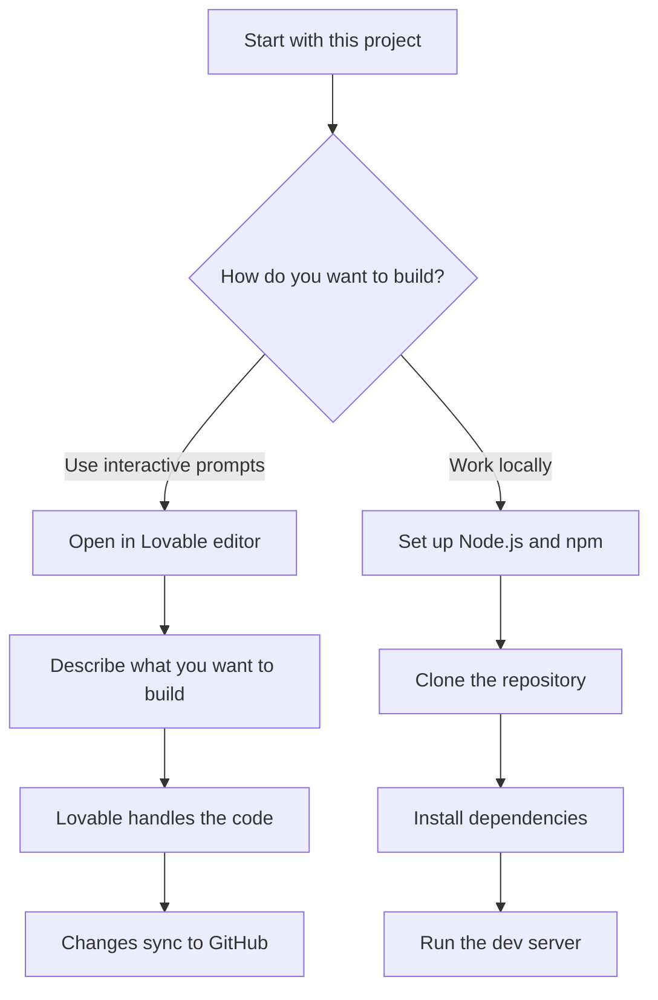
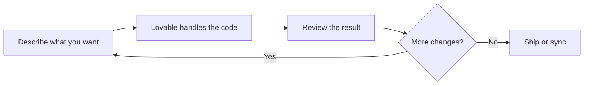

# Site scaffolding

Site scaffolding gives you a ready-to-build starting point for a new web project. It's for developers who want to skip blank-page setup and begin with a working app shell, a pre-configured stack, and two clear ways to keep building: through interactive, plain-language prompts in Lovable, or through a local development environment.

## What you get

When you start from this scaffolding, you get a working project already built with:

- TanStack Start for the app framework
- TypeScript for type safety
- React for the interface
- Tailwind CSS for styling

You don't assemble the build tooling, development server, or styling pipeline yourself. Those pieces are already wired together, so you can focus on what you want to build.

## Two paths to keep building

Figure: Site scaffolding start paths

### Build with interactive prompts

You can open the project in the Lovable editor and keep building by describing what you want in plain language. Lovable handles the code for each request, so you can make progress without writing every line yourself.

Figure: Interactive prompt building loop

When you connect the project to GitHub, every change you make in Lovable is committed straight to your repository. Your changes sync back into Lovable too, so your next prompt picks up wherever you left off.

> [!NOTE]
> The code is fully yours. Push to your repository and your changes sync back into Lovable, ready for your next prompt.

## Key benefits

- **Skip setup**, the build, development, and styling pipeline is already configured.
- **Build with prompts**, describe what you want and Lovable handles the code.
- **Stay in sync**, connect GitHub and every Lovable change becomes a commit that also syncs back.
- **Own everything**, the code is yours, and it stays in sync in both directions.
- **Develop your way**, use the hosted editor or a local setup with Node.js and npm.

## Limits

- This project provides the app shell and configuration. It does not include a separate command-line scaffolding wizard with multiple selectable project templates in the provided code.
- The interactive prompt-driven building path depends on the Lovable editor. If you work without it, you set up the project manually using the local development steps.
- Local setup assumes you can install Node.js and npm; the recommended installation path is nvm.

## Related

- [Product Overview](doc:ca8f433d-53d1-475b-a3a5-29b24f1ba173)
- [System Requirements and Installation](doc:1016cd5f-d53c-46d7-a74a-15b623ef5387)
