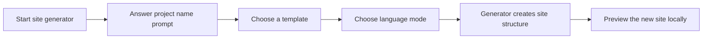

# Site scaffolding

Site Scaffolding is the guided starting point for creating a new documentation or blog site. Instead of assembling a project by hand, you answer a short series of setup prompts and receive a complete, working site structure you can immediately preview and begin filling with your own content.

## Who it's for

Site Scaffolding is for developers, technical writers, and site administrators who are starting a new site from scratch. You might use it when:

- You're creating your first documentation site for a project or product.
- You want a consistent starting structure rather than building navigation, styling, and content pages manually.
- You're evaluating how the product organizes documentation and blog content before committing to a larger migration.

## What it enables

The scaffolding process turns a few decisions into a ready-to-run site. During setup, you're prompted to:

- Name the new site or project
- Choose the template that best matches your goal, such as a classic documentation-focused layout
- Pick your preferred language mode, such as TypeScript or JavaScript
- Let the generator create the initial site structure for you

After the prompts finish, you have a site skeleton with working navigation, a default home page, and the foundations for documentation and blog sections. From there, you can launch a local preview and begin adding your own pages.

Figure: Site scaffolding flow

## Key options and prompts

During scaffolding, you make a small number of choices that shape the generated site:

- **Project or site name.** This becomes the display name shown on your new site.
- **Template.** The default classic template provides a balanced starting point with documentation, blog, and home page areas already wired together.
- **Language mode.** You can generate the site with TypeScript or JavaScript defaults, depending on which you prefer to work with.
- **Starter content.** The generated site includes placeholder pages and examples so you can see the structure working before you replace it.

## What you get afterward

Once scaffolding completes, you have a new site ready to customize. The result includes:

- A configured home page you can edit with your own product name and introduction.
- A documentation area with its own navigation sidebar.
- A blog area where you can publish posts over time.
- Baseline styling and layout so the site looks polished immediately.
- A local development setup you can start and preview without additional configuration.

You can then move on to creating content, adjusting site-wide settings, building a production version, and configuring things like redirects or search.

## Benefits

Site Scaffolding removes the repetitive setup work that normally comes before you can write anything useful:

- **Fast start.** You go from nothing to a previewable site in minutes.
- **Sensible defaults.** Navigation, page structure, and styling are already in place.
- **Consistent foundation.** Every site generated from the same template starts with the same reliable layout.
- **Room to grow.** The initial skeleton is a starting point, not a dead end; you can add pages, posts, versions, and custom configuration later.

## Limits and considerations

- **Command-line environment required.** The site generator runs from a terminal, and the local preview needs a compatible Node.js setup.
- **A starting point, not a finished site.** The generated content is placeholder material. You'll replace it with your own documentation, blog posts, and branding.
- **Template choices are intentional.** Scaffolding offers a focused set of templates rather than unlimited visual customization during setup. Layout and styling are refined afterward through content and site configuration.
- **No visual designer during setup.** The scaffolding experience is prompt-based, so you choose options from a menu rather than dragging and dropping elements.

## Related pages

- [System Requirements and Installation](doc:1016cd5f-d53c-46d7-a74a-15b623ef5387)
- [Site Building & Bundling](doc:0fcd8337-ee59-484f-bda3-4db080caa340)
- [Documentation](doc:7e97fe70-a638-4596-bb48-adfef8fb0b61)
- [Blog](doc:9ee63f83-3e40-49be-87bd-7b6a57c9a4c9)
- [MDX & Markdown Authoring](doc:8c883a2a-ae26-48ef-9a37-c40061a922af)
- [How to write Markdown content with front matter](doc:f6c3013b-eeca-4de7-9e8b-1e5ec5433170)
