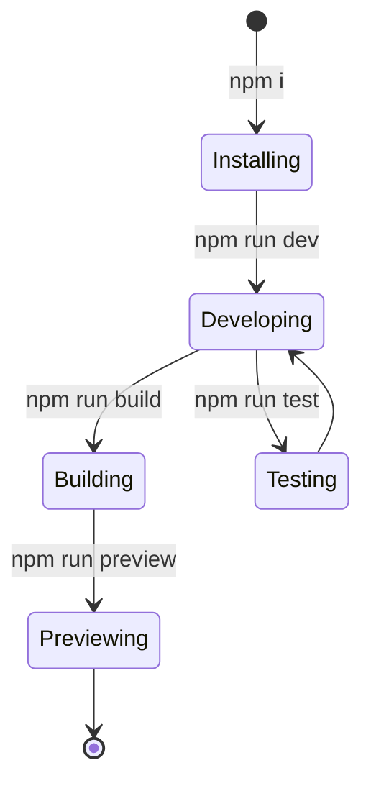

# Site scaffolding

Site Scaffolding gives developers a ready-to-run foundation for a new site. Instead of starting from an empty folder and assembling tools by hand, you get a project that is already wired together with TypeScript, React, Tailwind CSS, and TanStack Start. The scaffold includes the standard commands you need to develop, build, preview, and test your site.

## Who it's for

Site Scaffolding is for developers who are starting a new site and want to be productive immediately. It suits you if you prefer to describe what you want to build and iterate quickly with a local development server, or if you want a preconfigured baseline that you can push to GitHub and keep as your own.

## Development workflow

The scaffold uses a standard development loop: you start the development server, make changes, and see them reflected in the browser.

Figure: Development and build lifecycle

The development server provides immediate feedback on your changes. When the site is stable, a production build bundles it for deployment, and the preview step lets you check the result locally before publishing.

## Key options

The scaffold exposes several commands, each addressing a distinct stage of the workflow:

- **Development**:`npm run dev` starts the local development server for editing and previewing changes.
- **Production build**:`npm run build` compiles the site for deployment. A development-mode build is also available with`npm run build:dev`.
- **Preview**:`npm run preview` serves the compiled production output locally.
- **Linting**:`npm run lint` checks the code for potential issues.
- **Testing**:`npm run test` runs automated checks, and`npm run test:watch` re-runs them as files change.
- **Formatting**:`npm run format` normalizes code style across the project.

## Limits

The provided source files do not include an interactive prompt or a template gallery for generating a new Docusaurus site. The described guided setup with prompts and template selection is not present in the available code. Instead, scaffolding is based on cloning the repository and running the standard command workflow.

The scaffold also does not include built-in deployment or migration tooling. Publishing the production build to a hosting provider is a separate step outside the provided command set.

## Related

- [Site Building & Bundling](doc:0fcd8337-ee59-484f-bda3-4db080caa340)
- [Performance Optimization](doc:df7d4ea6-c89c-4a8f-b056-db5fba77362b)
- [System Requirements and Installation](doc:1016cd5f-d53c-46d7-a74a-15b623ef5387)
