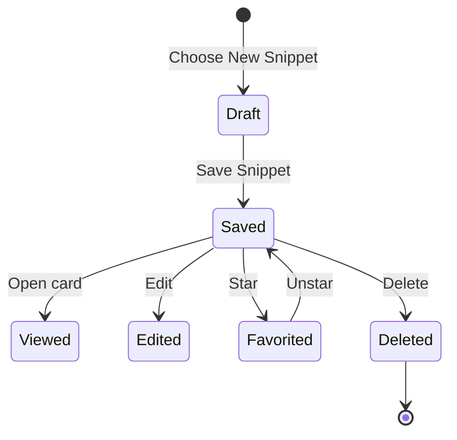
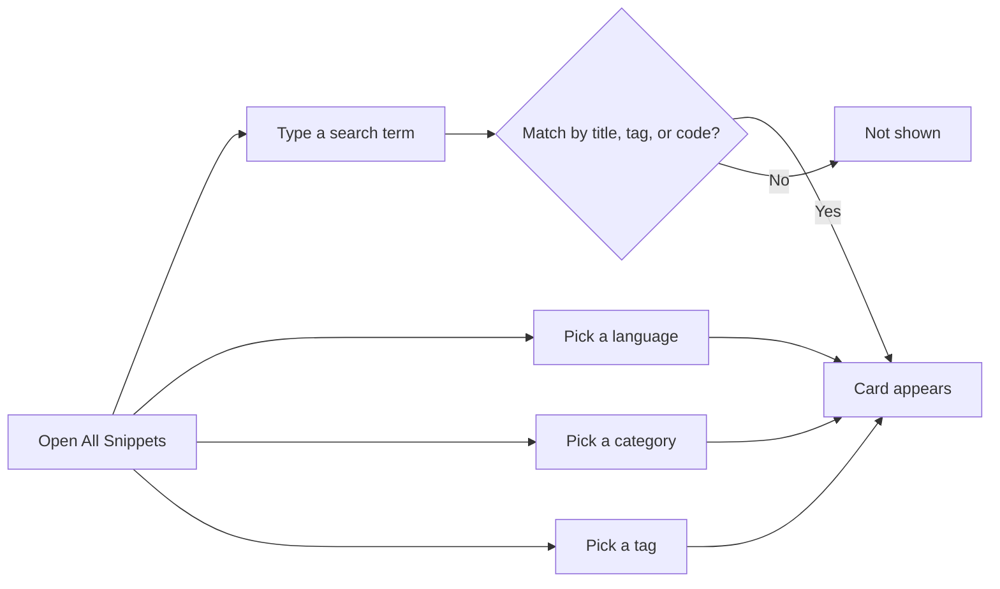

# Snippet library

The snippet library is your home for saving, finding, and reusing the code and text you want to keep close. It lives entirely on your device, so everything you save stays private and available even without a server or account.

The library appears as a responsive wall of snippet cards. Each card gives you a quick, color-highlighted preview of the snippet's code along with its language, category, tags, date, and favorite status—so you can scan your collection without opening each item.

## What the library lets you do

The library is built around a few everyday actions:

- Save a new snippet with a title, code, language, description, category, and tags
- See all your snippets in a grid or list
- Open any snippet for a full, focused view
- Edit or delete snippets you no longer need
- Mark favorites for quick access
- Search across titles, tags, and code
- Filter by language, category, and tag
- Export, import, or reset your whole library from **Settings**

Figure: A snippet's journey through the library

## Where your snippets live

The sidebar organizes your collection into five views:

- **Dashboard**, a summary of your library with total snippet, favorite, and language counts
- **All Snippets**, every snippet you have saved
- **Favorites**, snippets you have starred for quick access
- **Recently Added**, the newest additions to your library
- **Recently Used**, snippets you have copied, with the most recently copied first

The sidebar also lists your categories and languages. Selecting one narrows the library to that group; you can select the same item again to widen back to all snippets.

The footer of the sidebar shows the message **Saved on this device**, a reminder that your library is local to the browser you are using.

## How snippet cards present your content

Each card is a compact summary of a snippet, designed for fast scanning. A card shows:

- The snippet title
- A colored dot and name for the language
- The category
- An optional description
- Any tags as`#tag` chips
- A syntax-highlighted preview of the code with line numbers
- The date the snippet was last updated
- How many times the snippet has been copied
- A star to mark or unmark it as a favorite

Cards also include quick actions for **Copy** and **View**, plus a **More actions** menu with **Edit** and **Delete**.

In grid view, cards appear in responsive columns that adapt to your screen size. In list view, each snippet stretches across the page with the description and metadata on one side and a wider code preview on the other. Your chosen layout is remembered for your next visit.

## Finding the right snippet

You can narrow the library in two ways: by searching and by filtering.

The search box accepts free text and looks across snippet titles, tags, and code. The filter bar refines by:

- Language
- Category
- Tag
- Sort order, **Recently Added**, **Oldest First**, or **A–Z**

When any filter is active, **Clear Filters** removes them. The number of snippets currently shown appears above the cards, so you always know how much of your library you are viewing.

Figure: Narrowing down the library

If a search or filter combination returns nothing, the library shows an empty state with a **Clear filters** action. If you have no snippets at all, the empty state invites you to **+ New Snippet**.

## Viewing a snippet in detail

Selecting a card opens a detail view with the full code, the complete description, all tags, and the snippet's history. The detail view shows when the snippet was created, when it was last updated, how many times it was copied, and when it was last copied.

From the detail view you can:

- Copy the full code
- Mark or unmark the snippet as a favorite
- Edit the snippet
- Delete the snippet

## Creating and editing snippets

Choosing **New Snippet** opens a form where you enter:

- A title
- An optional description
- A language, JavaScript, Python, SQL, or Markdown
- A category, chosen from your existing categories or a new custom category
- Tags
- The code or Markdown content in an editor with a line-numbered, syntax-highlighted preview

The title and code are required. A **Mark as favorite** option lets you favorite a snippet at creation time. **Save Snippet** adds it to your library; **Save Snippet** in edit mode updates the existing entry.

## Data storage and privacy

Your library is saved in your browser on the current device. There is no server, account, or sign-in step. As a result:

- Your snippets remain on your device and under your control
- The library works instantly, including search across your saved items
- You should use **Settings** to export a JSON backup if you want to keep a copy outside the browser or move snippets to another device

Because storage is browser-based, available space depends on your browser. Most browsers offer around 5–10 MB per site, which is enough for a large collection of text snippets but not for binary files or attachments.

## Import, export, and reset

**Settings** provides three library actions:

- **Export library**, downloads all snippets as a JSON file named`codeknit-snippets.json`
- **Import library**, merges snippets from a previously exported CodeKnit JSON file, keeping your current snippets and skipping duplicates
- **Reset to sample data**, replaces everything in your library, with a confirmation step to prevent accidental loss

> [!NOTE]
> Exporting your library is the recommended way to back up snippets, share them, or move them to another browser.

## Related

- [Product Overview](doc:ca8f433d-53d1-475b-a3a5-29b24f1ba173)
- [Search and Filter](doc:3704cb56-cf68-421d-9db0-d3816a8af756)
- [Snippet Organization](doc:8367ddb8-1051-4848-a093-3b4352805aa4)
- [Favorites](doc:b66c5560-9b68-42eb-922d-a8aecab0dfcb)
- [Import and Export](doc:f1b42dc6-1597-47d7-b921-658815f5af20)
- [Code Editor](doc:a1109ff6-5fe7-437a-99ec-4d0b442bb0fd)
