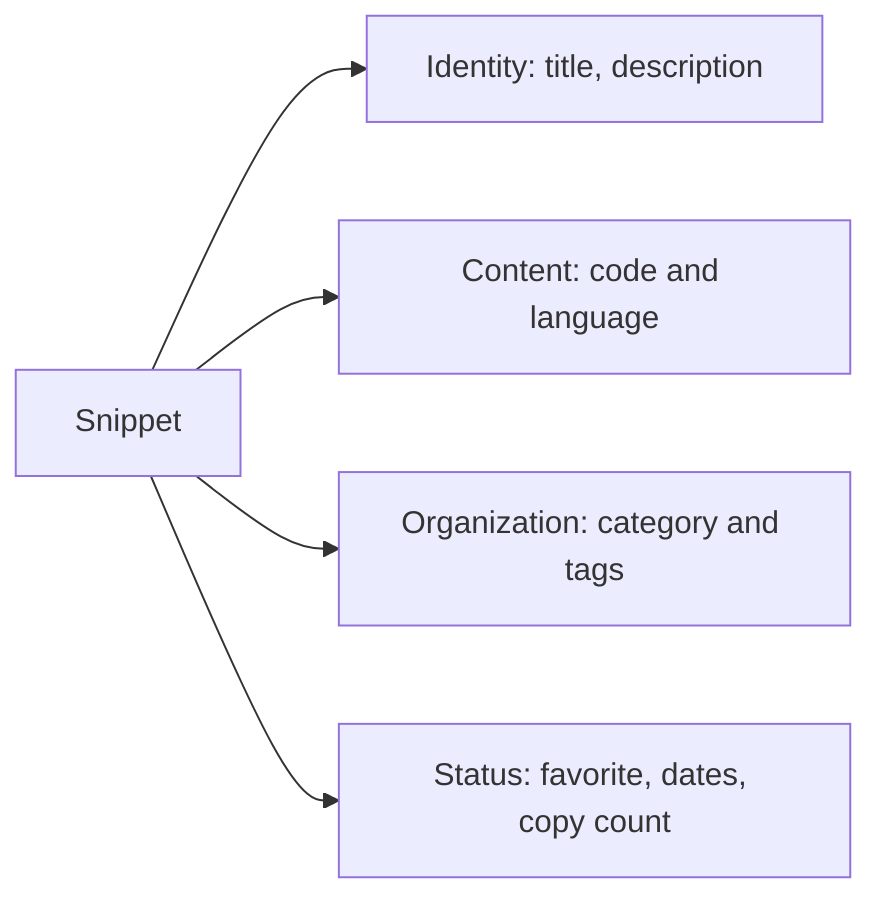
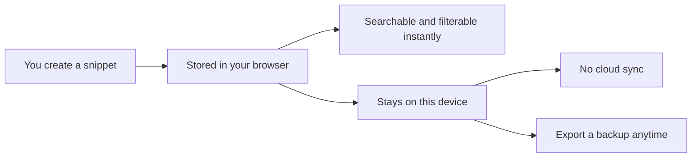
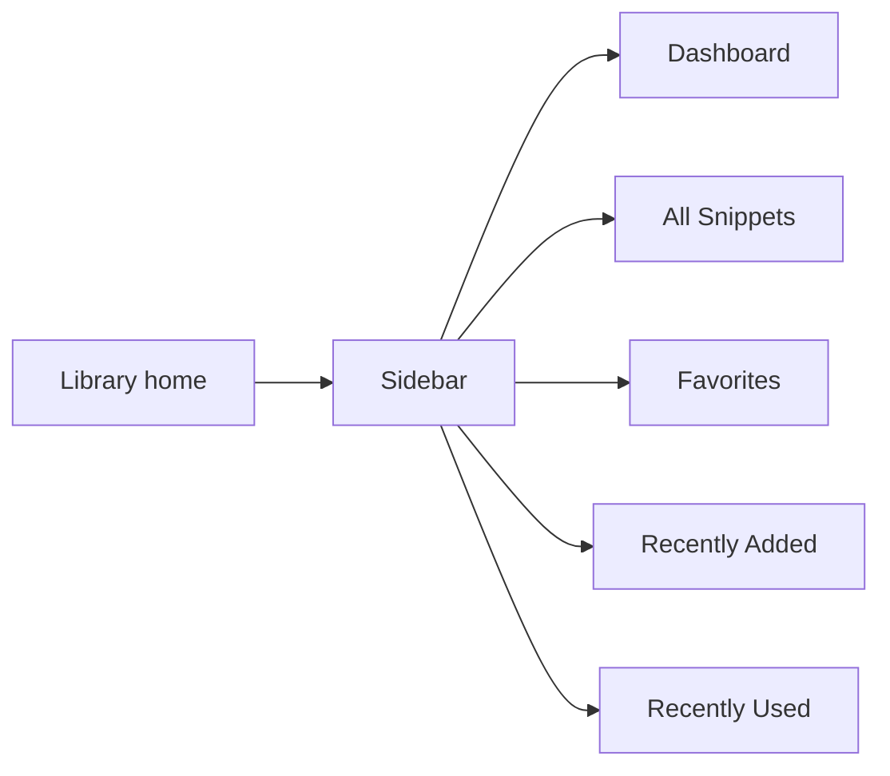
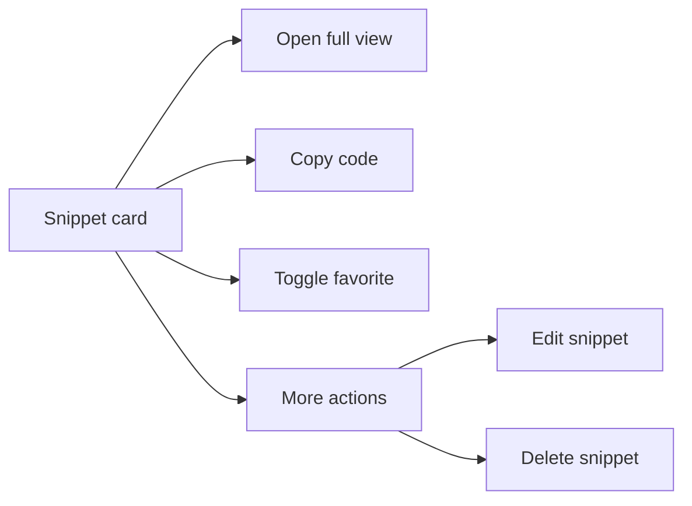
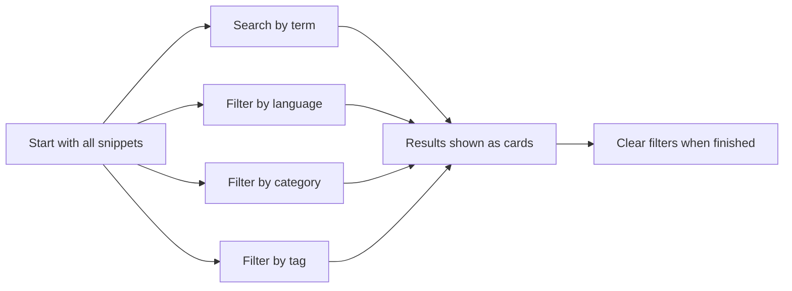

# Snippet library

## What is the snippet library?

The Snippet Library is where all of your saved code and text snippets live. It's the heart of CodeKnit: a searchable, filterable, and browsable collection that helps you save useful pieces of code, find them again quickly, and reuse them without hunting through old projects or notes.

A snippet is a saved unit of work. Every snippet has:

- A **title** that helps you recognize it at a glance
- The **code or text** itself, written in a supported language such as JavaScript, Python, SQL, or Markdown
- A **language** that controls how the code is colorized
- An optional **description** explaining what the snippet does
- A **category** to group related snippets
- One or more **tags** for finer-grained organization
- A **favorite** flag for important or frequently used snippets

You can create, view, edit, delete, copy, and organize snippets entirely from the library. It's a local-first workspace: everything you save stays on your own device.

Figure: What each snippet contains

## Who it's for

The Snippet Library is for anyone who regularly writes code or Markdown and wants a private, no-friction place to keep reusable pieces. It's especially useful for:

- **Developers** who reuse small utilities, configuration patterns, SQL queries, or boilerplate
- **Technical writers and note-takers** who manage Markdown examples and text templates
- **Learners** building a personal collection of patterns and examples they want to remember
- **Anyone who prefers local tools** and doesn't want snippets synced to an external server

## How the library works

When you save a snippet, it's stored directly in your browser on the current device. There is no server round-trip and no account required. That means your library opens instantly, search feels immediate, and your snippets remain private on your own machine.

Figure: How a snippet is stored and accessed

The sidebar footer reinforces this with the label **Saved on this device**. If you want a portable backup, you can export your entire library to a file from **Settings** and import it later. See [Import and Export](doc:f1b42dc6-1597-47d7-b921-658815f5af20) for details.

## Browsing the library

The library opens with a left sidebar for navigation and a main area for your snippets.

### Library sections

The sidebar includes several views, each with a distinct purpose:

- **Dashboard**, a summary of your library with total count, favorites, and languages, plus your recent snippets
- **All Snippets**, the complete collection with a total count badge
- **Favorites**, only snippets you've starred, with a count badge
- **Recently Added**, the last 10 snippets you saved, ordered newest first
- **Recently Used**, snippets you've copied, ordered by most recently copied

Each section is one click away from the sidebar. On mobile, open the navigation with the sidebar toggle at the top left.

Figure: Library navigation sections

### Categories and languages

Below the main views, the sidebar groups your snippets by **category** and by **language**. Each category shows a count of how many snippets it contains. Clicking a category or language filters the main view to show only that group. Click it again to clear the filter.

This is further covered in [Snippet Organization](doc:8367ddb8-1051-4848-a093-3b4352805aa4) and [Search and Filter](doc:3704cb56-cf68-421d-9db0-d3816a8af756).

## What you see on a snippet card

Each snippet appears as a card in the main area. Cards are designed for quick scanning without needing to open anything:

- **Syntax-highlighted code preview** showing up to 8 lines
- **Language badge** with a color-coded dot
- **Category label** with a folder icon
- **Title** that you can click to open the full view
- **Description** if one was added
- **Tags** appearing as rounded`#tag` chips
- **Favorite star** that appears filled when the snippet is starred
- **Updated or created date**, plus copy count when a snippet has been copied at least once
- **Copy** and **View** buttons
- A **More actions** menu for **Edit** and **Delete**

You can toggle between two layouts with the view controls on the filter bar:

- **Grid view** shows cards in responsive columns
- **List view** shows snippets as wide rows, with the code preview to the right

Figure: What you can do from a snippet card

Your layout choice is remembered, so the library reopens in whichever view you used last.

## Finding a specific snippet

Every library view includes a search bar and filter controls. You can:

- Type a search term to match snippet titles, tags, or code content
- Filter by **language**, **category**, or **tag**
- Sort by **Recently Added**, **Oldest First**, or **A–Z**
- Clear all active filters with **Clear Filters**

When no snippets match, the library shows an empty state with a helpful prompt: either create your first snippet or loosen your filters.

Figure: Search and filter flow

For a deeper explanation of how search, categories, tags, and favorites work together, see [How Snippets and Filters Work Together](doc:5aa23d07-2c0d-44f6-8a85-df82ca070b77).

## Viewing snippet details

Click a card, its title, or the **View** button to open the full detail view. This dialog shows everything at once:

- Full code with syntax highlighting and line numbers, in a scrollable area
- Language badge and category
- Title and description
- Tags
- Dates: created, updated, and last copied (when available)
- Total copy count
- Actions: **Favorite**, **Delete**, **Edit**, and **Copy code**

This is the place to read a snippet in full before deciding to copy or edit it.

## Creating and editing snippets

Use **New Snippet** in the header or sidebar to open the snippet form. The form includes:

- **Title** (required)
- **Description**
- **Language** selector
- **Category** selector, with an option to create a custom category
- **Tags** input
- A syntax-aware **code editor**
- A **Mark as favorite** switch

When you edit an existing snippet, the form opens with all current values filled in. Saving creates a new snippet or updates the existing one, and a confirmation toast appears at the bottom of the screen.

To delete a snippet, use **Delete** on the card's more-actions menu or in the detail view. A confirmation dialog asks you to confirm, since deletion is permanent.

> [!NOTE]
> You can also reset the whole library to sample data from **Settings** under **Reset to sample data**. This replaces all of your current snippets.

## Library settings

The **Settings** dialog, opened from the gear icon in the sidebar, gives you three library-level tools:

- **Export library**, downloads all snippets as a JSON file for backup or sharing
- **Import library**, merges snippets from a previously exported JSON file; duplicates are skipped
- **Reset to sample data**, replaces all snippets with the built-in sample set

Import and export are covered in detail in [Import and Export](doc:f1b42dc6-1597-47d7-b921-658815f5af20).

## Benefits and boundaries

### Benefits

- **Privacy-first**: snippets stay on your device and never travel to a server
- **No accounts or network required**: the library works and searches instantly, even offline
- **Fast lookup across thousands of entries**: search and filters operate directly on the locally stored library
- **Responsive design**: the interface adjusts from desktop columns to a mobile-friendly layout

### Boundaries

- **Device-local storage**: snippets are not synced or shared across devices or browsers. Export and import manually to move them.
- **Browser storage limits**: your browser provides a limited amount of storage for each website, typically around 5–10 MB. Large numbers of very big snippets may eventually approach this limit.
- **Backup is your responsibility**: since there's no cloud copy, export a backup periodically if your library matters to you.

## Related pages

- [Product Overview](doc:ca8f433d-53d1-475b-a3a5-29b24f1ba173)
- [Your First Snippet – Quick Start](doc:72dab710-31b9-4980-becf-be9fbd6d4d94)
- [Dashboard](doc:0cccb845-62f3-4e2b-b0ca-c7d768eaf700)
- [Search and Filter](doc:3704cb56-cf68-421d-9db0-d3816a8af756)
- [Snippet Organization](doc:8367ddb8-1051-4848-a093-3b4352805aa4)
- [Favorites](doc:b66c5560-9b68-42eb-922d-a8aecab0dfcb)
- [Code Editor](doc:a1109ff6-5fe7-437a-99ec-4d0b442bb0fd)
- [Syntax Highlighting](doc:0cc5fd84-0d94-4faf-ab51-00f580e726a4)
- [Import and Export](doc:f1b42dc6-1597-47d7-b921-658815f5af20)
- [How Snippets and Filters Work Together](doc:5aa23d07-2c0d-44f6-8a85-df82ca070b77)
