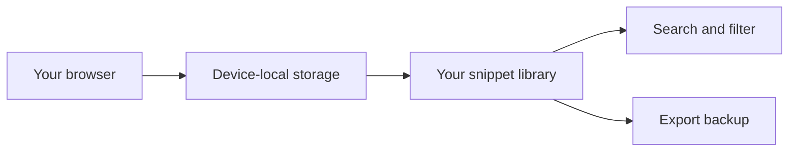
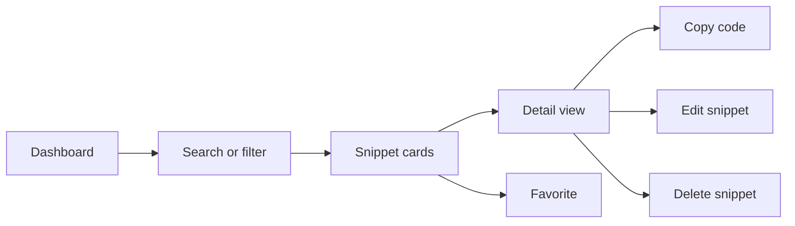

# Snippet library

CodeKnit’s Snippet Library is the home for everything you save. It’s a personal collection of code and Markdown snippets stored directly in your browser. You can create, browse, search, favorite, copy, edit, and delete snippets without creating an account or connecting to a server.

## What is the snippet library?

The library is the main workspace you see when you open CodeKnit. It brings all your saved snippets into one place and helps you find them again quickly. Each snippet can include:

- A **title**
- **Code or Markdown text**
- A **language** such as JavaScript, Python, SQL, or Markdown
- An optional **description**
- One or more **tags**
- A **category**
- **Favorite** status
- **Created** and **updated** dates
- How many times it has been copied

This extra information is what makes the library easy to scan without opening every snippet.

## Where your data lives

Your snippets stay on the device and browser you used to save them. CodeKnit does not upload your library to a cloud account or its own servers. That means your code remains private by default, and search feels fast because nothing has to travel over the internet.

For moving or backing up your library, you can export everything as a JSON file from **Settings**. That backup can then be imported into CodeKnit on another browser or device.

Figure: How the snippet library stays on your device

> [!NOTE]
> Your library lives only in this browser on this device. Clearing browser data or switching to a different browser will not automatically show your saved snippets, so export a backup first if you want to keep them.

## Exploring the library

The library uses a sidebar, a search area, and a grid of snippet cards. The sidebar is responsive and can be collapsed on smaller screens by selecting the navigation toggle.

Figure: Finding and reusing a saved snippet

### Dashboard overview

The **Dashboard** page greets you with the message **Your code, organized.** and shows three summary cards:

- **Total snippets** in your library
- **Favorites** you have starred
- **Languages** represented across your snippets

These cards let you understand the shape of your library at a glance.

### Sidebar navigation

The sidebar helps you jump between different views of your collection:

- **Dashboard** for an overview
- **All Snippets** for the full library
- **Favorites** for starred snippets
- **Recently Added** for the newest items
- **Recently Used** for snippets you have copied

Below those views, the sidebar lists your **Categories** and **Languages**. Selecting a category or language filters the visible snippets. The bottom of the sidebar confirms that your workspace is **Saved on this device**.

### Snippet cards

Each snippet appears on a card that gives you a fast preview of its contents. A card includes:

- The snippet **title**
- A **language badge** with a color dot
- The **category**
- An optional **description**
- **tags** as small`#tag` chips
- A code preview with **syntax highlighting**
- The **updated date**
- A **copy count**, if the snippet has been copied before
- A **favorite** star for quick starring
- **Copy** and **View** buttons
- A **more actions** menu with **Edit** and **Delete**

Selecting a card or its title opens the full detail view.

### Grid and list layouts

You can switch between a **grid** layout and a **list** layout using the layout icons in the filter bar. Grid view shows cards in responsive columns, while list view arranges each card horizontally for a more compact scan. CodeKnit remembers the layout you chose on that device.

### Detail view

Opening a snippet shows a larger dialog with the complete code, full metadata, tags, and dates. From here you can:

- Copy the code
- Mark the snippet as a favorite
- Edit the snippet
- Delete the snippet

The detail view also shows when the snippet was created, when it was updated, and when it was last copied.

## Creating, editing, and deleting

Select **New Snippet** in the sidebar or the top toolbar to save a new piece of code. The snippet form requires a title and code content. You can also add a description, choose a language, assign a category, add tags, and mark the snippet as a favorite.

Editing a snippet uses the same form and preserves your existing details. Deleting a snippet asks for confirmation first, since deletion cannot be undone.

## Finding snippets fast

Use the search box at the top of the page to search across your snippets, tags, and code. The filter bar below it lets you narrow the library by:

- Language
- Category
- Tag
- Sort order: **Recently Added**, **Oldest First**, or **A–Z**

When a filter is active, a **Clear Filters** button appears so you can reset the view without manually changing each option. For more detail, see [Search and Filter](doc:3704cb56-cf68-421d-9db0-d3816a8af756).

## Organizing snippets

Categories group related snippets under a single label and appear in the sidebar. Tags are more flexible labels that can describe what a snippet does, what it works with, or where you use it. You can combine categories, tags, language, and search to find exactly what you need. See [Snippet Organization](doc:8367ddb8-1051-4848-a093-3b4352805aa4) for more detail.

## Favorites and quick access

Select the star on any snippet card to mark it as a favorite. The **Favorites** view then collects all starred snippets so you can reach them without filtering. You can remove a snippet from favorites at any time. Learn more in [Favorites](doc:b66c5560-9b68-42eb-922d-a8aecab0dfcb).

## Copying snippets

Every snippet card includes a **Copy** button. Selecting it places the snippet code on your clipboard and updates the snippet’s copy count. The **Recently Used** view uses this history to show you which snippets you have copied recently. Learn more in [Copy to Clipboard](doc:fe088c40-690b-45b1-ab17-d2fd7e259b72).

## Backing up and restoring

Open **Settings** from the bottom of the sidebar to manage your local library:

- **Export library** downloads all snippets as a JSON file named`codeknit-snippets.json`
- **Import library** merges snippets from a previous CodeKnit JSON export, keeping existing snippets and skipping duplicates
- **Reset to sample data** replaces your current snippets with the built-in sample library

For a deeper look, see [Import and Export](doc:f1b42dc6-1597-47d7-b921-658815f5af20).

## Boundaries

Because the library is local-first, there are a few important limits to keep in mind:

- Your data is device-local only, with no automatic cloud sync
- Browser storage limits apply, usually around 5–10 MB per website
- Clearing site data can remove your saved snippets
- Moving to another browser or device requires an export and import

CodeKnit also has no server dependency for the library itself. Saving, searching, and filtering all happen directly in your browser.

## Related

- [Product Overview](doc:ca8f433d-53d1-475b-a3a5-29b24f1ba173)
- [Search and Filter](doc:3704cb56-cf68-421d-9db0-d3816a8af756)
- [Snippet Organization](doc:8367ddb8-1051-4848-a093-3b4352805aa4)
- [Favorites](doc:b66c5560-9b68-42eb-922d-a8aecab0dfcb)
- [Copy to Clipboard](doc:fe088c40-690b-45b1-ab17-d2fd7e259b72)
- [Import and Export](doc:f1b42dc6-1597-47d7-b921-658815f5af20)
