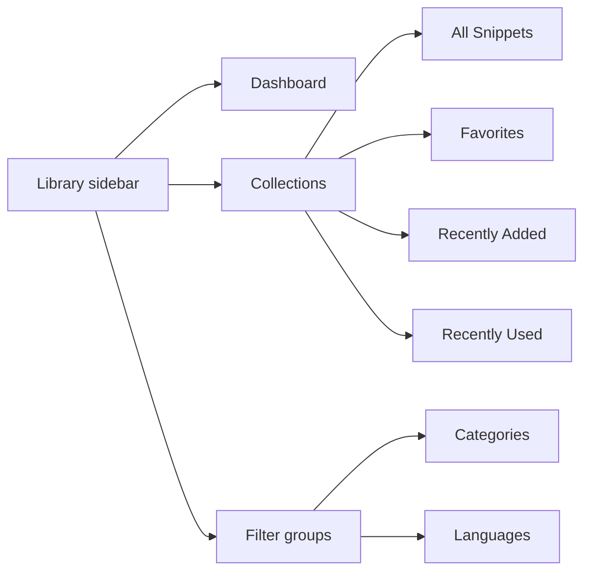
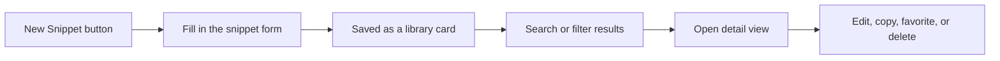
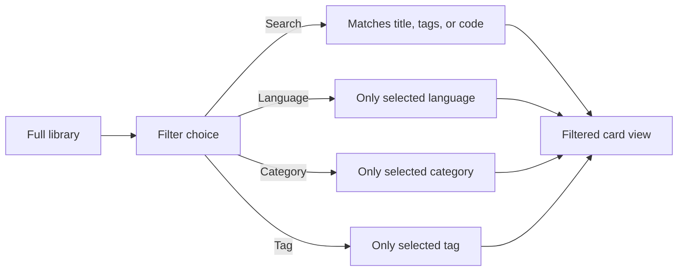
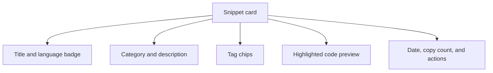

# Snippet library

The Snippet Library is CodeKnit's home for everything you save. It keeps your reusable code and Markdown snippets in one place on your own device, so you can get back to them in seconds instead of hunting through old files.

## What the library gives you

The library is your personal collection of [snippets](doc:08c7b9ec-c366-4fc5-b62c-01999c0ae167). Each snippet can hold code or Markdown text, a title, a language label, a category, and optional description and [tags](doc:8367ddb8-1051-4848-a093-3b4352805aa4).

With the library, you can:

- Save a new snippet at any time from the **New Snippet** button.
- See everything in a responsive grid or list.
- Open any card for the full snippet in a larger view.
- Favorite, edit, delete, or copy snippets from cards and from the detail view.
- Search by title, tag, or code and narrow results by language, category, or tag.
- Keep your whole collection private, with no sign-up and no server connection.

## How the library is organized

The sidebar is the main way you move around your library. It groups your work into sections and quick filter lists.

Figure: The library's main sections in the sidebar

- **Dashboard** gives you an at-a-glance summary with total snippets, favorites, and languages, followed by your snippet list. See [Dashboard](doc:0cccb845-62f3-4e2b-b0ca-c7d768eaf700).
- **All Snippets** is the complete library.
- **Favorites** shows only snippets you have starred.
- **Recently Added** shows your 10 most recent additions.
- **Recently Used** shows snippets you have copied, with the most recently copied first.
- **Categories** and **Languages** act as quick filters, with a count for each group.

## Creating and changing snippets

From any section, choose **New Snippet** in the top bar or at the bottom of the sidebar. A form opens where you can enter a title, description, language, category, tags, and the code or Markdown content, plus an optional **Mark as favorite** switch. Titles and code are required.

Figure: How a snippet moves through the library

Once a snippet is saved, you can edit it from the **More actions** menu on its card or from the **Edit** button in the detail view. Deleting works the same way and asks you to confirm first.

> [!WARNING]
> Deleting a snippet removes it permanently from this device and cannot be undone.

## Finding exactly what you need

The search box at the top of the screen searches snippet titles, tags, and code content. A second filter area lets you narrow the visible list by language, category, tag, and sort order. You can sort by **Recently Added**, **Oldest First**, or **A–Z**.

Figure: Reducing the full library to the snippets you need

When a filter is active, a **Clear Filters** button appears. The heading above the list always shows how many snippets are currently displayed. For more detail, see [search and filter](doc:3704cb56-cf68-421d-9db0-d3816a8af756).

## Reading a snippet card

Each card or list row gives you enough to identify a snippet without opening it. In grid view, cards appear in up to three columns on wide screens; in list view, they appear in a single-column arrangement. Your layout choice is remembered the next time you return.

Figure: What a snippet card shows

Every card shows a color-coded preview of the snippet's code with line numbers. If the code is longer than the preview, an overlay shows how many more lines exist. The language badge identifies the language at a glance; available languages are JavaScript, Python, SQL, and Markdown.

The card footer shows when the snippet was created or last updated, and how many times it has been copied. You can copy directly from the card, open the full snippet by clicking anywhere on the card, star it, or use the **More actions** menu to edit or delete it.

The full detail view shows the complete code in a scrollable preview along with the description, tags, creation and update dates, copy count, last-copied date, and actions to favorite, delete, edit, or copy. To learn more about copying, see [Copy to Clipboard](doc:fe088c40-690b-45b1-ab17-d2fd7e259b72).

## Where your data lives

Your library is stored locally in the browser on the device you use. There is no server, account, or cloud connection involved in saving and reading snippets. The sidebar reflects this with the label **Saved on this device**.

Because the library is local-first, the **Settings** dialog is where you can protect and manage your collection:

- **Export library** downloads a JSON backup of all snippets.
- **Import library** merges snippets from a previously exported CodeKnit backup. Existing snippets are kept, and duplicates are skipped.
- **Reset to sample data** replaces your current library with the sample collection.

For more on backups, see [Import and Export](doc:f1b42dc6-1597-47d7-b921-658815f5af20).

> [!NOTE]
> Your data is device-local and does not sync between browsers or devices on its own. Use **Export library** in Settings to keep a backup or move your library to another device.

## Benefits and boundaries

**Benefits**

- Local-first privacy: your snippets never leave your device.
- No server dependency: the library works offline after the app loads.
- Instant search across large collections.
- A consistent, mobile-friendly layout where the sidebar collapses behind a menu on smaller screens.

**Boundaries**

- No cloud sync: your library is tied to the browser and device where it was created.
- Browser storage limits apply, typically around 5–10 MB per domain. Most snippet libraries fit comfortably, but very large files or collections can approach that limit.
- Snippets are only as safe as your browser data. Back up regularly with **Export library**.
