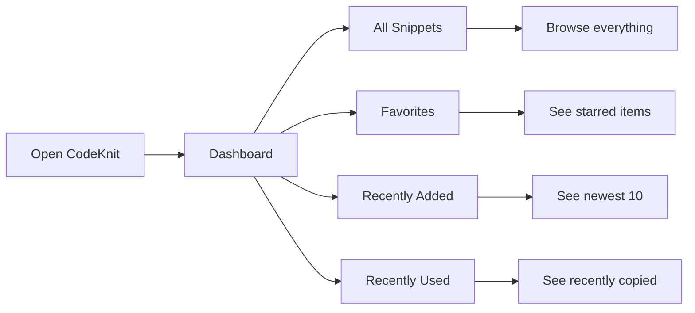
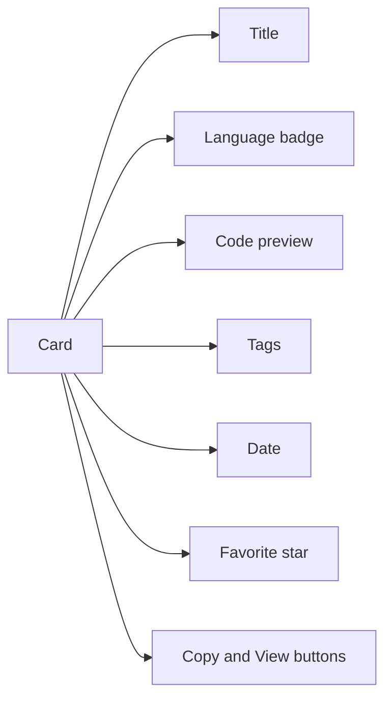

# Snippet library

The Snippet Library is your personal home for saved code and text. It's the main area where you create, view, organize, and reuse every snippet you save in CodeKnit. Your library lives entirely on the device you're using, so your snippets stay private by default and are instantly available whenever you're at the keyboard.

This guide explains what the library is, how it stores your work, and the ways you can browse, scan, and manage your collection.

## Who it's for

The library is for anyone who writes code or notes and wants a faster way to find and reuse them. Whether you're a developer keeping track of useful utilities, a data enthusiast storing frequent queries, or a writer collecting Markdown templates, the library gives you one place to keep it all organized.

## What you can do with the library

The library puts your saved snippets front and center. When you open CodeKnit, the library shows your collection with rich previews so you can recognize the right snippet at a glance.

### Create snippets with context

Every snippet in your library can include:

- **Title**, something you'll recognize instantly, like "Debounce utility"
- **Code or text**, the main content you want to save
- **Language**, JavaScript, Python, SQL, or Markdown
- **Description**, an optional note about what it does
- **Category**, a folder-like grouping, such as Utilities or Snippets
- **Tags**, free-form labels like`#react` or`#database`
- **Favorite status**, star the snippets you use most

When you create a snippet, the library asks you to fill in these details. Title and code are required; everything else is optional. For more on how snippets, categories, and tags work together, see [How Snippets and Filters Work Together](doc:5aa23d07-2c0d-44f6-8a85-df82ca070b77).

### Browse sections for different needs

The library is organized into sections you can reach from the sidebar:

- **Dashboard**, a quick summary of your library with total snippet count, favorite count, and language count
- **All Snippets**, the complete collection
- **Favorites**, snippets you've starred
- **Recently Added**, up to 10 of your newest snippets
- **Recently Used**, snippets you've copied, ordered by most recently copied

Figure: Library sections and what each one shows

The **Categories** and **Languages** lists in the sidebar let you narrow the library with a single click. Each category shows a count of how many snippets belong to it.

### Scan snippets without opening them

Each card in the library shows a preview of the code with your chosen language's color highlighting, a language badge, the category name, the creation or update date, and a list of tags. This lets you quickly scan across many snippets and find the one you need without opening a separate view.

Figure: What a snippet card shows

### Switch between grid and list views

The library supports two layouts, and your choice is remembered the next time you open CodeKnit:

- **Grid view**, cards are arranged in a responsive grid; great for visually comparing snippets
- **List view**, each snippet takes a wider horizontal row with a taller code preview; useful for reading longer code without opening details

Use the grid and list icons in the toolbar to switch. Your preference is saved on the device.

### See full snippet details

Click a snippet card to open a detail view with the complete code, full description, all tags, and timestamps. From the detail view you can copy the code, edit the snippet, delete it, or toggle its favorite status.

### Manage snippets directly from cards

Each card includes quick actions:

- **Star**, mark or unmark as a favorite
- **Copy**, copy the code to your clipboard in one click
- **View**, open the full detail view
- **More actions**, edit or delete through a menu

When you copy a snippet, the library records the copy count and the time it was copied. This information powers the **Recently Used** section and helps surface your most reused snippets.

## How your library is stored and protected

Your snippet library is stored in your browser's local storage on the device where you use CodeKnit. This means:

- **Local-first privacy**, your snippets are not uploaded to a server and don't require an account
- **Zero server dependency**, the library works offline and loads instantly
- **Persistence**, snippets remain available the next time you open CodeKnit on the same browser

Your library is not automatically synced across devices. If you use CodeKnit on a different browser or device, your snippets won't appear there unless you move them yourself. To create a backup or move snippets to another device, use the **Export library** and **Import library** options in the Settings dialog. For more, see [Import and Export](doc:f1b42dc6-1597-47d7-b921-658815f5af20).

> [!NOTE]
> Browsers typically limit local storage to around 5 to 10 MB per website. Thousands of short snippets usually fit comfortably, but very large code files or many images could eventually approach this limit.

## Filters and search

The library includes several tools to find a snippet quickly:

- **Search box**, searches snippets by title, tags, or code content
- **Language filter**, show snippets in a specific language
- **Category filter**, show snippets in a category
- **Tag filter**, show snippets that have a specific tag
- **Sort control**, order by Recently Added, Oldest First, or A–Z

When no results match your current filters or search, the library shows a clear empty state with options to clear filters or create a new snippet. For detailed guidance, see [Search and Filter](doc:3704cb56-cf68-421d-9db0-d3816a8af756).

## Understanding the dashboard

The Dashboard section appears at the top of your library and provides a quick health check of your collection:

- **Total snippets**, how many items are in your library
- **Favorites**, how many snippets you've starred
- **Languages**, which languages you have represented

It's a fast way to see the shape of your library without scrolling through everything. For more on the home screen, see [Dashboard](doc:0cccb845-62f3-4e2b-b0ca-c7d768eaf700).

## Boundaries and limitations

- **Device-local only**, your snippets are not automatically synced to the cloud or across devices
- **Browser storage limits**, local storage typically provides about 5 to 10 MB per site
- **No collaboration**, the library is a personal workspace, not a shared repository
- **Browser-specific**, clearing your browser data or using a private window can affect visibility of your snippets

## Related pages

- [Key Concepts and Terminology](doc:08c7b9ec-c366-4fc5-b62c-01999c0ae167)
- [How Snippets and Filters Work Together](doc:5aa23d07-2c0d-44f6-8a85-df82ca070b77)
- [Snippet Organization](doc:8367ddb8-1051-4848-a093-3b4352805aa4)
- [Search and Filter](doc:3704cb56-cf68-421d-9db0-d3816a8af756)
- [Favorites](doc:b66c5560-9b68-42eb-922d-a8aecab0dfcb)
- [Copy to Clipboard](doc:fe088c40-690b-45b1-ab17-d2fd7e259b72)
