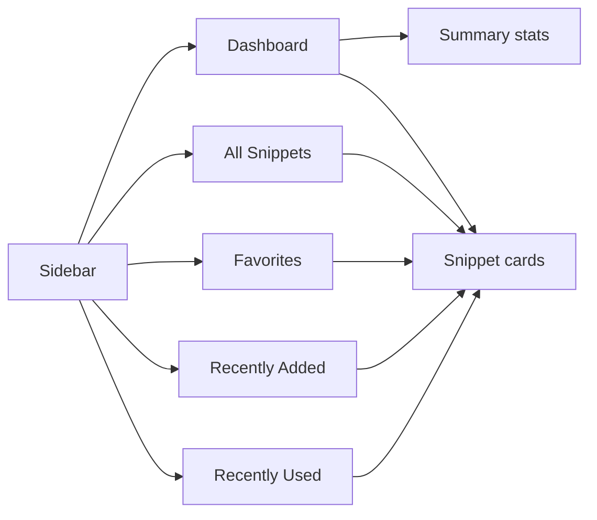
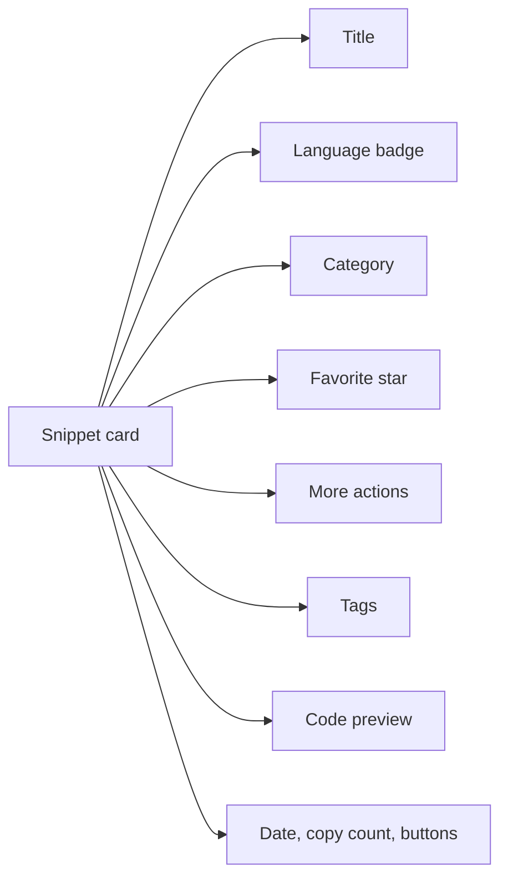
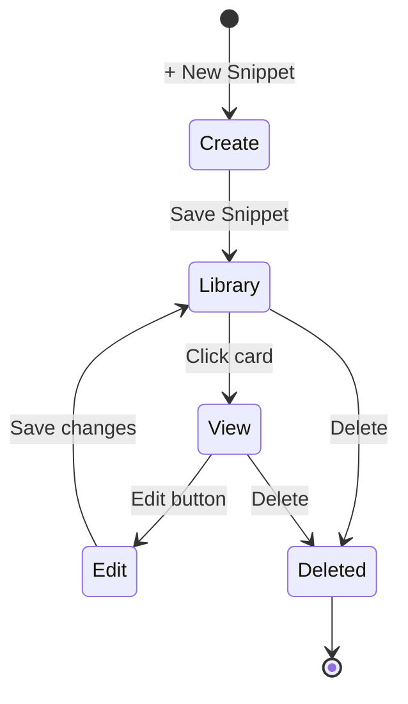

# Snippet library

The snippet library is your personal, always-available collection of saved code and text snippets. You can store anything from a JavaScript function to a Python script, a SQL query, or a Markdown note. Everything stays directly in your browser, so your library remains private, loads instantly, and works without an internet connection.

The library is for anyone who writes code or documentation and wants quick, organized access to reusable pieces. Instead of hunting through old files, you keep your best snippets in one place with search, filters, and a visual layout designed for fast scanning.

## What you can do

With your snippet library, you can:

- Create snippets with a title, code, language, description, tags, and category
- View any snippet's full details in a focused window
- Edit details or code whenever you need
- Delete snippets you no longer want
- Mark snippets as favorites for quick access
- Copy snippet code to your clipboard in one click
- Browse by category or language
- Search across titles, tags, and code
- Sort by Recently Added, Oldest First, or A to Z
- Switch between grid and list layouts

## How your library is organized

Snippets are stored locally in your browser, not on a server. Each snippet has these pieces of information:

| Field | What it's for |
|-------|---------------|
| Title | A short, memorable name such as "Debounce utility" |
| Code | The actual code or Markdown text you want to reuse |
| Language | JavaScript, Python, SQL, or Markdown |
| Description | Optional note explaining what the snippet does |
| Category | A grouping label such as "Utilities" |
| Tags | Searchable labels such as #react or #api |
| Favorite status | A star marking snippets you use often |

Categories and tags are your own system for grouping. You choose them when you create or edit a snippet, and you can create a custom category at any time. The sidebar lists your categories with counts, so you can see at a glance how many snippets fall under each one. For a deeper look at how organization works, see [Snippet Organization](doc:8367ddb8-1051-4848-a093-3b4352805aa4).

## Navigating your library

The sidebar is the starting point for everything in your library. It offers five sections, plus shortcuts for categories and languages.

Figure: Snippet library navigation sections

### Sidebar sections

- **Dashboard** – Shows summary stats and your snippets at a glance
- **All Snippets** – The full collection, unfiltered by section
- **Favorites** – Only snippets you've starred
- **Recently Added** – The 10 most recently created snippets
- **Recently Used** – Snippets you've copied, ordered by most recent copy

The sidebar also shows **Categories** and **Languages** lists. Clicking a category or language narrows the card view to just those snippets; clicking it again returns to all. Count badges on **All Snippets**, **Favorites**, and **Recently Used** show how many items each section contains.

On smaller screens, the sidebar collapses. Tap the menu button in the top-left corner to open it, and it closes automatically after you choose a section.

## What you see on each card

Each snippet appears as a card with the details you need to scan quickly.

Figure: Anatomy of a snippet card

The card shows:

- **Title** – Click to open the full snippet
- **Language badge** – Colored dot plus the language name
- **Category** – Folder icon with the category name
- **Favorite star** – Click to add or remove from favorites
- **More actions menu** – Edit or Delete options
- **Description** – If added, shown as a short preview
- **Tags** – Rounded chips with # labels
- **Code preview** – The first several lines of your code with syntax coloring
- **Footer** – Last updated date, copy count if any, Copy button, and View button

The code preview is syntax-highlighted so you can skim the structure before opening the full snippet. In grid layout, cards sit side by side in two or three columns. In list layout, each card stretches full width with the code preview alongside the details.

## Finding the right snippet

Your library gives you several ways to locate snippets:

1. **Search box** – Type in the search field in the header to search across titles, tags, and code
2. **Language filter** – Pick JavaScript, Python, SQL, or Markdown from the filter bar dropdown
3. **Category filter** – Pick a category from the filter bar dropdown
4. **Tag filter** – Pick a tag from the filter bar dropdown
5. **Sort** – Order by Recently Added, Oldest First, or A to Z
6. **Sidebar shortcuts** – Jump to Favorites, Recently Added, or Recently Used

When you apply any filter, a **Clear Filters** button appears so you can reset everything at once. If no snippets match, you'll see a friendly empty state with options to clear filters or create a new snippet. For details on how search and filters combine, see [How Snippets and Filters Work Together](doc:5aa23d07-2c0d-44f6-8a85-df82ca070b77).

## Life of a snippet

Snippets follow a simple cycle from creation to deletion:

Figure: Snippet lifecycle

When you delete a snippet, CodeKnit asks for confirmation first. Deleting is permanent and cannot be undone.

## Where your data lives

Your snippet library is entirely local to your browser. Snippets are saved to your device's browser storage, not sent to any server. This gives you:

- **Privacy** – Your code and notes never leave your device
- **Speed** – Search and filtering happen instantly, even with many snippets
- **Offline access** – Your library works without an internet connection

A few things to know about local storage:

- Snippets are tied to the browser you use. If you switch browsers or devices, your library won't automatically follow you.
- Browser storage has size limits (typically 5–10 MB per website). Very large snippets or thousands of lengthy entries might approach these limits.
- Clearing browser data for this site removes your library. Use the export feature to keep a backup.

## Backing up and restoring

In Settings, you can:

- **Export** – Download your entire library as a single JSON file
- **Import** – Merge a previously exported library; existing snippets stay, duplicates are skipped
- **Reset** – Replace everything with sample data

Exporting is a good habit if your library is valuable to you. The exported file can be imported later on the same browser or moved to another browser. For full details, see [Import and Export](doc:f1b42dc6-1597-47d7-b921-658815f5af20).

## Related

- [Dashboard](doc:0cccb845-62f3-4e2b-b0ca-c7d768eaf700)
- [Search and Filter](doc:3704cb56-cf68-421d-9db0-d3816a8af756)
- [Favorites](doc:b66c5560-9b68-42eb-922d-a8aecab0dfcb)
- [Copy to Clipboard](doc:fe088c40-690b-45b1-ab17-d2fd7e259b72)
- [Snippet Organization](doc:8367ddb8-1051-4848-a093-3b4352805aa4)
- [Your First Snippet – Quick Start](doc:72dab710-31b9-4980-becf-be9fbd6d4d94)
