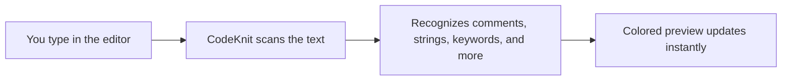
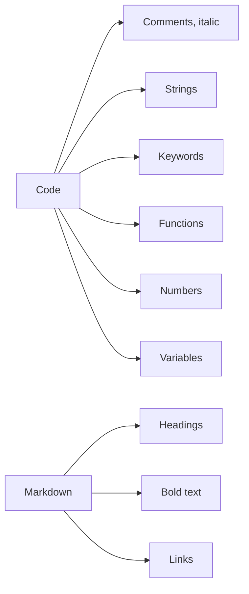

# Syntax highlighting

CodeKnit colors your code and Markdown as you type, so you can see the structure of a snippet at a glance and catch mistakes before they become a problem. The moment you paste or write something in the editor, each meaningful part of the text receives its own consistent color.

## What it is

Syntax Highlighting is a built-in reading aid for your snippets. It scans whatever you type and colors language-specific parts such as comments, strings, keywords, functions, numbers, and variables. For Markdown snippets, it highlights headings, bold text, and links. The highlighting runs entirely in your browser and updates instantly as you type.

This feature is for anyone who saves and reads code snippets—from developers who want to scan a function quickly to writers who want their documentation previews to look clean.

## How highlighting works

As you type in the editor, CodeKnit splits your text into small pieces and labels each piece based on what it represents. Comments become muted and italic, quoted text becomes a distinct color, reserved words become another color, and so on. The colored preview appears directly in the editor and in every preview of that snippet.

Figure: Real-time highlighting flow

Because the highlighting updates as you type, a missing closing quote or an unfinished comment often changes the colors immediately—giving you an early hint that something is off.

## Color guide

Each type of language construct uses its own consistent visual style. The actual colors are fixed by CodeKnit, so a string in one JavaScript snippet looks the same as a string in another.

| Highlight | What it represents |
| --- | --- |
| Comments | Explanatory text in code; shown in a muted color and italics |
| Strings | Quoted text, such as`"hello"` or`'world'` |
| Keywords | Reserved words such as`if`,`return`, or`def` |
| Functions | Function and method names |
| Numbers | Numeric values |
| Variables | Variable names |
| Headings | Markdown headings created with`#`; shown in a distinct color and semibold |
| Bold | Markdown bold text styled with`**`; shown in a semibold weight |
| Links | Markdown links; shown in a distinct color and underlined |
| Punctuation | Braces, brackets, operators, and other symbols; shown in a muted tone |

Figure: Code and Markdown highlighting categories

## Where you'll see highlighting

Highlighting appears in three places:

- In the editor when you create or edit a snippet
- In the card preview shown for each snippet on the Dashboard and other list pages
- In the full preview when you open a snippet from your library

You don't turn highlighting on or off—it's always active and follows the language you select for a snippet.

## Supported languages

CodeKnit provides highlighting for four languages:

- **JavaScript**
- **Python**
- **SQL**
- **Markdown**

When you choose a language in the snippet form, the editor and previews automatically use the correct rules for that language.

## Benefits

- **Instant feedback** – highlighting updates as you type, helping you spot missing quotes, unfinished comments, and other syntax issues early.
- **Lightweight and fast** – the highlighting engine is small and runs entirely in your browser, so it doesn't slow down your typing or require an internet connection.
- **One tool for code and docs** – the same highlighting works for both code snippets and Markdown documentation.
- **Consistent reading experience** – familiar structures always appear in the same visual style across your whole library.

## Limitations

- **Four languages only** – highlighting works with JavaScript, Python, SQL, and Markdown. Other languages will not receive language-specific coloring.
- **Not a full syntax checker** – highlighting helps you spot obvious issues, but it does not validate that your code is correct or complete.
- **Approximate matching** – the highlighting is based on text patterns, so very unusual or complex code may occasionally be colored imperfectly.

## Related

- [Code Editor](doc:a1109ff6-5fe7-437a-99ec-4d0b442bb0fd)
- [Snippet Library](doc:9f431e10-b005-4cc0-80b1-0af4acdcb3d8)
- [How Snippets and Filters Work Together](doc:5aa23d07-2c0d-44f6-8a85-df82ca070b77)
