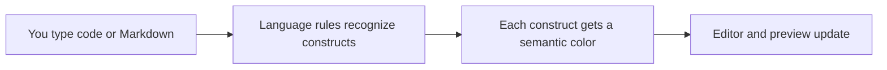
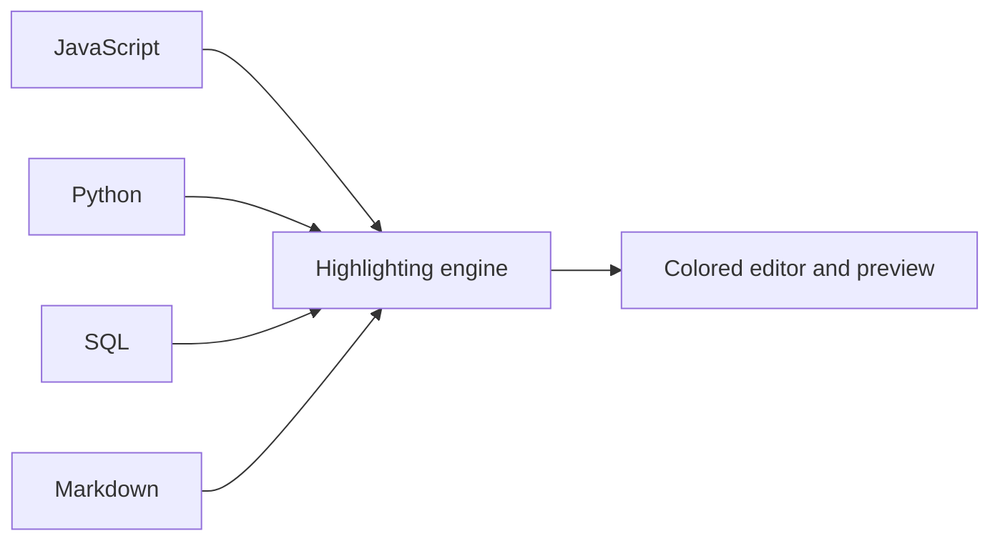

# Syntax highlighting

Syntax highlighting makes the code and Markdown in CodeKnit easier to read by colorizing each part of your text according to what it represents. It's for anyone who writes, reviews, or browses snippets and wants to understand code at a glance and catch mistakes early.

As you type, CodeKnit recognizes comments, strings, keywords, functions, numbers, variables, headings, bold text, links, and other constructs. Each type gets a consistent color treatment. The same highlighting appears instantly in the editor, on snippet cards, and in the full preview.

## How syntax highlighting works

CodeKnit uses a lightweight built-in recognition engine. You don't need to install any extra highlighting libraries or plugins. The engine runs entirely on your device and updates as soon as the text or the selected language changes.

Figure: How CodeKnit applies syntax highlighting as you type

The language you choose in the snippet form controls which recognition rules are used. For example, the word`return` is recognized as a keyword in JavaScript, not as ordinary text.

Figure: Language choice drives which highlighting rules are used

> [!NOTE]
> Highlighting follows the **Language** choice in the snippet form. If you switch a snippet from JavaScript to Python, CodeKnit immediately re-recognizes the text using Python rules.

## Supported languages

Syntax highlighting works for four languages:

| Language | What it recognizes |
|---|---|
| JavaScript | Comments, strings, keywords, functions, numbers, variables, and punctuation |
| Python | Comments, strings, keywords, functions, numbers, variables, and punctuation |
| SQL | Comments, strings, keywords, functions, numbers, and variables |
| Markdown | Headings, bold text, links, and italic text |

Code in any of these languages is highlighted as you type. Highlighting is limited to these four languages.

## Colors and what they represent

The exact hues depend on your current theme, but each construct uses a distinct, consistent treatment across the whole app.

| Construct | How it appears |
|---|---|
| Keywords | Emphasized with the keyword color |
| Strings | Shown in the string color |
| Functions | Shown in the function color |
| Numbers | Shown in the number color |
| Variables | Shown in the variable color |
| Comments | Faded comment color and italicized |
| Punctuation | Shown in a muted, subtle color |
| Markdown headings | Heading color and semibold |
| Markdown bold text | Default text color and semibold |
| Markdown links | Function color and underlined |

These consistent colors help you scan a snippet quickly and spot when something doesn't look correct. For example, a string that never ends usually fails to turn the string color, which can alert you to a missing closing quote.

Each language also has a small colored dot on its badge for quick identification: JavaScript uses the number color, Python uses the function color, SQL uses the string color, and Markdown uses the keyword color.

## Where you see highlighted text

- **While editing:** the [Code Editor](doc:a1109ff6-5fe7-437a-99ec-4d0b442bb0fd) colors the code or Markdown behind your text as you type.
- **On snippet cards:** each card shows a compact preview with the same highlighting.
- **In the detail view:** when you open a snippet, you see a full, scrollable preview with highlighting and line numbers.

## Benefits of built-in highlighting

- **Immediate feedback:** mistakes such as an unclosed string or an unexpected token often look visibly wrong because the expected color doesn't appear.
- **No setup required:** highlighting is automatic for supported languages.
- **Small and fast:** the recognition engine runs locally without downloading external dependencies.
- **One tool for code and documentation:** the same highlighting covers programming languages and Markdown.

## Limitations

- Highlighting supports JavaScript, Python, SQL, and Markdown only.
- Recognition is approximate and rule-based rather than a full-featured language parser. It may not catch every complex or nested language edge case.
- Markdown highlighting covers common inline formatting such as headings, bold, italic, and links, but is not a complete Markdown renderer.

## Related

- [Code Editor](doc:a1109ff6-5fe7-437a-99ec-4d0b442bb0fd)
- [Snippet Library](doc:9f431e10-b005-4cc0-80b1-0af4acdcb3d8)
- [Product Overview](doc:ca8f433d-53d1-475b-a3a5-29b24f1ba173)
