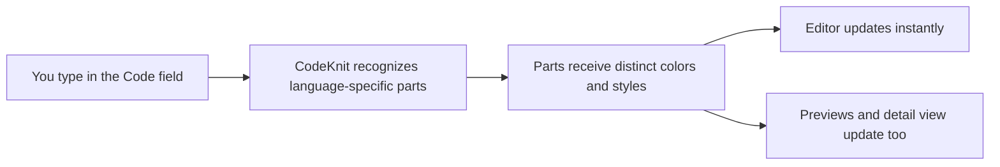
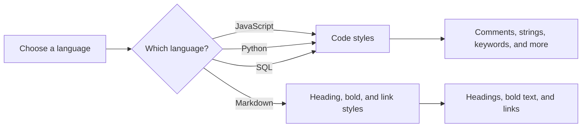

# Syntax highlighting

Syntax highlighting automatically colors the code and Markdown in CodeKnit so you can read a snippet at a glance and notice mistakes while you type. It runs as soon as you open the editor or view a snippet, there is nothing to enable or configure.

This feature is for anyone who creates, edits, or reads snippets. It helps you tell the parts of a snippet apart, spot an unfinished string or comment, and scan a code block faster.

## What syntax highlighting shows

CodeKnit recognizes language-specific parts of your text and gives each part a distinct visual style. The exact shades depend on your app theme, but the relationships stay consistent: a keyword always looks different from a string, for example.

| Language construct | How CodeKnit styles it |
| --- | --- |
| Comments | Italic, subdued color |
| Strings | Their own distinct color |
| Keywords | Their own distinct color |
| Functions | Their own distinct color |
| Numbers | Their own distinct color |
| Variables | Their own distinct color |
| Punctuation and symbols | Muted color |
| Markdown headings | Bold and colored |
| Markdown bold text | Bold |
| Markdown links | Underlined and colored |
| Plain text | Default text color |

Code languages use the code-focused styles. When you choose Markdown, CodeKnit switches to heading, bold, and link styling instead.

Figure: Highlighting appears as you type and in previews

## How the language choice affects highlighting

The **Language** selector in the snippet form controls which rules CodeKnit applies. CodeKnit supports four languages: JavaScript, Python, SQL, and Markdown. JavaScript, Python, and SQL use the code construct styles. Markdown uses heading, bold, and link styles.

Figure: Language choice drives the highlighting rules

Each language also has a small colored dot in lists and badges so you can identify the language of a snippet quickly.

## Where you see highlighted text

- In the **Code** field when you create or edit a snippet
- On snippet cards in the library
- In the full snippet detail view

In the editor, CodeKnit updates the colors immediately as you type. This live feedback helps you catch an unclosed quote, an unfinished comment, or a mismatched bracket before you save.

In previews, highlighted code appears with optional line numbers and is capped to a reasonable number of lines when a snippet is long. A **+N more lines** indicator appears when the preview is truncated.

## Benefits

- Immediate visual feedback while you write
- Consistent styling across the editor, cards, and detail view
- Works for both code and documentation in one tool
- No setup or separate downloads required
- Helps you notice syntax errors early

## Limits and things to know

- CodeKnit supports only four languages: JavaScript, Python, SQL, and Markdown.
- This is a lightweight highlighter, not a full code analysis tool. The highlighting is approximate and focuses on common patterns.
- Depending on the theme, color contrast may differ, but each construct keeps its distinct style relative to the others.

## Related

- [Code Editor](doc:a1109ff6-5fe7-437a-99ec-4d0b442bb0fd)
- [Snippet Library](doc:9f431e10-b005-4cc0-80b1-0af4acdcb3d8)
- [Product Overview](doc:ca8f433d-53d1-475b-a3a5-29b24f1ba173)
