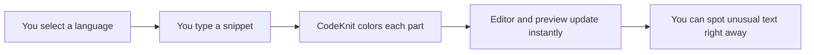

# Syntax highlighting

Syntax highlighting makes the code and Markdown in your snippets easier to read by automatically coloring different parts of the text. It works while you type in the snippet editor, and the same coloring appears in snippet cards, the detail view, and anywhere else CodeKnit shows snippet content.

This feature is designed for anyone who saves and reviews code or Markdown snippets. It helps you scan long snippets faster, notice parts that don't look right, and work with both code and documentation in one place.

## Where highlighting appears

Syntax highlighting is applied automatically in three places:

- **Code editor** – when you create or edit a snippet, colors update as you type.
- **Snippet cards** – the preview on each card uses the same colors for the first few lines.
- **Detail view** – when you select a snippet, the full content appears with the same highlighting.

Because the editor and preview share the same coloring, what you see while writing matches what you see when browsing your library.

Figure: How syntax highlighting updates as you type

## Supported languages

Highlighting is available for four languages:

- **JavaScript**
- **Python**
- **SQL**
- **Markdown**

When you create or edit a snippet, choose one of these from the **Language** menu. CodeKnit then applies the matching highlighting rules for that language, so JavaScript keywords are colored differently from SQL keywords, for example.

## How to read the colors

The exact colors depend on the current theme, but each part of a snippet gets a consistent visual treatment.

| Part of the snippet | How it appears |
| --- | --- |
| Comments | Muted and italic |
| Strings | One distinct color |
| Keywords | Another distinct color |
| Function names | A distinct color |
| Numbers | A distinct color |
| Variables | A distinct color |
| Markdown headings | Bolder text |
| Markdown bold text | Bolder text |
| Markdown links | Colored and underlined |
| Punctuation | Muted |
| Plain text | Normal text color |

This consistent mapping helps you read code quickly. For example, a comment is easy to distinguish from working code, and function names stand out from keywords and variables.

You can also use highlighting as an early check while typing. If a keyword stays in the plain text color when you expected it to change, you may have misspelled it. If a string appears to run far beyond where it should end, a missing closing quote may be the cause.

## Markdown formatting

When you choose Markdown as the language, CodeKnit highlights Markdown-specific constructs such as headings, bold text, and links. The Markdown stays in its source form with helpful colors, rather than being converted into a fully formatted document.

> [!NOTE]
> Markdown highlighting shows you the structure of the Markdown itself. It does not turn the snippet into a rendered, formatted page.

## What highlighting can and cannot do

Syntax highlighting is built into CodeKnit, so there is nothing extra to install or enable. It runs on your device and updates instantly as you type, without depending on an outside service.

There are a few boundaries to keep in mind:

- Highlighting is available only for JavaScript, Python, SQL, and Markdown.
- It is not a complete syntax or error checker. Some mistakes may still go unnoticed.
- Highlighting is based on pattern matching and is approximate. It can help you spot likely errors, but it does not validate your code or Markdown against every rule.

## Related

- [Code Editor](doc:a1109ff6-5fe7-437a-99ec-4d0b442bb0fd)
- [Snippet Library](doc:9f431e10-b005-4cc0-80b1-0af4acdcb3d8)
- [Concepts and Terminology](doc:08c7b9ec-c366-4fc5-b62c-01999c0ae167)
