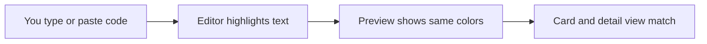
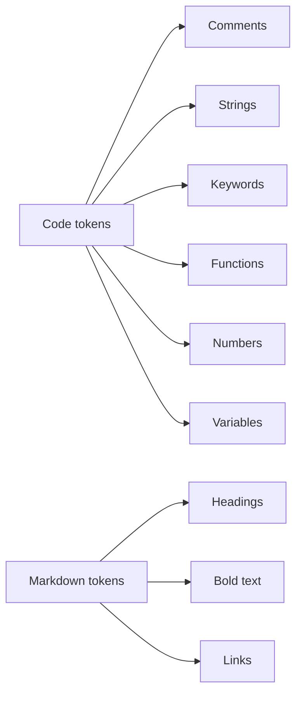
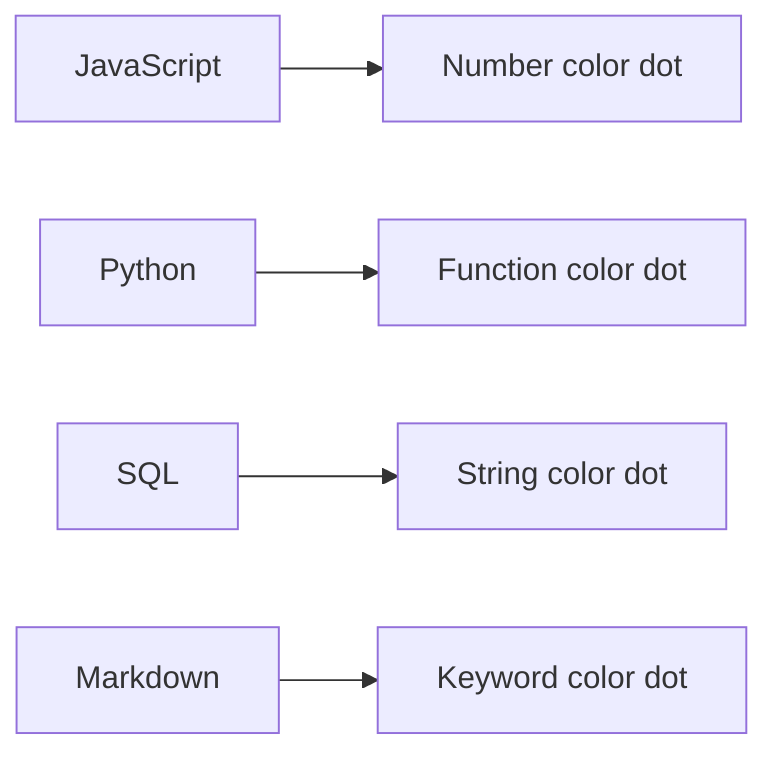

# Syntax highlighting

Syntax highlighting colorizes your code and Markdown as you write, so you can tell keywords, strings, numbers, comments, and other language constructs apart at a glance. It is built into CodeKnit's editor and every preview panel, with no setup required.

This feature is for anyone who saves or reads snippets. You see highlighting the moment you type or paste code into a snippet, and the same highlighting appears when you browse your library, open a snippet in detail view, or review code in a card preview.

## What you see

Highlighting appears in two places:

- In the **Code** box while you create or edit a snippet
- In read-only previews on snippet cards and in the snippet detail view

The editor shows highlighting behind your text as you type. The preview updates instantly with the same colors, so what you see in the editor matches what appears everywhere else.

Figure: Syntax highlighting appears as you type and carries into previews

## Token colors and what they mean

Each part of your code receives a color and style based on what it represents. You do not need to configure anything; the mapping is automatic.

| Construct | Appearance |
| --- | --- |
| Comments | Italic, muted color |
| Strings | Distinct string color |
| Keywords | Distinct keyword color |
| Functions | Distinct function color |
| Numbers | Distinct number color |
| Variables | Distinct variable color |
| Headings (Markdown) | Semibold heading color |
| Bold text (Markdown) | Semibold regular text |
| Links (Markdown) | Underlined function color |
| Punctuation | Muted color |
| Plain text | No special color |

For code, the highlighted constructs are comments, strings, keywords, functions, numbers, and variables. For Markdown, the highlighting recognizes headings, bold text, and links.

Figure: How constructs map to highlighting categories

## Supported languages

Syntax highlighting works with four languages:

- **JavaScript**
- **Python**
- **SQL**
- **Markdown**

Each language also has a small color dot next to its name in the sidebar and on snippet cards, so you can recognize the language of a snippet at a glance.

Figure: Language dot colors indicate each supported language

## How highlighting helps you

Color-coded text makes it easier to:

- Scan long snippets quickly
- Distinguish code from documentation in Markdown
- Spot mistakes early, such as an unclosed string or a mistyped keyword, because the expected color does not appear
- Keep a consistent look between the editor and preview

Highlighting runs in your browser as you type. Because it is built into CodeKnit and does not rely on a separate syntax library, it stays fast even with longer snippets and adds no extra load to the page.

## Boundaries

- Highlighting is limited to **JavaScript, Python, SQL, and Markdown**. Other languages are not highlighted.
- It is not a full-featured syntax highlighter. The highlighting uses pattern matching, so complex or edge-case syntax may be colored as plain text or matched approximately.
- A highlighted keyword or string reflects a pattern match, not a full validation of your code. Use it as a visual aid, not a guarantee that your snippet is error-free.

> [!NOTE]
> Color alone is not the only cue. Some constructs also use italic or semibold styling, which helps when the color is not distinct to you.

## Related

- [Code Editor](doc:a1109ff6-5fe7-437a-99ec-4d0b442bb0fd)
- [Snippet Library](doc:9f431e10-b005-4cc0-80b1-0af4acdcb3d8)
- [Snippet Organization](doc:8367ddb8-1051-4848-a093-3b4352805aa4)
- [Search and Filter](doc:3704cb56-cf68-421d-9db0-d3816a8af756)
