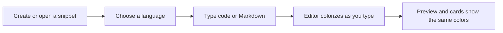

# Syntax highlighting

CodeKnit colorizes your snippets so the different parts of your code, queries, and Markdown stand out from each other. Highlighting appears automatically in the editor while you type, and the same colors are shown everywhere you read a saved snippet.

## Who it is for

Syntax highlighting helps anyone who writes or reviews snippets in CodeKnit:

- **Developers** can scan JavaScript, Python, or SQL and see comments, keywords, strings, and other constructs at a glance.
- **Documentation writers** can see where Markdown headings, bold text, and links are recognized.
- **Anyone reusing a snippet** can quickly understand its structure before copying or editing it.

## What you can do

When you create or edit a snippet, choose a language from the selector, and then type in the code area. As you write, CodeKnit updates the colorization instantly in both the editing area and the snippet preview. You do not need to save or refresh.

The same highlighting is used everywhere a snippet appears:

- On snippet cards in your library
- In the preview when you select a snippet
- In the detail dialog when you review saved code before copying

Figure: Where highlighting appears in your CodeKnit workflow

## What each language highlights

Each supported language has its own set of recognized constructs and visual treatments.

### JavaScript, python, and SQL

- **Comments** appear italicized and more muted than ordinary code.
- **Strings** receive their own distinct color.
- **Keywords** receive their own distinct color.
- **Functions** receive their own distinct color.
- **Numbers** receive their own distinct color.
- **Variables** receive their own distinct color.
- **Punctuation** appears muted so it does not compete with the meaningful text.

### Markdown

- **Headings** appear bold and use a distinct heading color.
- **Bold text** appears semibold.
- **Links** appear underlined and use a distinct link color.
- Plain Markdown punctuation appears muted.

Each language also has a colored dot you can see next to its name in the sidebar and on snippet badges. Those dots use the same accent colors that appear in the language's highlighting.

## What highlighting helps you notice

Because different constructs have different colors, you can often spot mistakes early, such as an unfinished string, a misplaced comment, or a heading that is not being recognized as a heading. If your Markdown looks like plain text instead of showing bold or colored headings, verify that **Markdown** is selected as the language.

> [!NOTE]
> For the most accurate highlighting, make sure the selected language matches the content of your snippet.

## Limits

CodeKnit highlights four languages only: **JavaScript**, **Python**, **SQL**, and **Markdown**.

The highlighting is designed to be fast and lightweight rather than a complete language parser. Its recognition is approximate, so unusual or complex syntax may occasionally be colored in an unexpected way. This feature is not a full-featured replacement for a dedicated code editor.

## Related

- [Code Editor](doc:a1109ff6-5fe7-437a-99ec-4d0b442bb0fd)
- [Snippet Library](doc:9f431e10-b005-4cc0-80b1-0af4acdcb3d8)
- [How Snippets and Filters Work Together](doc:5aa23d07-2c0d-44f6-8a85-df82ca070b77)
- [Key Concepts and Terminology](doc:08c7b9ec-c366-4fc5-b62c-01999c0ae167)
