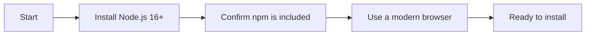

# System requirements and installation

This guide helps you set up CodeKnit on your own computer so you can run it locally. When you finish, you'll have a working copy of CodeKnit that you can open in your browser and use right away.

CodeKnit runs entirely in your web browser. It does not need a server, a database, or any cloud service. Your snippets are saved in your browser's built-in local storage, so they stay on your device unless you choose to export them.

## Before you begin

You need three things:

- **Node.js version 16 or later**, the tool that runs CodeKnit's development environment. We recommend installing Node.js with **nvm** (Node Version Manager) so you can easily switch between versions later. Follow the official nvm installation instructions for your operating system.
- **npm**, the package manager that installs CodeKnit's dependencies. npm comes bundled with Node.js, so once Node.js is installed, npm is available automatically.
- **A modern web browser**, Chrome, Firefox, Safari, or Edge, with clipboard API support so you can copy snippets with one click.

Figure: Prerequisites for running CodeKnit locally



## Step 1: Get a copy of the project

First, copy the project files to your computer. Open a terminal and run:

```sh
git clone <this-repository-url>
cd <repository-name>
```

Replace`<this-repository-url>` with the actual repository address and`<repository-name>` with the folder name that appears after cloning.

## Troubleshooting

**The development server won't start**

Make sure you're running the command from the project folder you cloned into. Also verify you ran`npm install` first, the dev server needs dependencies installed before it can start.

**Node.js version is too old**

If you see errors about unsupported features or syntax, check your Node.js version with`node --version`. If it's below 16, install a newer version. With nvm, you can run`nvm install --lts` to install a recent long-term support release and then`nvm use --lts` to switch to it.

**The browser doesn't show CodeKnit**

Confirm the terminal still shows the development server running. If you closed the terminal or stopped the process, restart it with`npm run dev`.

## Next steps

- See [Product overview](doc:ca8f433d-53d1-475b-a3a5-29b24f1ba173) to learn what CodeKnit can do.
- Follow [Your first snippet – quick start](doc:72dab710-31b9-4980-becf-be9fbd6d4d94) to create and save your first snippet.
