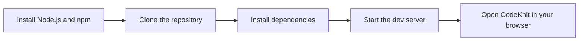
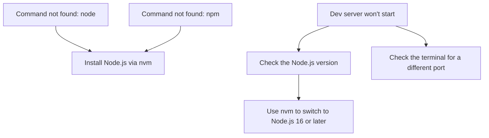

# System requirements and installation

This guide helps you install CodeKnit and run it on your own computer. By the end, you'll have CodeKnit open in your browser and ready to use.

## Before you begin

To run CodeKnit locally, you need:

- **Node.js 16 or later**, the runtime that powers the development server. Using nvm to install Node.js is recommended because it makes switching versions easy.
- **npm**, the package manager that installs CodeKnit's dependencies. npm comes bundled with Node.js.
- **A modern web browser**, such as the latest version of Chrome, Edge, Firefox, or Safari. The browser must support the clipboard API so you can copy snippets with one click.
- **Git**, used to download a copy of the project. Most computers already have Git installed.

> [!NOTE]
> CodeKnit stores your snippets in your browser's local storage. You don't need a separate server, database, or backend to run or use it.

## Install Node.js and npm

The easiest way to install Node.js is with nvm, the Node Version Manager.

1. Follow the installation instructions on the nvm installation guide.
2. Open a terminal and install a recent version of Node.js, for example:

```sh
   nvm install 20
   ```

3. Set that version as the active version:

```sh
   nvm use 20
   ```

If you already have Node.js installed, you can skip this section and verify your version instead.

## Download and install CodeKnit

Figure: Local installation flow



The diagram shows the four main steps: prepare your environment, download the project, install its dependencies, and start the development server.

1. Open a terminal.
2. Download a copy of the project by running:

```sh
   git clone <your-repository-url>
   ```

   Replace`<your-repository-url>` with the URL for your copy of the project.

3. Move into the project folder:

```sh
   cd <repository-name>
   ```

   Replace`<repository-name>` with the folder name created by the clone command.

4. Install all required dependencies:

```sh
   npm install
   ```

   This step can take a few minutes while npm downloads the necessary packages.

> [!TIP]
>`npm install` and`npm i` do the same thing. Use whichever you prefer.

## Start the development server

With the dependencies installed, you can launch CodeKnit.

1. In the same project folder, run:

```sh
   npm run dev
   ```

2. Wait a moment while the development server starts.
3. Open your browser and go to:

```text
   http://localhost:5173
   ```

You should now see CodeKnit. The development server typically uses port 5173, so this is the default address.

> [!NOTE]
> If port 5173 is already in use on your computer, the terminal output will show a different port. Use the address printed in the terminal instead.

## Verify your installation

To confirm that Node.js and npm are installed correctly:

1. Open a terminal.
2. Check the Node.js version:

```sh
   node --version
   ```

   You should see a version number such as`v20.11.0`. Make sure the version is 16 or later.

3. Check the npm version:

```sh
   npm --version
   ```

   You should see a version number such as`10.2.4`.

If both commands print a version number, your environment is ready.

## Build for production

For production deployments, you can create an optimized build.

1. Make sure you are in the project folder.
2. Run:

```sh
   npm run build
   ```

This produces a production-ready version of CodeKnit. Deploy the resulting build output to your preferred static hosting service.

## Troubleshooting common setup issues

Figure: Troubleshooting common setup issues



The diagram shows the most common issues: missing commands, an outdated Node.js version, and port conflicts.

###`node: command not found`

This means Node.js is not installed or not available in your current terminal session.

1. Follow the nvm installation steps in the earlier section.
2. Close and reopen your terminal.
3. Run`node --version` again to confirm it now works.

###`npm: command not found`

npm is installed alongside Node.js, so this usually means Node.js is missing or not active.

1. Install Node.js using nvm.
2. Run`nvm use <version>` to activate a Node.js version.
3. Run`npm --version` to verify.

## Next steps

- Learn what CodeKnit is and how it helps you: [Product Overview](doc:ca8f433d-53d1-475b-a3a5-29b24f1ba173)
- Create your first saved snippet: [Your First Snippet – Quick Start](doc:72dab710-31b9-4980-becf-be9fbd6d4d94)
- Understand how snippets are stored and organized: [Key Concepts and Terminology](doc:08c7b9ec-c366-4fc5-b62c-01999c0ae167)
