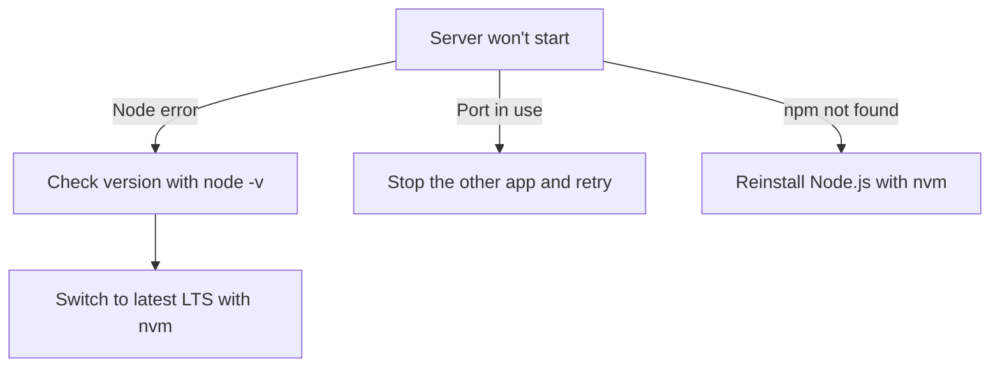

# System requirements and installation

Follow this guide to install and run CodeKnit on your own computer. CodeKnit runs entirely in your browser and keeps your snippets in your browser's local storage, so you don't need a server or a backend.

## What you need

To install and run CodeKnit locally, you need:

- **Node.js**, version 16 or later. The recommended way to install Node.js is with nvm (Node Version Manager), which makes it easy to switch between Node versions.
- **npm**, included with Node.js. You'll use npm to install dependencies and start CodeKnit.
- **Git**, used to copy (clone) the repository to your computer.
- **A modern web browser** with clipboard support, such as the latest Chrome, Edge, Firefox, or Safari.

> [!NOTE]
> CodeKnit stores your snippets in your browser's local storage. Nothing is sent to a server, and no database or backend setup is required.

## Install Node.js and npm

1. Open a terminal.
2. Install nvm if you don't already have it. The nvm project page provides installation instructions.
3. Run`nvm install --lts` to install the latest long-term support version of Node.js.
4. Run`node -v` to confirm Node.js is installed. You'll see a version number such as`v22.12.0`.
5. Run`npm -v` to confirm npm is installed.

## Verify your installation

After the development server starts:

1. Open CodeKnit in your browser.
2. Create and save a snippet.
3. Reload the page and confirm the snippet is still there. This confirms local storage is working.

## Troubleshooting

Use the following diagram to diagnose the most common setup issues:

Figure: Troubleshooting the local setup

### "npm: Command not found"

Node.js isn't installed or isn't on your path. Reinstall Node.js with nvm, then open a new terminal and try again.

### Node.js version errors

If the server refuses to start with a version-related error, check your version with`node -v`. The modern build tooling used by CodeKnit may require a newer Node.js version than v16. Upgrade with`nvm install --lts`, then run`nvm use --lts`.
