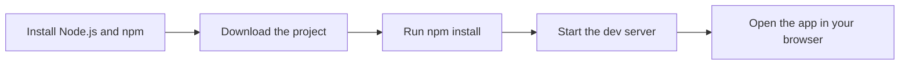
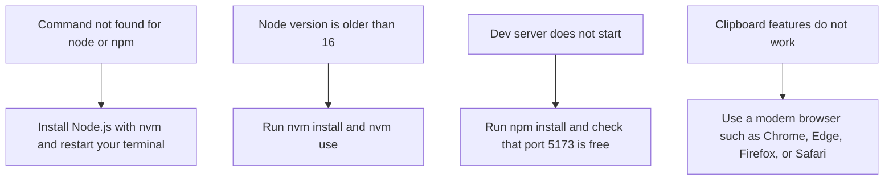

# System requirements and installation

CodeKnit runs entirely in your browser and stores your snippets locally on your computer. You do not need a server, a backend, or an account to use it. To install and run CodeKnit yourself, you need Node.js and npm.

## Before you start

Make sure you have:

- **Node.js** version 16 or later. The recommended way to install Node.js is with`nvm` (Node Version Manager), which makes it easy to install and switch between Node versions.
- **npm**, which is included when you install Node.js.
- **A modern web browser** with clipboard support, such as Chrome, Edge, Firefox, or Safari.

> [!NOTE]
> CodeKnit saves your snippets in your browser's local storage. If you clear your browser data, your snippets are removed. To keep a backup, use the export feature before clearing your browser. See [Import and Export](doc:f1b42dc6-1597-47d7-b921-658815f5af20).

Figure: Local setup flow


The diagram shows the four main steps to get CodeKnit running on your computer: install Node.js, download the project, install dependencies, and start the development server.

## Verify your installation

Run these commands in a terminal:

```sh
node -v
npm -v
```

`node -v` should show version 16 or later.`npm -v` should show a version number. If either command fails with a "command not found" error, Node.js is not installed or is not on your system path.

## Create a production build

To create an optimized build for deployment, run:

```sh
npm run build
```

To preview the production build locally before deploying, run:

```sh
npm run preview
```

## Troubleshooting common issues

Figure: Troubleshooting installation issues


The diagram shows common installation problems and the quickest action for each one. The sections below explain each fix in more detail.

### "Command not found" for node or npm

Node.js is not installed, or it is not available in your terminal. Install Node.js with`nvm`, then close and reopen your terminal.

### Node.js version is too old

If`node -v` shows a version older than 16, use`nvm` to install and switch to a newer version:

```sh
nvm install 20
nvm use 20
```

Replace`20` with the Node.js version you want to use.
