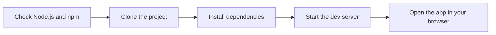
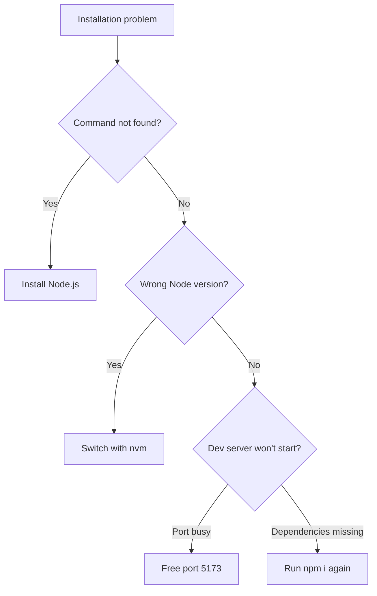

# System requirements and installation

This guide helps you install and run CodeKnit on your own computer. CodeKnit runs entirely in your web browser and stores your data locally, so you do not need a server, a database, or a backend service.

## What you need

Before you begin, make sure you have:

- **Node.js version 16 or later.** A current long-term support release is recommended. If you work with multiple Node.js versions, install Node using **nvm**.
- **npm.** npm is included when you install Node.js.
- **A modern web browser** that supports the clipboard API, such as the latest version of Chrome, Edge, Firefox, or Safari.
- **A terminal application**, such as Terminal on macOS, Command Prompt on Windows, or your preferred terminal on Linux.

> [!NOTE]
> CodeKnit saves your snippets locally in your browser using local storage. No account and no network connection are required after the app is running.

## How local installation works

The installation flow has five main stages, from checking your tools to opening the app.

Figure: Local installation flow

## Verify your installation

After the app opens, you should see the CodeKnit Dashboard. You can also confirm your tooling with these commands:

| What to check | Command |
| --- | --- |
| Node.js version |`node --version` |
| npm version |`npm --version` |

If both commands return a version number and the browser opens CodeKnit, your installation succeeded.

## Troubleshooting common issues

If the app does not open, use the decision tree below to identify the problem.

Figure: Installation troubleshooting flow

Here are the most common issues and how to fix them:

- **`node: command not found`**, Node.js is not installed or not available in your terminal. Install Node.js version 16 or later, then open a new terminal and retry.
- **Wrong Node.js version**, If your version is older than 16, use nvm to switch to a supported version, then run`npm i` again.
- **Port already in use**, If the development server cannot start because port 5173 is busy, stop the other process using that port and run`npm run dev` again.
- **Dependencies are missing or installation failed**, Run`npm i` again in a fresh terminal window, then start the development server once more.
- **Clipboard features do not work**, Use an up-to-date browser that supports the clipboard API.

## Next steps

- Start using the app right away with [Your First Snippet – Quick Start](doc:72dab710-31b9-4980-becf-be9fbd6d4d94).
- Learn what CodeKnit does at a high level in Product Overview.
- Understand the main terms you will see in [Concepts and Terminology](doc:08c7b9ec-c366-4fc5-b62c-01999c0ae167).
