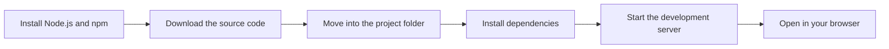
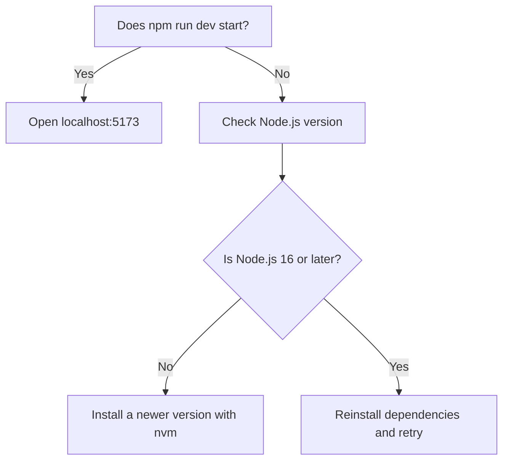

# System requirements and installation

This guide walks you through setting up CodeKnit on your own computer. By the end, you'll have CodeKnit running locally so you can start creating, organizing, and copying snippets.

## Before you begin

Make sure your computer has the following:

- **Node.js** version 16 or later. We recommend installing Node.js with nvm (Node Version Manager) because it makes switching between versions easier. A current Long-Term Support release works best.
- **npm**, which comes with Node.js. npm installs the other packages CodeKnit needs.
- **A modern web browser** with clipboard support, such as a recent version of Chrome, Edge, Firefox, or Safari. Clipboard support lets you copy snippets with one click.
- **Git**, to download the CodeKnit source code.

CodeKnit saves your snippets in your browser's local storage, so you don't need to set up a separate database or backend service.

## Installation overview

Here is the full journey from a fresh computer to a running CodeKnit.

Figure: Local installation flow



## Install and run CodeKnit

1. **Download the source code.** Use Git to clone the CodeKnit repository, then move into the folder it creates:

```
   git clone <repository-url>
   cd <repository-name>
   ```

   Replace`<repository-url>` with the CodeKnit repository address and`<repository-name>` with the folder name Git creates.

2. **Install dependencies.** Run:

```
   npm install
   ```

   This downloads everything CodeKnit needs and may take a few minutes.

3. **Start the development server.** Run:

```
   npm run dev
   ```

4. **Open CodeKnit in your browser.** Once the server starts, go to:

```
   http://localhost:5173
   ```

   This is the usual development server address. If your terminal shows a different address, use the one shown there.

You should now see the CodeKnit home screen. There's no account to create and no separate server to configure.

## Build for production

When you're ready to prepare a production copy of CodeKnit, run:

```
npm run build
```

This command creates optimized files that you can deploy to a hosting provider.

## Troubleshooting

Use this decision flow when something doesn't start as expected.

Figure: Troubleshooting installation issues



### Clipboard copying doesn't work

If copying snippets with one click doesn't work, try a recent version of Chrome, Edge, Firefox, or Safari. This feature requires browser clipboard support.

## Next steps

- [Product Overview](doc:ca8f433d-53d1-475b-a3a5-29b24f1ba173) to learn what CodeKnit can do
- [Your First Snippet – Quick Start](doc:72dab710-31b9-4980-becf-be9fbd6d4d94) to create and save your first snippet
- [Concepts and Terminology](doc:08c7b9ec-c366-4fc5-b62c-01999c0ae167) to learn key terms like snippet, category, and tag
