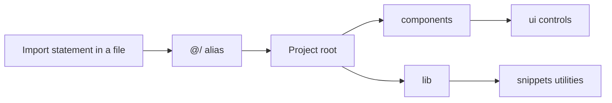

# TypeScript module aliases

TypeScript Module Aliases is a developer experience feature that lets you import modules across this project using short, stable paths instead of long chains of relative folder references. It's for anyone writing or maintaining code in this codebase—theme developers, plugin authors, and contributors who touch any part of the interface or underlying logic.

With module aliases enabled, every import uses a consistent`@/` prefix that points to the project root. The prefix directs the build tool to the right location, so you always know where a file lives no matter which file you're editing.

## What module aliases do

When you open any source file in this project, you'll notice that imports follow the same pattern:`@/` followed by a folder name. This prefix represents the top level of the project and maps to the root directory where the source code lives.

Figure: How the`@/` alias maps to the project root

This one prefix replaces multiple relative-folder hops like`../../../` that would otherwise be needed to reach shared files from deeply nested locations.

## Who this helps

This feature is built for developers who work on this product's internals. If you're a theme or plugin developer, or you're contributing a feature or fix, you benefit from it every time you write an import. It's the tool that keeps imports predictable across the entire codebase.

## Benefits

- **Consistent imports everywhere**: Whether you're working in a top-level layout component or a deeply nested utility, every import uses the same`@/` prefix and follows the same pattern. There's no guessing about how many`../` segments a file needs.
- **Stable paths during refactoring**: If you move a file to a different folder, its imports don't break as long as it still lives under the alias root. The alias resolves to the same location regardless of where the importing file sits.
- **Clearer organization**: The alias makes the project structure obvious. Imports grouped under`@/components` refer to interface components, while imports under`@/lib` refer to shared utilities and data logic.
- **Faster navigation**: Because every import starts from the same root reference, you can scan a file and immediately understand where its dependencies are located.

## Key options

The alias system in this project exposes these configurable areas:

- **`@/components/ui`**: A collection of reusable interface elements such as buttons, dialogs, inputs, and a sidebar. These components are shared across the product and imported from multiple places.
- **`@/lib`**: The central area for shared utilities and product logic. This includes snippet filtering, types, data storage, import/export helpers, and utility functions.
- **`@/lib/snippets`**: The dedicated module group for snippet-related functionality, including language and filter types, the snippet store, search and sort logic, code highlighting, and import/export utilities.

Each of these areas is reachable through the same`@/` root prefix, so no additional configuration is needed when you work within them.

## Limits

- **Build tooling required**: Module aliases only work when the build tooling is properly set up. Running the project with the standard development command handles this automatically, but imports won't resolve without the configured toolchain.
- **Root-relative only**: The alias points to the project root and doesn't support mappings to locations outside the project or to third-party packages. External packages still use their standard package names.
- **Prefix consistency matters**: To reap the full benefit of stable imports, developers need to use the`@/` prefix consistently rather than reverting to relative paths. Both work, but mixing styles reduces the clarity the alias is designed to provide.

## Next steps

- Learn about the overall product structure in [Product Overview](doc:ca8f433d-53d1-475b-a3a5-29b24f1ba173)
- Set up the project locally in [System Requirements and Installation](doc:1016cd5f-d53c-46d7-a74a-15b623ef5387)
- Understand the shared terminology in [Key Concepts and Terminology](doc:08c7b9ec-c366-4fc5-b62c-01999c0ae167)
- See how snippet data and logic are organized in [Snippet Library](doc:9f431e10-b005-4cc0-80b1-0af4acdcb3d8)
