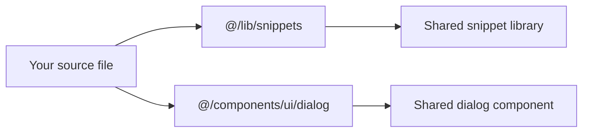

# TypeScript module aliases

TypeScript module aliases give theme and plugin developers a clean, consistent way to reference shared modules inside this project. Instead of writing long relative paths that climb through parent folders, you write a short, stable path that starts with`@/`.

## Who it's for

This feature is for developers who maintain or extend the project. If you build custom views, tweak shared components, or add new utilities, aliases keep your imports readable and consistent.

## Benefits

- **Consistent references**: No matter where you edit, the path to a shared resource looks the same.
- **Fewer mistakes**: You avoid counting`../` levels to reach a shared folder.
- **Easier refactoring**: Imports stay stable even when files move within the aliased folders.
- **Clearer intent**: An import such as`@/lib/snippets/types` immediately shows that the module is a shared snippet library type definition.

## How aliases work in day-to-day work

The diagram below shows what happens when you use an aliased import in your source file.

Figure: How the @/ alias maps imports to shared folders

Every`@/` import resolves to a shared location in the project. You don't need to trace back folder by folder to know what's being used, the prefix tells you the module lives under a shared folder, and the build tooling handles the mapping.

## Key examples

The aliases are used consistently across the project's source files. For example, the main layout imports several shared modules using the`@/` shorthand:

-`@/components/ui/button`
-`@/components/ui/input`
-`@/components/ui/sidebar`
-`@/lib/utils`
-`@/lib/snippets/filter`
-`@/lib/snippets/store`
-`@/lib/snippets/types`

You don't need to configure anything to use these aliases. They are already wired into the project's TypeScript and build tooling.

## Key options and limits

The alias setup is decided by the project and applies project-wide.

- The`@/` prefix maps to shared folders under the source root.
- Import lines can point to shared interface components or internal libraries.
- The resolver supports the same path mapping during development and production builds.

> [!NOTE]
> The`@/` shorthand is a project convention, not a standard TypeScript feature. It relies on the path resolution plugin included with the project's development dependencies.

Limits to keep in mind:

- The aliases cover internal shared modules only; they don't replace imports from external packages.
- If the path resolution plugin is removed from the development dependencies, aliased imports stop working.
- A module must remain at a location that matches what the alias points to.

## Related pages

- [Site Building & Bundling](doc:0fcd8337-ee59-484f-bda3-4db080caa340)
- [Key Concepts and Terminology](doc:08c7b9ec-c366-4fc5-b62c-01999c0ae167)
- [Product Overview](doc:ca8f433d-53d1-475b-a3a5-29b24f1ba173)
