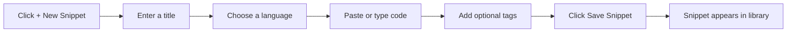

# Your first snippet: quick start

Save your first reusable piece of code in CodeKnit. This guide walks you through the whole create-and-save flow, from opening the dialog to finding your new snippet in your library.

## Prerequisites

- CodeKnit is installed and running on your device.
- You can see the CodeKnit sidebar, Dashboard, or snippet list.

## Create and save your first snippet

Follow these steps to create your first snippet.

1. Click **+ New Snippet** in the top bar or in the sidebar. The **New snippet** dialog opens.
2. In the **Title** field, type a name for your snippet, for example **Quick Sort Algorithm**. This field is required.
3. In the **Language** dropdown, choose **JavaScript**, **Python**, **SQL**, or **Markdown**. JavaScript is selected by default.
4. Paste or type your code into the **Code** area. This field is required. As you type, CodeKnit colors your code and shows line numbers to make it easier to read.
5. Optional: in the **Tags** field, type a tag and press **Enter** or comma to add it. Repeat to add more tags. Tags are stored in lowercase automatically.
6. Click **Save Snippet**.

The following diagram shows the same flow at a glance.

Figure: Create and save your first snippet

### Optional details before saving

While the dialog is open, you can also add a short **Description**, choose a **Category** (the default is **Utilities**, or select **+ Custom category…** to create your own), and turn on **Mark as favorite** if you want to find this snippet quickly later.

## After you save

When you click **Save Snippet**, a confirmation message appears and the dialog closes. Your new snippet is added to your library immediately.

You can now find it in:

- **Dashboard** under **Your Snippets**
- **All Snippets**
- **Recently Added**

Once a snippet is saved, you can search for it, filter by language or tag, copy it to your clipboard, mark it as a favorite, or organize it further.

> [!NOTE]
> Your snippets are stored in your browser on this device, so they stay available when you close and reopen CodeKnit.

## Common issues

### Tags appear in lowercase

Tags are automatically converted to lowercase when you add them. For example, typing **React** saves as **react**. This is expected and keeps your tags consistent when you filter later.

### You can't save the snippet

Both **Title** and **Code** are required. If either one is empty, CodeKnit shows an error under that field. Fill in the missing information, then click **Save Snippet** again.

### Copying a snippet asks for browser permission

The first time you copy a snippet, your browser may ask for permission to access the clipboard. Choosing **Allow** lets you use the copy feature later without interruption.

## Next steps

- [Search and Filter](doc:3704cb56-cf68-421d-9db0-d3816a8af756)
- [Snippet Organization](doc:8367ddb8-1051-4848-a093-3b4352805aa4)
- [Copy to Clipboard](doc:fe088c40-690b-45b1-ab17-d2fd7e259b72)
- [Favorites](doc:b66c5560-9b68-42eb-922d-a8aecab0dfcb)
- [Product Overview](doc:ca8f433d-53d1-475b-a3a5-29b24f1ba173)
