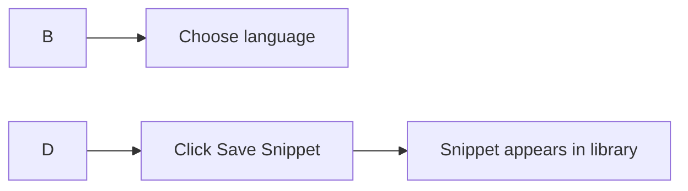

# Your first snippet: quick start

Create and save your first code snippet in just a few steps. You'll learn the basic create-and-save workflow so you can start building your personal snippet library right away.

Before you begin, make sure CodeKnit is installed and running in your browser. If you need help getting set up, see [System Requirements and Installation](doc:1016cd5f-d53c-46d7-a74a-15b623ef5387).

Figure: Creating your first snippet

## Create your first snippet

1. In the top bar or sidebar, click **+ New Snippet**. A dialog opens with empty fields.
2. In the **Title** field, type a name for your snippet, for example`Quick Sort Algorithm`. Title is required.
3. In the **Language** dropdown, choose **JavaScript**, **Python**, **SQL**, or **Markdown**. JavaScript is selected by default, but you can change it to match your code.
4. In the **Code** field, paste or type your code. Code is required.
5. Optional: in the **Tags** field, type a tag and press **Enter** or type a comma to add it. Tags help you find snippets later.
6. Click **Save Snippet**.

That's it, your snippet is saved.

## What happens next

Your new snippet appears in your library right away. From there, you can:

- Find it using **search** by title, tag, or code
- Narrow it down with **language**, **category**, and **favorite** filters
- Copy the code to your clipboard with one click
- Organize it into categories or mark it as a favorite

If you started from the **Dashboard**, your snippet count updates immediately, and you can see the language you just used reflected in your library stats.

## Other fields you can fill in

While only **Title** and **Code** are required, the new snippet dialog also includes optional fields that are worth knowing:

- **Description**, a short note about what the snippet does
- **Category**, a group you assign, such as **Utilities**. Choose an existing category or open a custom category field by selecting **+ Custom category…**
- **Favorite**, turn on the **Mark as favorite** switch to star the snippet for quick access

## Common issues

Here are two behaviors to be aware of as you create and use snippets:

- **Tags are lowercased automatically.** If you type`QuickSort` as a tag, it saves as`quicksort`. Use consistent wording so you can filter by tags later without surprises.
- **Clipboard access may require browser permission.** The first time you copy a snippet, your browser might ask for permission to access the clipboard. If copying doesn't work, check your browser's clipboard permissions.

Once you've created your first snippet, try these guides to get more value from your library:

- [Snippet Library](doc:9f431e10-b005-4cc0-80b1-0af4acdcb3d8)
- [Search and Filter](doc:3704cb56-cf68-421d-9db0-d3816a8af756)
- [Snippet Organization](doc:8367ddb8-1051-4848-a093-3b4352805aa4)
- [Copy to Clipboard](doc:fe088c40-690b-45b1-ab17-d2fd7e259b72)
- [Favorites](doc:b66c5560-9b68-42eb-922d-a8aecab0dfcb)
