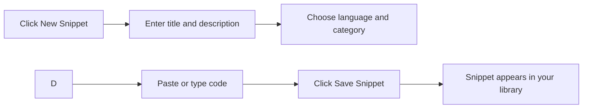

# Your first snippet: quick start

Save your first reusable code snippet in CodeKnit in just a minute or two. This guide walks you through creating one snippet from start to finish, so you'll understand the basic save-and-reuse workflow.

## Prerequisites

- CodeKnit is open and running in your browser
- You have a snippet idea ready, anything from a small utility function to a markdown note

## Create your first snippet

1. Open the new snippet form by clicking **New Snippet**. You'll find this button in the top bar and near the bottom of the sidebar.
2. Enter a title in the **Title** field, such as`Quick Sort Algorithm`. This field is required.
3. Add a short description in the **Description** field. This step is optional, but a few words like "Sorts a list in place" help you remember the snippet's purpose later.
4. Choose a language from the **Language** dropdown: **JavaScript**, **Python**, **SQL**, or **Markdown**. JavaScript is selected by default.
5. Keep or change the **Category**. The form starts with **Utilities** selected, you can pick a different existing category, or choose **+ Custom category…** to create your own.
6. Add optional tags in the **Tags** field. Type a tag and press **Enter** or a comma to add it. For example,`sorting` or`algorithms`.
7. Paste or type your code into the editor. The editor shows line numbers and highlights syntax as you type. Pressing **Tab** indents a line by two spaces.
8. Optionally, turn on **Mark as favorite** if you want this snippet starred for quick access later.
9. Click **Save Snippet**.

Figure: Creating and saving your first snippet

## What happens after you save

When saving finishes, you'll see a **Snippet saved** message, and the form closes. Your new snippet is now in your library, where you can:

- Find it under **All Snippets** or **Recently Added**
- Search for it by title, tag, or code
- Filter by language, category, or tag
- Copy the code with one click
- Open it to view, edit, favorite, or delete it

Your snippets are stored in your browser on this device, so they're ready every time you open CodeKnit.

> [!NOTE]
> If you click **Save Snippet** without a title or code, the form shows a message asking for the missing required field. Fill it in and click **Save Snippet** again.

## Common questions

> [!NOTE]
> Tags are saved in lowercase to keep them consistent. If you type`SQL`, it appears as`sql` on the snippet.

> [!TIP]
> Depending on your browser, the first time you use **Copy** on a snippet you may be asked to allow clipboard access. Allow it to copy code normally.

Now that you know the basic workflow:

- Keep building your collection with the [Snippet Library](doc:9f431e10-b005-4cc0-80b1-0af4acdcb3d8) guide
- Organize snippets by category and tag in [Snippet Organization](doc:8367ddb8-1051-4848-a093-3b4352805aa4)
- Find snippets by title, language, and more with [Search and Filter](doc:3704cb56-cf68-421d-9db0-d3816a8af756)
- Learn what you can do with the [Code Editor](doc:a1109ff6-5fe7-437a-99ec-4d0b442bb0fd)
