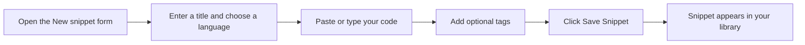

# Your first snippet: quick start

Create and save your first code or Markdown snippet in just a few minutes. If you're new to CodeKnit, start with the [product overview](doc:ca8f433d-53d1-475b-a3a5-29b24f1ba173) for a quick tour.

## Before you begin

Make sure CodeKnit is installed and running. When you open it, the **Dashboard** greets you with "Your code, organized." If your library is empty, you'll also see a **No snippets yet** message in the middle of the page.

## Create and save your first snippet

The following figure shows the complete flow, from opening the form to finding your saved snippet.

Figure: Creating your first snippet

Follow these steps:

1. Click **New Snippet**. You'll find this button at the top of the page next to the search box, and also at the bottom of the left sidebar. If your library is empty, the center of the screen also shows a **+ New Snippet** button.

2. Enter a title. Type a descriptive name such as "Quick Sort Algorithm" into the **Title** box. This field is required.

3. Choose a language. Open the **Language** dropdown and select **JavaScript**, **Python**, **SQL**, or **Markdown**. Your choice controls how the code is displayed in the editor and in previews.

4. Paste or type your code. Click into the code box, it shows the hint "// Paste or write your code here", and paste or type your snippet. As you go, you'll see syntax colors and line numbers.

5. Add optional tags. Click into the **Tags** box, type a label, and press **Enter** or comma to add it. For example, type`algorithm` and press **Enter**. You can add as many tags as you like; they're all optional.

6. Click **Save Snippet** at the bottom of the form. You'll see a "Snippet saved" confirmation, and the form closes.

> [!NOTE]
> The form also has optional **Description**, **Category**, and **Mark as favorite** fields. **Category** starts as **Utilities** unless you choose another option. You can leave these as-is for now.

> [!TIP]
> Pressing **Tab** in the code box inserts two spaces for indentation.

## What happens after saving

Your snippet appears in the **Your Snippets** list on the Dashboard and under **All Snippets** in the sidebar. The card shows the title, a language badge, its category, any tags you added, and a preview of the code.

From here you can:

- [Search and filter](doc:3704cb56-cf68-421d-9db0-d3816a8af756) to find the snippet again
- [Copy the code to your clipboard](doc:fe088c40-690b-45b1-ab17-d2fd7e259b72)
- [Organize snippets with categories and tags](doc:8367ddb8-1051-4848-a093-3b4352805aa4)
- [Mark snippets as favorites](doc:b66c5560-9b68-42eb-922d-a8aecab0dfcb)

## Expected result

You now have one saved snippet in your library. The Dashboard shows **1** under Total snippets. You understand the basic create-and-save workflow and are ready to add more.

## Common issues

### Tags are auto-lowercased

When you type a tag such as`QuickSort`, CodeKnit stores it as`quicksort`. All tags are converted to lowercase automatically. Searching for`quicksort` or`QUICKSORT` will still find it.

### Can't save?

The **Title** and code fields are required. If either is empty, you'll see a red message explaining what's missing. Fill in the required fields, then click **Save Snippet** again.

### Copying code requires browser permission

When you use the copy feature for the first time, your browser may ask whether to allow clipboard access. Choose **Allow** to let CodeKnit copy snippet code for you. This is standard browser behavior, not an error.
