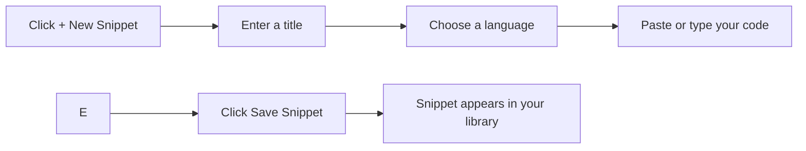
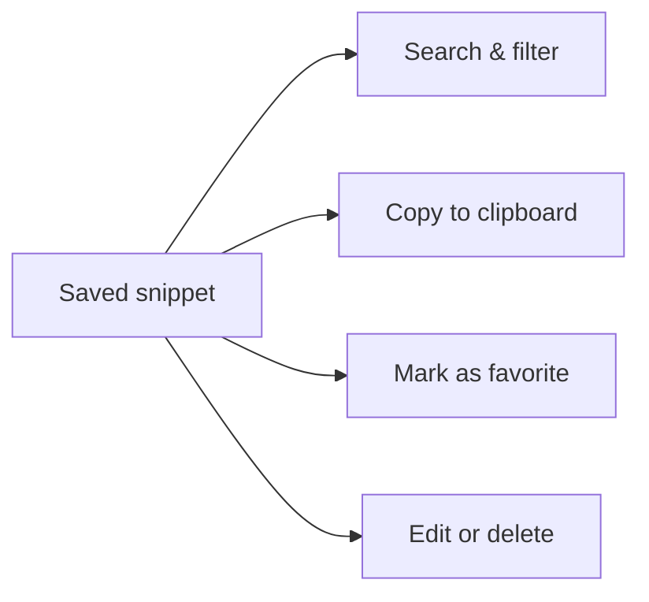

# Your first snippet: quick start

In this guide, you create and save your first code snippet in CodeKnit. A snippet is a saved piece of code or Markdown text with a title, language, category, and tags. After you save it, you can search, filter, copy, and organize it.

## Prerequisites

Before you begin, make sure:

- CodeKnit is installed and running. If you haven't set it up yet, see [System Requirements and Installation](doc:1016cd5f-d53c-46d7-a74a-15b623ef5387).
- You're on the main screen with the sidebar and **New Snippet** button visible.

## Create your first snippet

Follow these steps to create and save a snippet.

1. Click **+ New Snippet** in the top-left of the main window or the **New Snippet** button in the sidebar. A **New snippet** dialog opens.
2. Enter a title in the **Title** field. For example, type`Quick Sort Algorithm`. The title is required.
3. Choose a language from the **Language** dropdown. Options are **JavaScript**, **Python**, **SQL**, and **Markdown**. Your selection controls syntax highlighting.
4. Paste or type your code into the code area. The editor includes line numbers and highlights keywords, strings, and comments.
5. Optionally, type one or more tags in the **Tags** field. Press **Enter** or comma after each tag to add it. Tags help you find snippets later.
6. Click **Save Snippet**. A confirmation message appears, and the dialog closes.

Here's the flow at a glance:

Figure: Saving your first snippet

## What happens after you save

- Your snippet is stored locally in your browser.
- It appears in the **All Snippets** list with a preview of the code.
- The **Dashboard** shows updated counts for total snippets, favorites, and languages.
- You can immediately use the search box or filters to locate it.

Now that your snippet is saved, you can:

- **Search and filter** to find it by title, tags, language, or category. See [Search and Filter](doc:3704cb56-cf68-421d-9db0-d3816a8af756).
- **Copy the code** to your clipboard with one click. See [Copy to Clipboard](doc:fe088c40-690b-45b1-ab17-d2fd7e259b72).
- **Organize it** with categories, tags, and favorites. See [Snippet Organization](doc:8367ddb8-1051-4848-a093-3b4352805aa4) and [Favorites](doc:b66c5560-9b68-42eb-922d-a8aecab0dfcb).
- **Edit or delete** it later from the snippet card or detail view.

Here's a quick look at what you can do with a saved snippet:

Figure: Actions available on a saved snippet

## Expected result

You have one saved snippet in your library and understand the basic create-and-save workflow. You can create more snippets anytime using the same steps.

## Common issues

- **Tags are automatically lowercase.** When you type a tag such as`React`, CodeKnit saves it as`react`. This keeps tags consistent for filtering.
- **Clipboard access may require browser permission.** If clicking **Copy** doesn't copy the code, your browser might be blocking clipboard access. Check your browser's permission settings or allow clipboard access for this site. See [Copy to Clipboard](doc:fe088c40-690b-45b1-ab17-d2fd7e259b72) for details.
- **The title and code fields are required.** If you leave either one empty, you'll see an error message under the field. Fill them in and try again.

Now that you've created your first snippet, explore:

- [Snippet Library](doc:9f431e10-b005-4cc0-80b1-0af4acdcb3d8) to understand your snippet collection.
- [Search and Filter](doc:3704cb56-cf68-421d-9db0-d3816a8af756) to find snippets quickly.
- [Snippet Organization](doc:8367ddb8-1051-4848-a093-3b4352805aa4) to categorize and tag.
- [Copy to Clipboard](doc:fe088c40-690b-45b1-ab17-d2fd7e259b72) to reuse code instantly.
