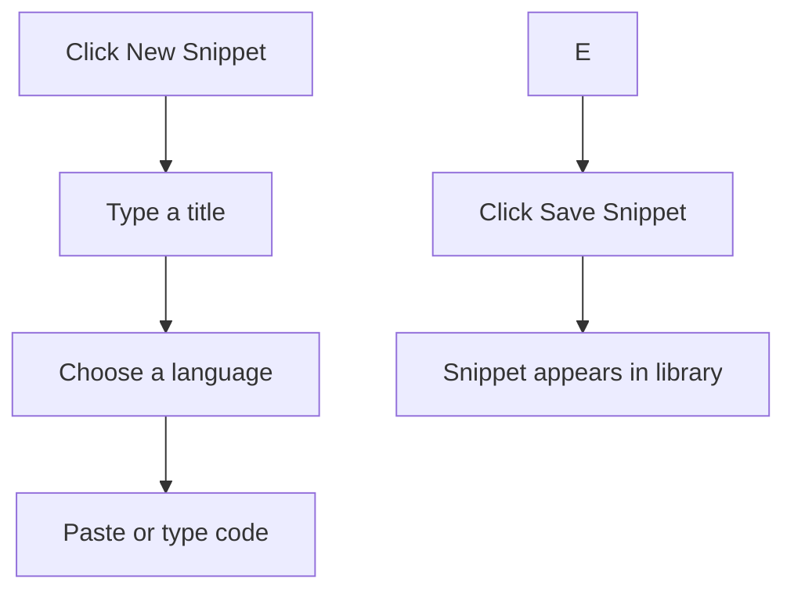

# Your first snippet: quick start

Save your first reusable piece of code in CodeKnit. This guide walks you through creating a snippet, a reusable unit of code or Markdown text with a title, language, and optional tags. By the end, you'll have one saved snippet and understand the basic create-and-save workflow.

## Before you begin

Make sure CodeKnit is running in your browser. You don't need an account, your snippets are stored on your device.

## Create and save your first snippet

Figure: Snippet creation flow

### 1. Open the new snippet form

Click **New Snippet** in the sidebar, or click **+ New Snippet** near the top-right corner of the page. The form opens with two defaults already set: **JavaScript** for the language and **Utilities** for the category.

### 2. Enter a title

In the **Title** field, type a descriptive name, for example, **Quick Sort Algorithm**. The title is required; you can't save without it. The field shows a suggested example such as *Debounce utility* to guide you.

### 3. Choose a language

Open the **Language** dropdown and select one of four options: **JavaScript**, **Python**, **SQL**, or **Markdown**. The editor uses this choice to color your code for readability as you type.

### 4. Paste or type your code

Click into the code area and paste or type your code. The editor shows numbered lines and highlights syntax based on the language you selected. Press **Tab** to indent your code by two spaces.

### 5. Add optional tags

In the **Tags** field, type a tag and press **Enter** or **comma** to add it. Repeat to add more tags. Tags help you locate snippets later through search and filters. For example, you could add **sorting** and **algorithm** to a Quick Sort snippet.

> [!NOTE]
> Tags save in lowercase. If you type`QuickSort`, it appears as`quicksort`. This keeps tags consistent when filtering.

### 6. Click save

Click **Save Snippet** at the bottom of the form. The form closes and your snippet appears in your library.

## What happens next

After you save, your snippet appears in your library with its title, language badge, and tags. From there, you can:

- **Search** for it using the search box
- **Filter** by language, category, or tag
- **Copy** the code with one click
- **Edit or delete** it anytime
- **Star** it as a favorite for quick access

Your snippet is stored locally in your browser, so you can open CodeKnit later and it'll still be there.

## Optional fields to fill in

Before saving, you can also:

- Add a **Description** explaining what the snippet does
- Change the **Category**, or choose **+ Custom category…** to create your own
- Toggle **Mark as favorite** to star it immediately

## Common issues

**Tags are lowercased automatically.** When you type a tag such as`QuickSort`, CodeKnit saves it as`quicksort`. Use all-lowercase tags from the start if the exact capitalization matters to you.

**Your browser may ask for clipboard permission.** The first time you try to copy a snippet, your browser might show a permission prompt. Allow access to copy code to your clipboard.

Now that you've saved your first snippet, explore what else you can do:

- Learn how to [search and filter your snippets](doc:3704cb56-cf68-421d-9db0-d3816a8af756)
- Read about the [Snippet Library](doc:9f431e10-b005-4cc0-80b1-0af4acdcb3d8)
- Understand how [snippets and filters work together](doc:5aa23d07-2c0d-44f6-8a85-df82ca070b77)
- Discover how to [organize snippets with categories and tags](doc:8367ddb8-1051-4848-a093-3b4352805aa4)
- Learn about [favorites](doc:b66c5560-9b68-42eb-922d-a8aecab0dfcb)
