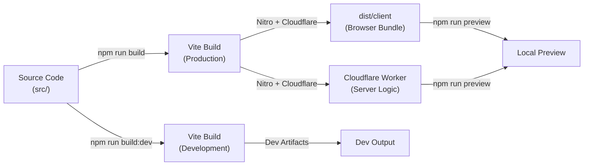
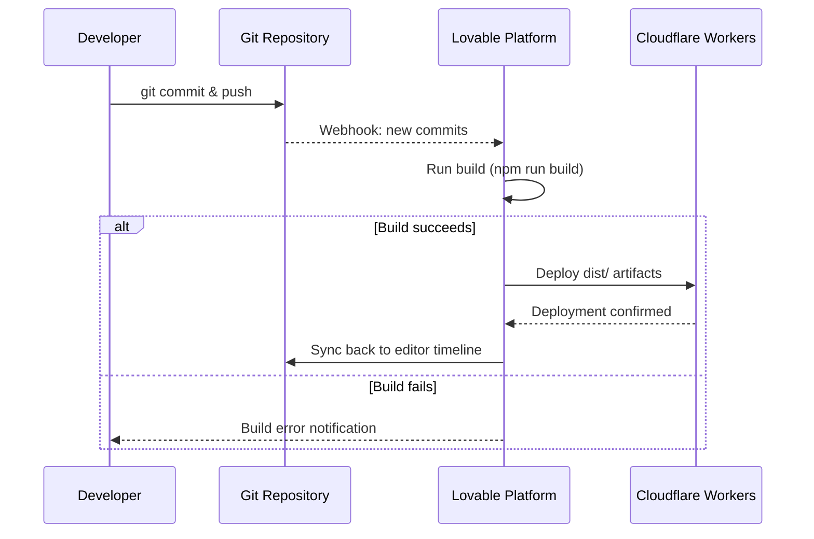

# Build, deployment, and CI/CD pipeline

Build, deploy, and maintain your CodeKnit application from local development through production. This guide covers the complete pipeline: how to build for different environments, deploy to serverless infrastructure, test production builds locally, and understand the security and sync constraints that keep your project connected to Lovable.

## Overview of the build system

CodeKnit uses Vite and TanStack Start to create a full-stack application optimized for serverless deployment on Cloudflare Workers. The build process generates client-side bundles for the browser and server-side code compatible with Cloudflare's runtime.

Figure: Build pipeline and artifact flow



The build system is configured in three key places: `vite.config.ts` orchestrates the entire build, `package.json` provides build scripts, and `bunfig.toml` protects your supply chain with version and release-age guards.

## Development and production build scripts

### Production build

Run the production build using the following command:

```bash
npm run build
```

This command:
- Compiles your TypeScript source code to ES2022 JavaScript
- Bundles React components and dependencies with tree-shaking enabled
- Generates optimized client bundles in `dist/client`
- Builds Nitro server entry point for Cloudflare Workers
- Applies Tailwind CSS compilation and other optimizations
- Creates production-ready artifacts ready to deploy

The production build runs in release mode (the default for Vite) and applies full minification and optimization.

### Development build

For testing a development-mode build locally without running the dev server, use:

```bash
npm run build:dev
```

This build runs with `--mode development` and produces unminified artifacts suitable for debugging. Use this when you need to inspect build output or test a production-like setup without optimizations that obscure code during troubleshooting.

### Local development server

To run the application locally during development without building:

```bash
npm run dev
```

This starts the Vite dev server with hot module replacement (HMR), enabling you to see changes instantly as you edit files. The dev server includes TypeScript checking, ESLint integration, and sourcemaps for debugging.

## Vite and TanStack start configuration

The build configuration lives in `vite.config.ts` and relies on the `@lovable.dev/vite-tanstack-config` package, which pre-configures essential plugins:

```typescript
// vite.config.ts
import { defineConfig } from "@lovable.dev/vite-tanstack-config";

export default defineConfig({
  tanstackStart: {
    server: { entry: "server" },
  },
});
```

The `@lovable.dev/vite-tanstack-config` package automatically includes:
- TanStack devtools (development only)
- TanStack Start and React integration
- Tailwind CSS via `@tailwindcss/vite`
- TypeScript path resolution (`@/*` alias to `src/*`)
- Nitro build plugin (Cloudflare as default target)
- VITE_* environment variable injection
- React and TanStack dependency deduplication
- Error logging and sandbox detection plugins

**Do not** manually add these plugins to `vite.config.ts` or the app will break with duplicate configurations. The `@lovable.dev/vite-tanstack-config` package already handles them. If you need additional Vite configuration, pass it via `defineConfig({ vite: { ... } })`.

The `tanstackStart.server.entry` setting redirects TanStack Start's bundled server entry to `src/server.ts`, which wraps SSR errors. Nitro uses this entry point to build the serverless function.

## Cloudflare workers and nitro deployment

Your application targets Cloudflare Workers as the default serverless platform. The Nitro framework (included in devDependencies) handles the compilation.

### Build artifacts

After running `npm run build`, you'll find:

- **Client bundle**: `dist/client/` contains all browser-side JavaScript, stylesheets, and assets. These are static files deployed to Cloudflare's CDN.
- **Server bundle**: The Nitro build creates a Workers-compatible server handler that processes SSR requests, API routes, and middleware.
- **Configuration files**: Environment variables and routing metadata needed for Cloudflare deployment.

### How the build targets cloudflare

Nitro automatically configures itself for Cloudflare Workers through the `@lovable.dev/vite-tanstack-config` plugin. No additional configuration is required, the nitro build plugin runs with Cloudflare as the preset during `vite build`.

The server entry point (`src/server.ts`) is processed by Nitro, which wraps it for the Cloudflare Workers runtime. When you deploy, Cloudflare reads the generated assets and server bundle, then routes requests to your Worker.

## Preview mode: Testing production builds locally

Before deploying to production, test your production build locally using:

```bash
npm run preview
```

This command:
- Serves the production build artifacts from `dist/`
- Runs a local HTTP server that simulates the production environment
- Applies all production optimizations and minification
- Allows you to verify that your app works with production assets

Preview mode does **not** run a full Cloudflare Workers emulator; it serves the client bundle and provides a basic Node.js HTTP server. Use preview to catch bundle issues, verify styling, and confirm that optimizations haven't broken functionality. For full Cloudflare Workers testing, use Cloudflare's local development tools (such as Wrangler) if available in your environment.

## Environment configuration and lovable integration

CodeKnit is a Lovable-managed project, which means deployment and git sync are handled through Lovable's platform. Understanding this integration is crucial for maintaining a working deployment pipeline.

### Lovable's role in deployment

Lovable:
- Monitors the connected git branch for new commits
- Automatically syncs commits back to the Lovable editor
- Triggers deployment hooks when you push to the connected branch
- Maintains project history that shows up in the editor timeline

### Environment variables and build configuration

The build process injects environment variables prefixed with `VITE_` into your client code via Vite's built-in mechanism. Server-side environment variables are managed by Nitro and can be configured through `.env` files or platform-specific configuration (such as Cloudflare Workers secrets).

Do not commit secrets to git. Use Lovable's environment management or Cloudflare's secret configuration to provide sensitive values at deploy time.

### Git history and lovable sync constraints

A critical constraint: **avoid rewriting published git history**. Force pushes, rebases, amends, and squashes on commits already pushed will break Lovable's sync and cause the user to lose project history.

As documented in `AGENTS.md`:

> Avoid rewriting published git history, force pushing, or rebasing/amending/squashing commits that are already pushed, as it rewrites history on Lovable's side and the user will likely lose their project history.

This means:

1. **Never force push** to the connected branch after committing
2. **Never rebase** commits that have been pushed
3. **Never amend** published commits
4. **Never squash** commits that are already in git history

If you need to fix a mistake, create a new commit. This keeps the branch in a working state and maintains the continuous sync with Lovable. The Lovable editor will show all commits, so a clean, chronological history is preferable anyway.

## Supply chain security with bunfig.toml

CodeKnit uses Bun as its package manager and includes supply-chain guards in `bunfig.toml`:

```toml
[install]
saveTextLockfile = true
minimumReleaseAge = 86400
minimumReleaseAgeExcludes = ["@lovable.dev/vite-tanstack-config", "@lovable.dev/mcp-js", "@lovable.dev/ai-gateway", "@lovable.dev/email-js", "@lovable.dev/webhooks-js"]
```

### 24-hour release age guard

The `minimumReleaseAge = 86400` setting (measured in seconds) prevents installation of packages published less than 24 hours ago. This guard:
- Reduces the risk of installing malicious or buggy versions shortly after release
- Gives the community time to discover and report issues
- Applies to all packages except those explicitly excluded

### Exceptions for lovable packages

The `minimumReleaseAgeExcludes` list bypasses the 24-hour guard for Lovable's own tooling packages:
- `@lovable.dev/vite-tanstack-config`
- `@lovable.dev/mcp-js`
- `@lovable.dev/ai-gateway`
- `@lovable.dev/email-js`
- `@lovable.dev/webhooks-js`

These packages are excluded because Lovable may release critical updates and fixes that need immediate deployment. Before adding any package to this exclusion list, confirm with the team that the package is trusted and that immediate deployment is necessary.

### Adding new packages safely

When installing a new dependency:

1. Run `npm install package-name` (or `bun add package-name`)
2. The package manager will respect `minimumReleaseAge`
3. If the package was just released, wait 24 hours or add it to the exclusion list (with team approval)
4. The lockfile will be updated and committed

This strategy protects against supply-chain attacks while maintaining fast iteration for Lovable's internal tooling.

## Development vs. production mode differences

Your application behaves differently depending on whether it's built for development or production:

### Development build (`npm run build:dev`)

- Assets are **not minified**, making debugging easier
- Sourcemaps are included, allowing browser DevTools to show original TypeScript
- React DevTools and TanStack DevTools are enabled
- Console warnings are verbose
- Performance optimizations like tree-shaking are skipped

Use development builds when:
- Investigating a build-time bug
- Verifying that your app works with optimizations disabled
- Testing locally before committing to production

### Production build (`npm run build`)

- All assets are **minified** using Vite's default rollup configuration
- Tree-shaking removes unused code
- CSS is purged of unused Tailwind classes
- React is optimized for performance
- Sourcemaps are generated but should not be deployed publicly
- File sizes are reduced, resulting in faster downloads and execution

The production build is what gets deployed to Cloudflare Workers. It's optimized for speed and minimal bundle size.

## Performance optimization considerations

### Tree-shaking and dead code elimination

Vite and Rollup automatically remove unused exports from your bundle. To ensure tree-shaking works correctly:

- Use ES6 `import` and `export` syntax (not CommonJS `require`)
- Avoid side effects in module-level code
- Mark modules as side-effect-free in `package.json` by setting `"sideEffects": false`

The `package.json` already declares `"sideEffects": false`, which tells the bundler that all modules can be safely removed if unused.

### Lazy loading and code splitting

TanStack Start and Vite support automatic code splitting for routes. This means:

- Each route's code is bundled separately
- The browser only downloads JavaScript needed for the current page
- Navigating to a new route loads its bundle on demand

This is configured automatically by TanStack Start's plugin; no additional setup is needed.

### Tailwind CSS optimization

The build includes Tailwind CSS via `@tailwindcss/vite`. Tailwind purges unused CSS classes from your build output automatically:

- Only CSS for classes actually used in your templates is included
- Dynamically generated class names (like `className={'text-' + size}`) won't be included; use explicit class names or Tailwind's safelist feature if needed

### Client bundle size

Monitor your client bundle size:

1. Build with `npm run build`
2. Check `dist/client/` for file sizes
3. Use a tool like `vite-plugin-visualizer` to analyze what's taking up space (not installed by default)

If the bundle grows unexpectedly, check for:
- Unused dependencies in `node_modules`
- Large libraries that could be replaced with smaller alternatives
- Assets not being compressed or cached appropriately

## Monitoring and debugging production builds

### Verifying the production build locally

After running `npm run build`, inspect the artifacts:

```bash
# Check client bundle contents
ls -lah dist/client/

# Start the preview server
npm run preview

# Open http://localhost:4173 in your browser
```

### Debugging with preview mode

In preview, you can:
- Inspect network requests using browser DevTools
- Check that all assets load correctly
- Verify styling and layout with production CSS
- Test performance with production-optimized JavaScript

Preview uses a simple Node.js HTTP server, so some Cloudflare-specific features (such as KV storage or environment variables) won't be available. For those, deploy to a staging Cloudflare Worker or use Cloudflare's local development tools.

### Checking build output

Examine `dist/` after a build:

```bash
npm run build

# List all generated files
find dist/ -type f -exec ls -lh {} \;

# Check for unexpected large files
find dist/ -size +100k -type f
```

Large files might indicate:
- Missing tree-shaking (check that dependencies use ES6 exports)
- Duplicate dependencies (check that versions in `package.json` match)
- Unminified code (verify you ran `npm run build`, not `build:dev`)

### Sourcemaps in production

The production build generates sourcemaps (`.map` files) for debugging, but do **not** deploy these to your CDN. They expose your original source code and increase bundle size.

- Store sourcemaps securely in your build artifacts
- Upload them to a monitoring service (like Sentry) if you need production debugging
- Never serve `.map` files publicly

### Cloudflare deployment logs

After deploying to Cloudflare:

1. Check Cloudflare's dashboard for Worker deployment status
2. View real-time logs from your deployed Worker (via Cloudflare CLI or dashboard)
3. Monitor error rates and performance metrics
4. Set up alerts for deployment failures or spikes in error rates

## Build troubleshooting

If your build fails, follow these steps:

1. **Clear cache**: Delete `node_modules/.vite` and try again
   ```bash
   rm -rf node_modules/.vite
   npm run build
   ```

2. **Check TypeScript errors**: The build will fail if TypeScript compilation has errors
   ```bash
   npx tsc --noEmit
   ```

3. **Verify dependencies**: Ensure all packages are installed and compatible
   ```bash
   npm install
   npm ls
   ```

4. **Review environment variables**: Check that all required `VITE_*` variables are set
   ```bash
   env | grep VITE_
   ```

5. **Check git status**: Ensure the working directory is clean
   ```bash
   git status
   ```

For more detailed troubleshooting steps, see [Troubleshooting and Debugging](doc:1b203822-fd22-4fd1-ba44-1c369f176899).

## Git workflow and deployment pipeline

The deployment pipeline is tightly integrated with git:

Figure: Commit-to-deployment flow for Lovable projects



### Deployment checklist

Before pushing to trigger a deployment:

1. **Run tests locally**
   ```bash
   npm run test
   ```

2. **Lint and format code**
   ```bash
   npm run lint
   npm run format
   ```

3. **Build locally to verify**
   ```bash
   npm run build
   npm run preview
   ```

4. **Review git changes**
   ```bash
   git diff
   git status
   ```

5. **Commit with a clear message**
   ```bash
   git commit -m "Feature: add new snippet syntax highlighting"
   git push
   ```

After pushing, Lovable will automatically build and deploy. Monitor the deployment status in Lovable's dashboard.

## Related documentation

- [Contributing to CodeKnit: Code Standards and GitHub Workflow](doc:8ec33934-0dfd-429e-88a1-89fbed259d51), Code style standards and PR process that feed into the build pipeline
- [Setting Up CodeKnit Development Environment](doc:4250b87f-66ca-457d-9f4c-995cbfb65108), Initial setup required before building locally
- [Troubleshooting and Debugging](doc:1b203822-fd22-4fd1-ba44-1c369f176899), Detailed diagnosis of build failures and runtime issues
- [Data Persistence Layer: SnippetRepository Pattern and localStorage Implementation](doc:34778b37-21c0-4087-91f0-c28fecb57477), Architecture that affects how data flows through your deployed app
- [Unit Testing Strategy: Vitest, jsdom, and Test Examples](doc:79ef8d7b-27d7-41ff-b361-9721a150f157), Testing pipeline that runs before builds