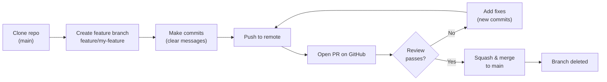

# Code style, pull request, and review guidelines

Contribute to CodeKnit by following these standards for code style, TypeScript practices, component patterns, and git workflows. These guidelines ensure consistent, maintainable code and smooth collaboration with the Lovable integration.

## Code style and linting

CodeKnit enforces code style through **ESLint** and **Prettier**. All TypeScript and React code must pass linting before you open a pull request.

### ESLint configuration

The `eslint.config.js` file defines the project's linting rules. Key rules include:

- **React Hooks rules**: Enforced by `eslint-plugin-react-hooks`. Violations (such as missing dependencies in `useEffect`) will fail the build.
- **React Refresh exports**: Component files must export components, not just constants, unless you mark them with `allowConstantExport: true`.
- **Restricted imports**: The `server-only` package from Next.js is not allowed. Use `.server.ts` file naming or `@tanstack/react-start/server-only` instead.
- **TypeScript best practices**: ESLint extends `typescript-eslint` recommended config, including strict type checking.

Run linting locally:

```bash
npm run lint
```

Fix linting errors automatically where possible:

```bash
npm run lint -- --fix
```

### Prettier formatting

Prettier auto-formats your code for consistent style. Before committing, run:

```bash
npm run format
```

This command rewrites all TypeScript, JavaScript, and configuration files to match the project's style.

## TypeScript best practices

### Strict null checks

CodeKnit uses strict TypeScript configuration. Always account for `null` and `undefined`:

```typescript
// ❌ Avoid: Assumes value is never null
function processSnippet(snippet: Snippet) {
  console.log(snippet.title.length);
}

// ✅ Good: Handle null explicitly
function processSnippet(snippet: Snippet | null) {
  if (!snippet) return;
  console.log(snippet.title.length);
}
```

### Type definitions

Define types in `types.ts` or alongside the component file. Use interfaces for objects, enums for fixed values:

```typescript
// src/types.ts
export interface Snippet {
  id: string;
  title: string;
  language: string;
  category: string;
  tags: string[];
  content: string;
  favorites: number;
  copyCount: number;
  lastUpdated: Date;
}

export enum SnippetLanguage {
  TypeScript = "typescript",
  SQL = "sql",
  Markdown = "markdown",
}
```

### No `any` types

Never use the `any` type. Instead, define a proper type or use generics:

```typescript
// ❌ Avoid
function handleData(data: any) {
  return data.value;
}

// ✅ Good
function handleData<T extends { value: unknown }>(data: T) {
  return data.value;
}
```

## Component patterns

### Functional components with hooks

Write all components as functional components using React hooks. Avoid class components:

```typescript
// ✅ Good: Functional component with hooks
interface SnippetCardProps {
  snippet: Snippet;
  onSelect: (id: string) => void;
}

export function SnippetCard({ snippet, onSelect }: SnippetCardProps) {
  const [isFavorite, setIsFavorite] = useState(false);

  return (
    <div onClick={() => onSelect(snippet.id)}>
      <h3>{snippet.title}</h3>
      <button onClick={() => setIsFavorite(!isFavorite)}>
        {isFavorite ? "★" : "☆"}
      </button>
    </div>
  );
}
```

### Prop destructuring and type-safe interfaces

Always destructure props and define a typed interface:

```typescript
// ❌ Avoid: Props object without destructuring
export function Header(props) {
  return <h1>{props.title}</h1>;
}

// ✅ Good: Destructured props with interface
interface HeaderProps {
  title: string;
  subtitle?: string;
}

export function Header({ title, subtitle }: HeaderProps) {
  return (
    <header>
      <h1>{title}</h1>
      {subtitle && <p>{subtitle}</p>}
    </header>
  );
}
```

### Controlled components

Use controlled components when managing form state. This pattern is used throughout the codebase for consistency:

```typescript
// ✅ Good: Controlled input
interface SearchProps {
  value: string;
  onChange: (value: string) => void;
}

export function SearchInput({ value, onChange }: SearchProps) {
  return (
    <input
      value={value}
      onChange={(e) => onChange(e.target.value)}
      placeholder="Search snippets..."
    />
  );
}
```

## React hooks rules and conventions

### Hooks rules

Follow the Rules of Hooks:

- **Call hooks at the top level** of your component or custom hook; never inside conditionals or loops.
- **Call hooks only from React function components** or custom hooks.

ESLint enforces these rules automatically via `eslint-plugin-react-hooks`.

```typescript
// ❌ Avoid: Hook inside condition
function SearchSnippets() {
  if (shouldSearch) {
    const [query, setQuery] = useState(""); // ❌ Violation
  }
}

// ✅ Good: Hook at top level
function SearchSnippets() {
  const [query, setQuery] = useState("");
  if (!query) return null;
}
```

### Custom hook conventions

Custom hooks follow a naming pattern starting with `use` and return values or state:

```typescript
// ✅ Good: Custom hook for snippet fetching
export function useSnippets(category?: string) {
  const [snippets, setSnippets] = useState<Snippet[]>([]);
  const [loading, setLoading] = useState(false);

  useEffect(() => {
    setLoading(true);
    // Fetch logic
    setLoading(false);
  }, [category]);

  return { snippets, loading };
}

// Usage
function SnippetList() {
  const { snippets, loading } = useSnippets("typescript");
  if (loading) return <Spinner />;
  return <div>{/* render snippets */}</div>;
}
```

## File organization

Organize your code into these directories:

- **`src/components/`**: React components. Group by feature if the app grows.
- **`src/hooks/`**: Custom React hooks (e.g., `useSnippets.ts`, `useCopy.ts`).
- **`src/lib/`**: Utility functions and libraries (e.g., `src/lib/snippets/repository.ts`, `src/lib/snippets/highlight.ts`).
- **`src/types.ts`**: Shared type definitions and interfaces.
- **`src/routes/`**: TanStack Router route definitions.

```
src/
├── components/
│   ├── SnippetCard.tsx
│   ├── SearchInput.tsx
│   └── AppLayout.tsx
├── hooks/
│   ├── useSnippets.ts
│   ├── useCopy.ts
│   └── useFilter.ts
├── lib/
│   ├── snippets/
│   │   ├── repository.ts
│   │   ├── highlight.ts
│   │   └── filter.ts
│   └── utils.ts
├── types.ts
└── routes/
    └── __root.tsx
```

## Naming conventions

- **Components**: Use PascalCase (e.g., `SnippetCard.tsx`, `AppLayout.tsx`).
- **Functions and hooks**: Use camelCase (e.g., `formatDate()`, `useSnippets()`, `copyToClipboard()`).
- **Files**: Match the export name. A file exporting `SnippetCard` should be named `SnippetCard.tsx`.
- **Constants**: Use SCREAMING_SNAKE_CASE for module-level constants (e.g., `MAX_SNIPPET_LENGTH = 5000`).

```typescript
// ✅ Good: File AppLayout.tsx
export function AppLayout({ children }: { children: React.ReactNode }) {
  return <div>{children}</div>;
}

// ✅ Good: Custom hook useSnippets.ts
export function useSnippets(category?: string) {
  // hook logic
}

// ✅ Good: Utility function formatDate.ts
export function formatDate(date: Date): string {
  return date.toLocaleDateString();
}
```

## Pull request process

### Commit messages

Write clear, descriptive commit messages that explain what changed and why:

```
Good:
  "Add filter by language in snippet search"
  "Fix: prevent double submission on form"
  "Docs: update component API in README"

Avoid:
  "fix stuff"
  "asdf"
  "WIP"
```

### Avoid force pushing

**Do not rebase, amend, or force-push commits that are already pushed to the main branch.** This project is synced with Lovable, and rewriting history breaks the editor's project history. See `AGENTS.md` for details.

If you need to fix a commit:
- For unpushed commits: amend locally and push once.
- For pushed commits: create a new commit with the fix.

### Opening a pull request

1. Create a feature branch from `main`: `git checkout -b feature/my-feature`.
2. Make your changes and commit with clear messages.
3. Push your branch: `git push origin feature/my-feature`.
4. Open a pull request with a clear description of what you changed and why.
5. Ensure all checks pass: linting, type checking, and tests.

## Review checklist

When reviewing or submitting code, verify:

### Functionality
- [ ] The feature works as described.
- [ ] Edge cases are handled (empty states, errors, loading states).
- [ ] No console errors or warnings.

### TypeScript and types
- [ ] All variables and functions have explicit types (no `any`).
- [ ] Props interfaces are defined for all components.
- [ ] Null and undefined are handled explicitly.
- [ ] No unused variables or imports.

### Component patterns
- [ ] Components are functional, not class-based.
- [ ] Props are destructured and typed.
- [ ] Controlled components use state correctly.
- [ ] Custom hooks follow naming conventions and return values.

### React and hooks
- [ ] Hooks are called only at the top level (not in conditions or loops).
- [ ] `useEffect` dependencies are correct and complete.
- [ ] No infinite loops or unnecessary re-renders.

### Accessibility
- [ ] Radix UI components are used for interactive elements.
- [ ] Semantic HTML is used (`<button>` instead of `<div onClick>`).
- [ ] ARIA labels are provided where needed.
- [ ] Keyboard navigation works.
- [ ] Color contrast meets WCAG AA standards.

### Responsive design
- [ ] Tailwind CSS is used for styling.
- [ ] Layout works on mobile, tablet, and desktop.
- [ ] No hardcoded pixel widths; use responsive classes.
- [ ] Touch targets are at least 44×44 pixels.

### Code style
- [ ] ESLint passes (`npm run lint`).
- [ ] Prettier formatting is applied (`npm run format`).
- [ ] No restricted imports (e.g., `server-only`).

### Testing
- [ ] Critical user paths are tested.
- [ ] Vitest tests pass locally (`npm run test`).
- [ ] New tests cover new code paths where applicable.

### Documentation
- [ ] JSDoc comments updated for new functions and components.
- [ ] README updated for major features.
- [ ] Type definitions are clear and self-documenting.

## Git workflow summary

This diagram shows the typical feature branch workflow:

Figure: Feature branch workflow


**Key points:**
- Always branch from `main`.
- Write clear, atomic commits.
- Push commits (never force-push pushed history).
- Keep the branch in a working state for Lovable sync.
- Merge via pull request, not direct commits.

## Documentation expectations

### JSDoc comments

Document functions and components with JSDoc. This helps IDEs provide autocomplete and helps other developers understand your code:

```typescript
/**
 * Formats a snippet for display, applying syntax highlighting.
 *
 * @param snippet - The snippet object to format
 * @param language - The language for syntax highlighting
 * @returns Formatted HTML string
 */
export function formatSnippet(snippet: Snippet, language: string): string {
  // implementation
}

/**
 * Card component displaying a single snippet.
 *
 * @param snippet - The snippet to display
 * @param onSelect - Callback fired when snippet is selected
 */
export function SnippetCard({ snippet, onSelect }: SnippetCardProps) {
  // implementation
}
```

### README updates

For new features or significant changes, update the main `README.md` with:
- What the feature does
- How to use it (with examples)
- Any configuration or setup needed

## Quick reference

| Item | Standard |
|------|----------|
| **Linting** | ESLint (run `npm run lint`) |
| **Formatting** | Prettier (run `npm run format`) |
| **Components** | Functional with hooks, PascalCase file names |
| **Props** | Destructured, typed interfaces required |
| **Hooks** | At top level only, custom hooks start with `use` |
| **Types** | Strict null checks, no `any`, define interfaces |
| **Files** | Match export names, organize by `components/`, `hooks/`, `lib/` |
| **Commits** | Clear messages, no force-pushes to pushed history |
| **Testing** | Vitest (`npm run test`), jsdom environment |

---

## Related documentation

- [Contributing to CodeKnit: Code Standards and GitHub Workflow](doc:8ec33934-0dfd-429e-88a1-89fbed259d51)
- [Setting Up CodeKnit Development Environment](doc:4250b87f-66ca-457d-9f4c-995cbfb65108)
- [Unit Testing Strategy: Vitest, jsdom, and Test Examples](doc:79ef8d7b-27d7-41ff-b361-9721a150f157)
- [Data Persistence Layer: SnippetRepository Pattern and localStorage Implementation](doc:34778b37-21c0-4087-91f0-c28fecb57477)
- [Troubleshooting and Debugging](doc:1b203822-fd22-4fd1-ba44-1c369f176899)