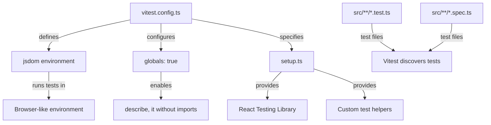

# Test strategy and coverage guide

You'll learn the testing philosophy, strategy, and coverage expectations for CodeKnit. This guide explains how to write effective tests across different layers of the codebase, from pure utility functions to React components and integration workflows.

## Testing philosophy

CodeKnit uses a layered testing approach that matches the project's architecture. We prioritize:

- **Unit tests** for pure functions and business logic (tokenization, filtering, date formatting)
- **Component tests** for React components and hooks using React Testing Library
- **Integration tests** for user workflows (snippet create-edit-delete lifecycle)
- **Accessibility testing** for Radix UI components to ensure inclusive interfaces

This strategy balances test coverage with development velocity. We test the most critical paths thoroughly while keeping test maintenance overhead manageable.

## Test infrastructure and configuration

Figure: Test environment and file discovery



Your test setup is configured in `vitest.config.ts` with the following key settings:

**Environment**: Tests run in `jsdom`, which simulates a browser DOM environment. This lets you test React components that interact with the DOM without running a full browser.

**Global test functions**: `globals: true` means you can use `describe`, `it`, `expect`, and other Vitest functions without importing them. This keeps test files clean and familiar if you've written tests with Jest before.

**Setup file**: `src/test/setup.ts` runs before all tests. This file typically configures React Testing Library, sets up mock implementations, and provides shared test utilities. All tests have access to utilities exported from setup.ts.

**Test file discovery**: Vitest automatically discovers and runs files matching `src/**/*.{test,spec}.{ts,tsx}`. Use `.test.ts` for most unit tests and `.spec.ts` for integration or component tests—both patterns work.

**Path aliases**: The `@` alias resolves to `src/`, so you can import utilities as `import { formatDate } from "@/lib/utils"` in both source and test files.

## Unit testing pure functions

Pure functions are the easiest and most reliable tests to write. Focus on the functions that handle critical logic: tokenization, filtering, and date formatting.

### Testing the syntax tokenizer (highlight.ts)

The tokenizer in `src/lib/snippets/highlight.ts` is a pure function that takes source code and returns an array of tokens. Each token has a type (keyword, string, comment.) and value.

Write unit tests for:

- **Language detection**: Verify the tokenizer correctly identifies tokens for each supported language (SQL, JavaScript, Markdown)
- **Token boundaries**: Ensure tokens are split at correct positions; adjacent tokens don't overlap
- **Edge cases**: Empty strings, single-line and multi-line comments, escaped characters, nested structures

Example test structure:

```typescript
describe("highlight tokenizer", () => {
  it("should tokenize SQL keywords", () => {
    const code = "SELECT * FROM users";
    const tokens = tokenizeSQL(code);
    
    expect(tokens).toContainEqual(
      expect.objectContaining({ type: "keyword", value: "SELECT" })
    );
  });

  it("should handle multi-line comments", () => {
    const code = "/* comment */\nSELECT 1";
    const tokens = tokenizeSQL(code);
    
    expect(tokens.some(t => t.type === "comment")).toBe(true);
  });

  it("should not tokenize empty input", () => {
    const tokens = tokenizeSQL("");
    expect(tokens).toEqual([]);
  });
});
```

**What to test**: Token type correctness, token value accuracy, and that the full input is consumed (no missing characters). Test one language at a time to keep tests focused.

### Testing filter logic (filter.ts)

The filter module in `src/lib/snippets/filter.ts` exports functions that narrow a snippet list by language, category, tags, and search terms. These are pure functions—same input always produces the same output.

Write unit tests for:

- **Single filter application**: Each filter function (filterByLanguage, filterByCategory) correctly identifies matching snippets
- **Filter combination**: Multiple filters compose correctly; a snippet must match all active filters
- **Empty results**: Filters that match nothing return an empty array
- **Case sensitivity**: Search terms handle uppercase and lowercase consistently

Example test structure:

```typescript
describe("snippet filters", () => {
  const snippets = [
    { id: "1", language: "sql", category: "database", tags: ["query"] },
    { id: "2", language: "javascript", category: "ui", tags: ["react"] },
  ];

  it("should filter by language", () => {
    const result = filterByLanguage(snippets, "sql");
    expect(result).toHaveLength(1);
    expect(result[0].id).toBe("1");
  });

  it("should combine filters", () => {
    const filtered = filterByLanguage(snippets, "sql");
    const combined = filterByCategory(filtered, "database");
    
    expect(combined).toHaveLength(1);
  });

  it("should return empty array when no matches", () => {
    const result = filterByLanguage(snippets, "python");
    expect(result).toEqual([]);
  });
});
```

**What to test**: Each filter independently, combined filters, boundary cases (no results, all results), and that original data isn't mutated.

### Testing utility functions (formatDate)

The `formatDate` function in `src/components/LanguageBadge.tsx` converts ISO date strings to human-readable format. This pure function is easy to test and critical for the UI.

Write unit tests for:

- **Valid ISO dates**: "2024-01-15" becomes "Jan 15, 2024"
- **Invalid or missing dates**: Gracefully handle null, undefined, or malformed strings
- **Edge dates**: Year boundaries, leap days

Example test structure:

```typescript
describe("formatDate", () => {
  it("should format valid ISO dates", () => {
    expect(formatDate("2024-01-15")).toBe("Jan 15, 2024");
  });

  it("should handle undefined input", () => {
    expect(formatDate(undefined)).toBe("Unknown");
  });

  it("should handle invalid dates", () => {
    expect(formatDate("not-a-date")).toBe("Invalid date");
  });
});
```

**What to test**: Common input formats, edge dates, and error cases. Keep this test fast—it should run in milliseconds.

## Component testing strategy

React components interact with the DOM, props, state, and hooks. Use React Testing Library to test components from the user's perspective: What can a user see and do?

### Testing react components with jsdom

The jsdom environment provides a minimal DOM implementation. This is fast (no real browser) and sufficient for most React component tests.

React Testing Library provides queries to find elements: `getByRole`, `getByText`, `getByTestId`. Prefer queries that match how users interact with the UI (by role and text) over implementation details (by class name).

Example component test structure:

```typescript
import { render, screen } from "@testing-library/react";
import { SnippetCard } from "@/components/SnippetCard";

describe("SnippetCard", () => {
  it("should display snippet title and language", () => {
    const snippet = {
      id: "1",
      title: "Find users",
      language: "sql",
      code: "SELECT * FROM users",
    };

    render(<SnippetCard snippet={snippet} />);

    expect(screen.getByText("Find users")).toBeInTheDocument();
    expect(screen.getByText("sql")).toBeInTheDocument();
  });

  it("should call onDelete when delete button is clicked", () => {
    const onDelete = vi.fn();
    render(<SnippetCard snippet={mockSnippet} onDelete={onDelete} />);

    screen.getByRole("button", { name: /delete/i }).click();

    expect(onDelete).toHaveBeenCalledWith("1");
  });
});
```

**What to test**:

- **Rendering**: Component renders without errors and displays expected content
- **User interactions**: Button clicks, form submissions, keyboard input trigger expected callbacks
- **Props**: Component correctly uses and responds to prop changes
- **Conditional rendering**: Elements appear and disappear based on state

### Mocking hooks and external dependencies

Some components depend on custom hooks like `useCopy` or external APIs. Mock these to isolate component behavior.

**Mocking navigator.clipboard in useCopy**:

The `useCopy` hook wraps `navigator.clipboard.writeText`. Browsers don't support clipboard in jsdom by default, so the setup file should provide a mock:

```typescript
// src/test/setup.ts
Object.assign(navigator, {
  clipboard: {
    writeText: vi.fn(),
  },
});
```

Then in tests, you can verify clipboard calls:

```typescript
describe("useCopy hook", () => {
  it("should copy text to clipboard", () => {
    const { result } = renderHook(() => useCopy("hello"));

    act(() => {
      result.current.copy();
    });

    expect(navigator.clipboard.writeText).toHaveBeenCalledWith("hello");
  });
});
```

**Mocking API calls**:

If components fetch data, mock the fetch or axios call:

```typescript
vi.mock("@/api/snippets", () => ({
  fetchSnippets: vi.fn(() =>
    Promise.resolve([{ id: "1", title: "Test" }])
  ),
}));
```

Then test that the component handles loading and success states.

### Testing radix UI components and accessibility

Radix UI components are accessible by default and use ARIA attributes. When testing Radix components, use queries that respect accessibility:

```typescript
describe("Dialog component with Radix", () => {
  it("should open and close dialog", async () => {
    render(<DialogExample />);

    const openButton = screen.getByRole("button", { name: /open/i });
    openButton.click();

    const dialog = screen.getByRole("dialog");
    expect(dialog).toBeInTheDocument();

    const closeButton = screen.getByRole("button", { name: /close/i });
    closeButton.click();

    expect(dialog).not.toBeInTheDocument();
  });

  it("should have proper ARIA labels", () => {
    render(<DialogExample />);
    const dialog = screen.getByRole("dialog");

    expect(dialog).toHaveAttribute("aria-labelledby");
  });
});
```

Use `getByRole` to query Radix components. Radix assigns proper ARIA roles, making this natural. Verify that focus management, keyboard navigation (Escape to close), and ARIA labels work as expected.

## Integration testing for workflows

Integration tests verify that multiple components and functions work together correctly. Focus on critical user workflows.

### Testing the snippet lifecycle (create-edit-delete)

A key workflow is: User creates a snippet → User edits it → User deletes it. Test this end-to-end by rendering a complete page or feature and simulating user actions.

Example integration test structure:

```typescript
describe("Snippet lifecycle", () => {
  it("should create, edit, and delete a snippet", async () => {
    render(<SnippetManager />);

    // Create
    screen.getByRole("button", { name: /new snippet/i }).click();
    screen.getByLabelText(/title/i).value = "My Query";
    screen.getByLabelText(/code/i).value = "SELECT *";
    screen.getByRole("button", { name: /save/i }).click();

    await waitFor(() => {
      expect(screen.getByText("My Query")).toBeInTheDocument();
    });

    // Edit
    screen.getByRole("button", { name: /edit/i }).click();
    screen.getByLabelText(/title/i).value = "My Updated Query";
    screen.getByRole("button", { name: /save/i }).click();

    await waitFor(() => {
      expect(screen.getByText("My Updated Query")).toBeInTheDocument();
    });

    // Delete
    screen.getByRole("button", { name: /delete/i }).click();
    screen.getByRole("button", { name: /confirm delete/i }).click();

    await waitFor(() => {
      expect(screen.queryByText("My Updated Query")).not.toBeInTheDocument();
    });
  });
});
```

**What to test**:

- Initial state: Page renders with correct defaults
- Create: Form submission creates a new item and updates the UI
- Edit: Changes persist and UI reflects updates
- Delete: Item is removed from the list
- Error handling: Invalid input shows error messages; API failures are handled gracefully

### Testing filter and search workflows

Test that combining filters and search produces correct results:

```typescript
describe("Filter and search workflow", () => {
  it("should filter by language and search text", async () => {
    render(<SnippetLibrary />);

    // Apply language filter
    screen.getByRole("combobox", { name: /language/i }).click();
    screen.getByRole("option", { name: /sql/i }).click();

    // Enter search text
    screen.getByPlaceholderText(/search/i).value = "users";

    await waitFor(() => {
      const cards = screen.getAllByRole("article"); // Assume cards are articles
      cards.forEach(card => {
        expect(card.textContent).toMatch(/users/i);
        expect(card.textContent).toMatch(/sql/i);
      });
    });
  });
});
```

## Test data and fixtures

Maintain a fixture file with common test data to avoid repeating snippet definitions:

```typescript
// src/test/fixtures/snippets.ts
export const mockSnippets = {
  sqlQuery: {
    id: "sql-1",
    language: "sql",
    category: "database",
    title: "Find Active Users",
    code: "SELECT * FROM users WHERE active = true",
    tags: ["query", "users"],
    createdAt: "2024-01-15",
  },
  jsFunction: {
    id: "js-1",
    language: "javascript",
    category: "functions",
    title: "Debounce",
    code: "const debounce = (fn, delay) => { ... }",
    tags: ["utility", "react"],
    createdAt: "2024-01-14",
  },
  markdownGuide: {
    id: "md-1",
    language: "markdown",
    category: "docs",
    title: "Git Workflow",
    code: "# Git Workflow\n## Branches\n...",
    tags: ["git", "docs"],
    createdAt: "2024-01-13",
  },
};
```

Then import and use in tests:

```typescript
import { mockSnippets } from "@/test/fixtures/snippets";

it("should display SQL snippet", () => {
  render(<SnippetCard snippet={mockSnippets.sqlQuery} />);
  expect(screen.getByText("Find Active Users")).toBeInTheDocument();
});
```

**Benefits**: Consistent test data, easy to add scenarios (multilingual snippets, edge cases), and changes to data shape update all tests automatically.

## Running tests

### Development: Watch mode

Use watch mode while developing to get instant feedback:

```bash
npm run test:watch
```

Vitest re-runs tests when you save files. Press `p` to filter by filename, `t` to filter by test name, or `q` to quit. Watch mode is fast—only affected tests rerun.

### CI: Single run

Run all tests once in continuous integration:

```bash
npm run test
```

This runs the full test suite and exits. Use this in GitHub Actions, GitLab CI, or similar.

## Coverage targets and priorities

Aim for 80% overall coverage, but prioritize:

**High priority** (target 95%+ coverage):

- Syntax tokenizer (`src/lib/snippets/highlight.ts`): Incorrect tokenization breaks syntax highlighting across the entire app
- Filter logic (`src/lib/snippets/filter.ts`): Wrong filtering returns incorrect search results
- Form validation and error handling: Users see unclear errors if validation doesn't work

**Medium priority** (target 80%+ coverage):

- React components: Buttons, forms, cards, modals
- Custom hooks: useCopy, useSnippets, any hook that manages state
- Utility functions: formatDate, string helpers, API client wrappers

**Lower priority** (target 50%+ coverage):

- UI edge cases: Responsive breakpoints, theme switching
- Rarely executed error paths: Network timeouts, permission errors
- Styling and layout tests: Harder to test, lower value

Run coverage regularly to identify gaps:

```bash
npm run test -- --coverage
```

This generates a coverage report showing which lines, branches, and functions are untested.

## Mocking strategies

### Mocking navigator.clipboard

The setup file should mock `navigator.clipboard`:

```typescript
// src/test/setup.ts
Object.assign(navigator, {
  clipboard: {
    writeText: vi.fn(() => Promise.resolve()),
  },
});
```

Then in hook tests, verify the mock was called:

```typescript
it("should write to clipboard", async () => {
  const { result } = renderHook(() => useCopy("text"));
  
  await act(async () => {
    await result.current.copy();
  });

  expect(navigator.clipboard.writeText).toHaveBeenCalledWith("text");
});
```

### Mocking fetch and API calls

Mock API calls so tests don't depend on network:

```typescript
// Mock at module level
vi.mock("@/lib/api", () => ({
  fetchSnippets: vi.fn(),
}));

import { fetchSnippets } from "@/lib/api";

describe("SnippetList", () => {
  it("should load and display snippets", async () => {
    fetchSnippets.mockResolvedValue([
      { id: "1", title: "Test" },
    ]);

    render(<SnippetList />);

    await waitFor(() => {
      expect(screen.getByText("Test")).toBeInTheDocument();
    });
  });

  it("should handle fetch errors", async () => {
    fetchSnippets.mockRejectedValue(new Error("Network error"));

    render(<SnippetList />);

    await waitFor(() => {
      expect(screen.getByText(/failed to load/i)).toBeInTheDocument();
    });
  });
});
```

### Mocking date and time

Use `vi.useFakeTimers()` for consistent date tests:

```typescript
it("should format current date", () => {
  vi.setSystemTime("2024-01-15");
  
  expect(getCurrentDateString()).toBe("Jan 15, 2024");
  
  vi.useRealTimers();
});
```

## Testing accessibility with radix UI

Radix UI components include proper ARIA attributes. Test accessibility by:

**Using accessible queries**: Prefer `getByRole`, `getByLabelText`, and `getByPlaceholderText` over `getByTestId`:

```typescript
// Good: matches how users find elements
expect(screen.getByRole("button", { name: /save/i })).toBeInTheDocument();

// Avoid: implementation detail
expect(screen.getByTestId("save-btn")).toBeInTheDocument();
```

**Verifying focus management**: Dialogs and dropdowns should trap focus:

```typescript
it("should trap focus in dialog", () => {
  render(<Dialog isOpen={true} />);

  const dialog = screen.getByRole("dialog");
  const buttons = within(dialog).getAllByRole("button");

  // Verify focus moves within dialog, not outside
  buttons[buttons.length - 1].focus();
  fireEvent.keyDown(buttons[buttons.length - 1], { key: "Tab" });

  expect(buttons[0]).toHaveFocus();
});
```

**Checking ARIA attributes**: Ensure components have proper labels and descriptions:

```typescript
it("should have descriptive ARIA label", () => {
  render(<Dialog title="Delete snippet?" />);

  const dialog = screen.getByRole("dialog");
  expect(dialog).toHaveAttribute("aria-labelledby");
  expect(dialog).toHaveAttribute("aria-describedby");
});
```

**Testing keyboard navigation**: Menus and dropdowns should respond to arrow keys and Enter:

```typescript
it("should navigate dropdown with arrow keys", () => {
  render(<Dropdown />);

  const trigger = screen.getByRole("button");
  trigger.click();

  const option1 = screen.getByRole("option", { name: /first/i });
  option1.focus();

  fireEvent.keyDown(option1, { key: "ArrowDown" });

  const option2 = screen.getByRole("option", { name: /second/i });
  expect(option2).toHaveFocus();
});
```

## Best practices

**Keep tests focused**: Each test verifies one behavior. If a test has multiple assertions, consider splitting it.

**Use descriptive test names**: `it("should tokenize SQL keywords")` is clearer than `it("tokenizes")`.

**Avoid implementation details**: Test what users do and see, not how components work internally. Avoid testing internal state.

**Use test fixtures**: Maintain common mock data in `src/test/fixtures/` to reduce duplication.

**Mock external dependencies**: Mock APIs, timers, clipboard, and browser APIs so tests run offline and fast.

**Run tests frequently**: Use watch mode during development. Full runs should take under 10 seconds for fast feedback.

**Keep setup.ts minimal**: Only add truly global utilities. Test-specific mocks belong in individual tests.

**Use act() for state updates**: When testing hooks or state changes, wrap updates in `act()`:

```typescript
act(() => {
  setSnippet({ ...snippet, title: "New" });
});
```

## See also

- [Unit Testing Strategy: Vitest, jsdom, and Test Examples](doc:79ef8d7b-27d7-41ff-b361-9721a150f157)
- [Syntax Highlighting System Design](doc:f61a6d46-c460-4460-b318-2258ec30ceca)
- [Snippet Filtering and Query API Design](doc:8dfd3894-c92c-4bd1-af0c-38e69f26db5b)