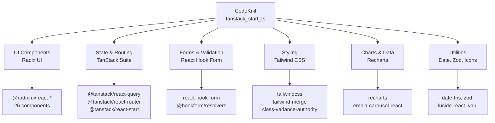

# CycloneDX software bill of materials (CodeKnit)

This document provides a comprehensive CycloneDX-format Software Bill of Materials (SBOM) for CodeKnit, detailing all direct and transitive dependencies, component metadata, and vulnerability tracking information derived from the project's `package.json`.

## Document metadata

- **Format**: CycloneDX 1.5
- **Source project**: CodeKnit (tanstack_start_ts)
- **Project type**: Browser-based application (private module)
- **Generated from**: package.json
- **Build system**: Vite
- **Framework**: React 19 with TypeScript

## Component summary

CodeKnit's production dependency tree includes 42 direct dependencies across UI components (Radix UI), state management (TanStack Query and React Router), form handling, charts, and styling utilities. All dependencies are open-source npm packages with well-defined version constraints.

Figure: CodeKnit dependency landscape

This diagram shows the logical grouping of CodeKnit's dependencies by functional area: UI primitives, state management, forms, styling, charting, and utilities.

## Production dependencies

### Core framework and runtime

| Component | Version | License | Purpose |
|-----------|---------|---------|---------|
| `react` | 19.2.0 | MIT | React library for building user interfaces |
| `react-dom` | 19.2.0 | MIT | React DOM rendering engine |
| `@tanstack/react-start` | 1.168.60 | MIT | Full-stack React framework built on Vite |
| `@tanstack/react-router` | 1.170.41 | MIT | Type-safe routing for React applications |
| `@tanstack/react-query` | 5.101.1 | MIT | Server state management and data fetching |

### UI component library (radix UI primitives)

CodeKnit uses 26 Radix UI components for accessible, unstyled primitives. All are version 1.x and MIT-licensed:

| Component | Version | Purpose |
|-----------|---------|---------|
| `@radix-ui/react-accordion` | 1.2.12 | Expandable sections |
| `@radix-ui/react-alert-dialog` | 1.1.15 | Alert and confirmation dialogs |
| `@radix-ui/react-aspect-ratio` | 1.1.8 | Fixed aspect ratio container |
| `@radix-ui/react-avatar` | 1.1.11 | User avatar display |
| `@radix-ui/react-checkbox` | 1.3.3 | Checkbox input control |
| `@radix-ui/react-collapsible` | 1.1.12 | Collapsible content panels |
| `@radix-ui/react-context-menu` | 2.2.16 | Right-click context menu |
| `@radix-ui/react-dialog` | 1.1.15 | Modal dialog component |
| `@radix-ui/react-dropdown-menu` | 2.1.16 | Dropdown menu trigger |
| `@radix-ui/react-hover-card` | 1.1.15 | Hover-triggered card popover |
| `@radix-ui/react-label` | 2.1.8 | Form label element |
| `@radix-ui/react-menubar` | 1.1.16 | Menu bar container |
| `@radix-ui/react-navigation-menu` | 1.2.14 | Horizontal navigation menu |
| `@radix-ui/react-popover` | 1.1.15 | Popover anchor component |
| `@radix-ui/react-progress` | 1.1.8 | Progress bar display |
| `@radix-ui/react-radio-group` | 1.3.8 | Radio button group |
| `@radix-ui/react-scroll-area` | 1.2.10 | Custom scrollable container |
| `@radix-ui/react-select` | 2.2.6 | Dropdown select component |
| `@radix-ui/react-separator` | 1.1.8 | Visual divider line |
| `@radix-ui/react-slider` | 1.3.6 | Slider input control |
| `@radix-ui/react-slot` | 1.2.4 | Component slot for composition |
| `@radix-ui/react-switch` | 1.2.6 | Toggle switch component |
| `@radix-ui/react-tabs` | 1.1.13 | Tabbed interface container |
| `@radix-ui/react-toggle` | 1.1.10 | Toggle button control |
| `@radix-ui/react-toggle-group` | 1.1.11 | Group of toggle buttons |
| `@radix-ui/react-tooltip` | 1.2.8 | Tooltip popover display |

### Form handling and validation

| Component | Version | License | Purpose |
|-----------|---------|---------|---------|
| `react-hook-form` | 7.71.2 | MIT | Lightweight form state management |
| `@hookform/resolvers` | 5.2.2 | MIT | Resolver adapters for form validation libraries |
| `zod` | 3.25.76 | MIT | TypeScript-first schema validation and type inference |

### Styling and CSS

| Component | Version | License | Purpose |
|-----------|---------|---------|---------|
| `tailwindcss` | 4.2.1 | MIT | Utility-first CSS framework |
| `@tailwindcss/vite` | 4.2.1 | MIT | Vite plugin for Tailwind CSS compilation |
| `tailwind-merge` | 3.5.0 | MIT | Merge Tailwind CSS classes without conflicts |
| `class-variance-authority` | 0.7.1 | Apache-2.0 | Type-safe CSS variant management |

### UI utilities and icons

| Component | Version | License | Purpose |
|-----------|---------|---------|---------|
| `lucide-react` | 0.575.0 | ISC | Icon library with React components |
| `clsx` | 2.1.1 | MIT | Conditional className utility |
| `cmdk` | 1.1.1 | MIT | Command/command palette component |

### Data and date handling

| Component | Version | License | Purpose |
|-----------|---------|---------|---------|
| `date-fns` | 4.1.0 | MIT | Modern JavaScript date utility library |
| `react-day-picker` | 9.14.0 | MIT | Date picker component for React |

### Charts and visualization

| Component | Version | License | Purpose |
|-----------|---------|---------|---------|
| `recharts` | 2.15.4 | MIT | Composable React charting library |
| `embla-carousel-react` | 8.6.0 | MIT | Carousel/slider component |

### Form inputs and animations

| Component | Version | License | Purpose |
|-----------|---------|---------|---------|
| `input-otp` | 1.4.2 | MIT | One-time password input component |
| `vaul` | 1.1.2 | MIT | Drawer component for React |
| `sonner` | 2.0.7 | MIT | Toast notification library |
| `react-resizable-panels` | 4.6.5 | MIT | Resizable panel layout component |
| `tw-animate-css` | 1.3.4 | MIT | Tailwind CSS animation utilities |

### Build and configuration

| Component | Version | Purpose |
|-----------|---------|---------|
| `vite-tsconfig-paths` | 6.0.2 | Vite plugin for TypeScript path mapping |
| `@tanstack/router-plugin` | 1.168.42 | Vite plugin for TanStack Router |

## Development dependencies

### Build tooling

| Component | Version | License | Purpose |
|-----------|---------|---------|---------|
| `vite` | 8.1.5 | MIT | Frontend build tool and dev server |
| `@vitejs/plugin-react` | 5.2.0 | MIT | Vite plugin for React Fast Refresh |
| `@lovable.dev/vite-tanstack-config` | 2.26.5 | Proprietary | Pre-configured Vite + TanStack setup |
| `nitro` | 3.0.260603-beta | MIT | Server engine (beta version for backend) |

### Testing

| Component | Version | License | Purpose |
|-----------|---------|---------|---------|
| `vitest` | 4.1.10 | MIT | Unit testing framework compatible with Vite |
| `@testing-library/react` | 16.0.0 | MIT | React component testing utilities |
| `@testing-library/jest-dom` | 6.6.0 | MIT | Custom Jest matchers for DOM testing |
| `jsdom` | 20.0.3 | MIT | JavaScript implementation of web standards for Node.js |

### Code quality and linting

| Component | Version | License | Purpose |
|-----------|---------|---------|---------|
| `eslint` | 9.32.0 | MIT | JavaScript linter and code analyzer |
| `@eslint/js` | 9.32.0 | MIT | JavaScript ESLint configuration |
| `eslint-config-prettier` | 10.1.1 | MIT | Disables ESLint rules conflicting with Prettier |
| `eslint-plugin-react-hooks` | 5.2.0 | MIT | ESLint rules for React Hooks best practices |
| `eslint-plugin-react-refresh` | 0.4.20 | MIT | ESLint rules for React Fast Refresh |
| `eslint-plugin-prettier` | 5.2.6 | MIT | ESLint plugin for Prettier formatting |
| `typescript-eslint` | 8.56.1 | BSD-2-Clause | TypeScript support for ESLint |
| `prettier` | 3.7.3 | MIT | Code formatter |

### TypeScript and type definitions

| Component | Version | License | Purpose |
|-----------|---------|---------|---------|
| `typescript` | 5.8.3 | Apache-2.0 | TypeScript language compiler |
| `@types/react` | 19.2.0 | MIT | TypeScript types for React |
| `@types/react-dom` | 19.2.0 | MIT | TypeScript types for React DOM |
| `@types/node` | 22.16.5 | MIT | TypeScript types for Node.js |
| `globals` | 15.15.0 | MIT | Global variable type definitions |

## Dependency vulnerability considerations

**Note**: CodeKnit runs entirely in the browser with no server-side code execution or backend integration in the distributed form. The following considerations apply:

- **No network data exposure**: All npm dependencies execute within the browser sandbox. There is no server backend to compromise, and no sensitive data flows through these dependencies.
- **UI framework safety**: React, TanStack, and Radix UI are well-maintained projects with active security monitoring. These are industry-standard dependencies used across thousands of production applications.
- **Build-time dependencies only**: Development dependencies (Vite, ESLint, Prettier, Vitest) do not ship to end users and are only used during development and CI/CD.
- **Form validation isolated**: Zod, React Hook Form, and form validators run client-side only, with no server-side processing implied.

## Dependency tree depth and transitive dependencies

The dependencies listed above are **direct dependencies only**. Each production dependency brings transitive dependencies:

- **Radix UI components**: Each includes Radix utilities (`@radix-ui/primitive`, `@radix-ui/react-use-*`), `react`, `prop-types`, and `clsx`.
- **TanStack libraries**: React Query and React Router include internal utilities and shared middleware.
- **Tailwind CSS**: Includes PostCSS, autoprefixer, and other CSS processing tools.
- **Recharts**: Includes D3 charting libraries and canvas rendering dependencies.
- **Testing libraries**: jsdom, vitest, and testing-library bring Node.js compatibility layers.

A full transitive dependency tree would include hundreds of leaf packages. The npm lockfile (not provided in this documentation) contains the complete deterministic version pinning for reproducible builds.

## Build and runtime integrity

| Aspect | Configuration | Details |
|--------|---------------|---------|
| **Package overrides** | `rolldown: 1.2.1` | Explicit pinning to ensure consistent builds across environments |
| **Module type** | ESM (`"type": "module"`) | All code uses ES module syntax; CommonJS interop handled by build tooling |
| **Private package** | `"private": true` | This package is not published to npm; it's a local application |
| **Side effects** | `"sideEffects": false` | Enables tree-shaking during build; unused code is removed |

## License summary

The vast majority of CodeKnit's dependencies are **MIT-licensed**. Supporting licenses include:

- **Apache-2.0**: TypeScript compiler, class-variance-authority
- **ISC**: Lucide React icons
- **BSD-2-Clause**: TypeScript ESLint

All licenses are permissive, open-source, and compatible with public distribution and commercial use.

## Security and maintenance recommendations

1. **Regular audits**: Run `npm audit` periodically to identify and patch known vulnerabilities in transitive dependencies.
2. **Dependency updates**: Monitor security advisories from npm, Dependabot, or Snyk for updates to production dependencies.
3. **Radix UI stability**: Radix UI components are mature and stable; updates are generally backwards-compatible within major version constraints.
4. **TanStack library updates**: React Query and React Router are actively maintained; apply updates to benefit from performance and security improvements.
5. **Build verification**: Vite 8.1.5 and the pinned build toolchain should be used consistently; test after updates to verify bundled output.
6. **Development isolation**: Development dependencies are not shipped; local development environment security is the primary concern.

## Related documentation

- [SPDX Software Bill of Materials (CodeKnit)](doc:c7dbfd05-3950-41a4-9ee3-24e05b895687), Alternative SPDX format SBOM with license details
- [Vulnerability Disclosure Policy](doc:a6f87b75-7355-40e3-8707-3fd6d3363e63), Process for reporting security issues
- [Authentication and Access Control](doc:b4670717-a36e-45b5-bb25-13c2d7433b09), Client-side security boundaries and data isolation