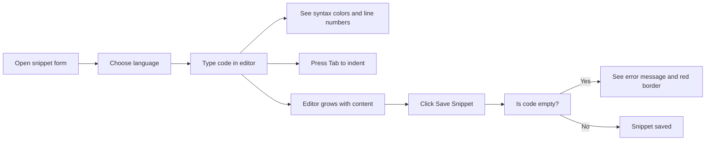
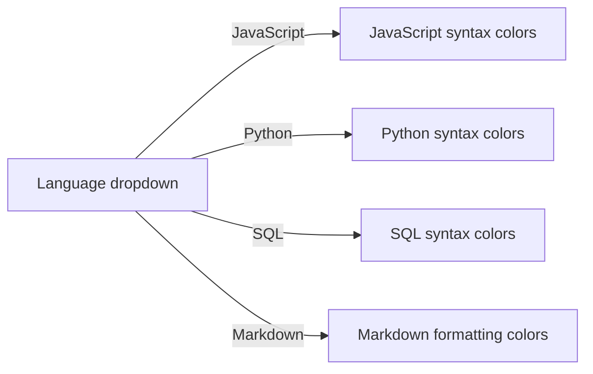
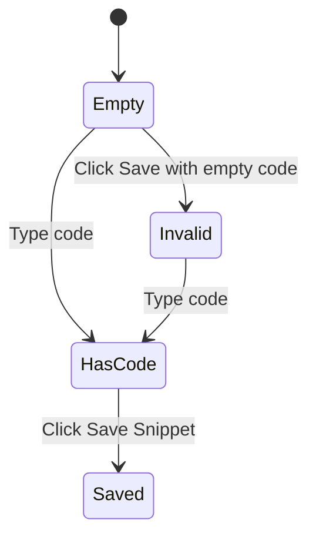

# Code editing

Code Editing is the writing area inside the snippet form that helps you enter, format, and review code while creating or updating a snippet. It’s designed for developers who want visual feedback as they type, clean indentation, and confidence that a snippet will save correctly.

When you open the form to create a new snippet or edit an existing one, the Code section shows a dedicated editor rather than a plain text box. As you type, the editor:

- Colors your code according to the language you selected
- Shows line numbers down the left side
- Keeps your indentation consistent when you press Tab
- Grows taller to show more lines, then scrolls when your code gets long
- Flags missing code when you try to save

The editor focuses on writing and reviewing one snippet at a time in a single language.

## The editor experience

The flow below shows how the editor fits into creating or updating a snippet.

Figure: Code writing and saving flow in the snippet form

You don’t need to switch tools or remember syntax conventions. The editor reflects your language choice immediately and gives you consistent formatting as you work.

## Syntax highlighting

The editor supports four languages:

- JavaScript
- Python
- SQL
- Markdown

When you pick a language in the **Language** dropdown, the editor applies colors to the code according to that language. Keywords, strings, comments, and numbers appear in distinct colors so you can quickly scan your code while typing.

Figure: Language selection determines the highlighting colors

The same highlighting appears when your snippet is displayed in cards and the detailed view, so what you see in the editor matches what you’ll see later in your library.

## Tab indentation

In the editor, pressing the **Tab** key inserts two spaces at the current cursor position instead of moving focus out of the field. This keeps indentation uniform and lets you structure code blocks with repeated presses.

- Press **Tab** to indent
- The cursor stays in the code so you can continue typing at the indented position

This is especially useful for writing nested blocks in JavaScript, Python, SQL, or code examples in Markdown.

## Line numbers and automatic sizing

As your code grows, the editor:

- Shows a numbered gutter on the left so you always know which line you’re on
- Grows taller to fit more lines, up to a comfortable maximum
- Scrolls inside the box when your code gets long, so the form remains usable

Line numbers update automatically based on the number of lines. The editor starts with room for at least eight lines even when empty.

## Validation before saving

Before a snippet can be saved, the form checks that the code section isn’t empty. If you click **Save Snippet** without entering any code:

- The editor border turns red
- A message appears below the field:`Code is required.`
- The snippet is not saved until you add code

This catches incomplete snippets early, so empty code entries don’t end up in your library.

Figure: Code field validation states

## Boundaries

The editor is intentionally lightweight and focused on capturing reusable snippets:

- No code autocomplete or suggestions appear as you type
- No refactoring tools, multi-cursor editing, or other advanced IDE features are included
- You can paste code directly into the editor; it does not reformat or alter pasted text
- Each snippet uses one language at a time

These boundaries keep the editor simple, fast, and predictable for saving code you want to reuse.

## Related

- [Snippet Management](doc:d875ccc9-b2fb-4c86-82a0-190a6952a4c7), create and edit snippets
- [Code Preview and Highlighting](doc:1af35ce8-def3-409e-a761-91543f16f3d9), how code appears outside the editor
- [Search and Filtering](doc:d4db354c-9033-416f-babe-aaab07cc3975), find saved snippets by language
- [Snippet Organization](doc:c88b9d7b-71f1-4365-b228-3a4ca18a9db4), navigate by language and category
- [Understanding Snippet Metadata](doc:0454440c-0145-46fc-910a-1e0a7ef4c962), language, category, and other fields
