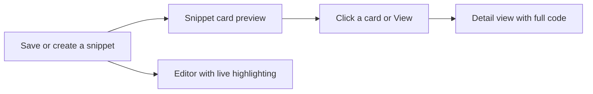
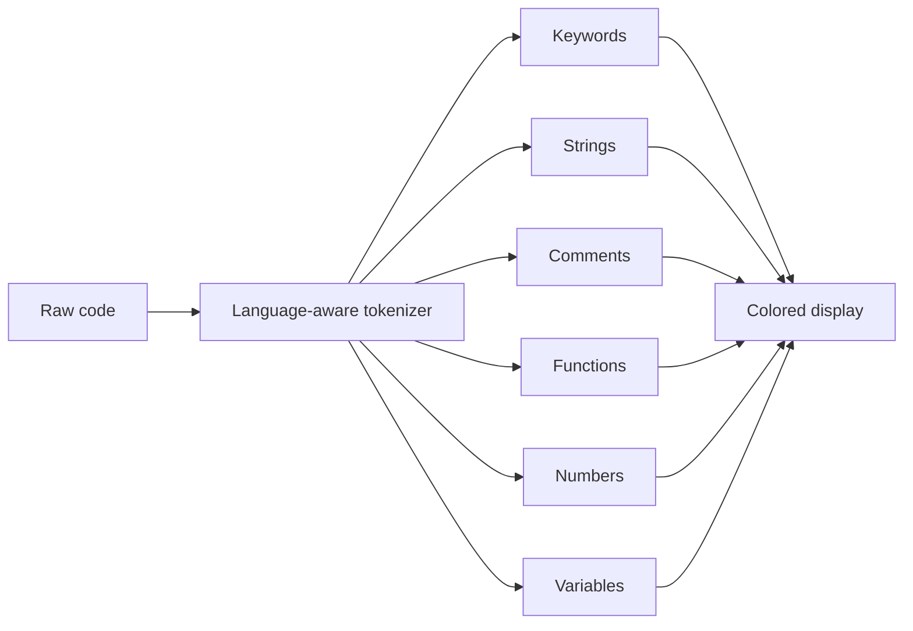
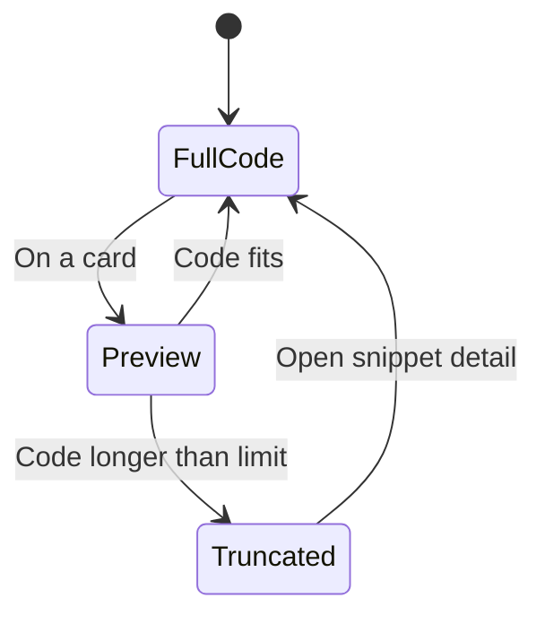

# Code preview and highlighting

Code Preview and Highlighting makes every snippet easier to read by applying syntax colors to the different parts of your code and numbering each line for quick reference. You'll see highlighted code on every snippet card, in the expanded detail view, and live in the editor while you type.

## What you can do

When you save a snippet, CodeKnit automatically recognizes the language you selected and colors the code accordingly. Keywords, strings, comments, functions, numbers, and variables each get their own distinct color, so you can scan a block of code and immediately recognize its structure. Line numbers appear along the left edge, making it easy to point to a specific line when discussing or reviewing a snippet.

On snippet cards, long code is automatically trimmed so cards stay compact. A **+N more lines** indicator appears at the bottom of the preview, and you can open the full snippet to see everything.

## Where highlighting appears

Code Preview and Highlighting is present in three places:

- **Snippet cards**, a compact, truncated preview of the first few lines
- **Detail view**, the full, scrollable code shown in a larger dialog
- **Editor**, live, real-time highlighting as you type or paste code into the snippet form

Figure: Where code highlighting appears

## Syntax colors

Each language uses a consistent set of colors so that the same kind of code element always looks the same across every snippet. This helps you recognize patterns at a glance.

| Code element | How it's shown |
| --- | --- |
| Keywords (for example,`if`,`return`,`import`) | Distinct keyword color |
| Strings (text values in quotes) | String color |
| Comments | Italicized with a muted comment color |
| Function names | Function color |
| Numbers | Number color |
| Variables | Variable color |
| Punctuation | Muted color |

Support for these colors depends on the language of the snippet. Code written in **JavaScript**, **Python**, **SQL**, or **Markdown** is highlighted. Markdown includes additional visual cues such as headings in bold, bold text, and underlined links, so reading documentation-style snippets is also easier.

Figure: How code is broken into colored parts

## Line numbers

Line numbers are shown by default on every code preview and in the editor. The numbers run down the left side and correspond exactly to the lines of code, so you can refer to "line 4" and know everyone else looking at the same snippet will see the same line.

Line numbers are not selectable, they are a visual aid only, so copying code from a snippet never includes the line numbers.

## Truncated previews on cards

To keep snippet cards from becoming too large, each card shows only the first several lines of code. The exact number depends on the layout:

- **Grid view** cards show up to 8 lines
- **List view** cards show up to 6 lines

If a snippet is longer than the limit, a subtle fade appears at the bottom of the preview along with a **+N more lines** indicator, where N is the number of hidden lines. Opening the snippet shows the complete code.

Figure: Truncation flow for snippet previews

## Full code in the detail view

When you open a snippet by clicking its card or selecting **View**, the detail dialog shows the entire code block with the same syntax coloring and line numbers. If the code is very long, the preview area becomes scrollable so you can move through it without the dialog growing beyond the screen.

## Live highlighting in the editor

When you create or edit a snippet, the code editor highlights your code as you type. This means you see the final colored result immediately, line by line, rather than only after saving. The editor also shows line numbers and keeps them aligned as you add or remove lines.

The editor supports pressing **Tab** to indent code by two spaces, and the text area scrolls automatically as your code grows.

## Supported languages

Highlighting works with these languages:

- **JavaScript**
- **Python**
- **SQL**
- **Markdown**

The color each snippet receives depends on the language selected when it was created or last edited. The same language colors are also reflected in the language badge next to each snippet, with a small colored dot that matches the language's syntax accent color.

## Boundaries and limits

- **Highlighting is pattern-based, not a full language parser.** In unusual or complex code, occasional elements may not be colored exactly as a dedicated language tool would color them. Basic code structures are covered reliably.
- **No copy from the preview area itself.** The highlighted preview is read-only. To copy code, use the **Copy** or **Copy code** button on the card or in the detail view.
- **No click-to-edit from the preview.** You can't select or edit directly inside the preview block. Use the **Edit** button on the card or in the detail view to open the editor.
- **Line numbers cannot be hidden by end users.** They are always displayed in the current app, although the underlying display component supports turning them off for other contexts.

## Related

- [Snippet Management](doc:d875ccc9-b2fb-4c86-82a0-190a6952a4c7)
- [Code Editing](doc:2cbb8fac-e41c-44bf-93bd-7fc333e72aa0)
- [Dashboard](doc:73800e45-b85d-4bd0-9a64-7620aa9bdf7e)
- [Product Overview and Key Concepts](doc:3a2f38ea-1eb7-45d0-91ef-d101d4eb349c)
