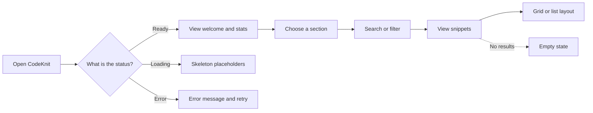
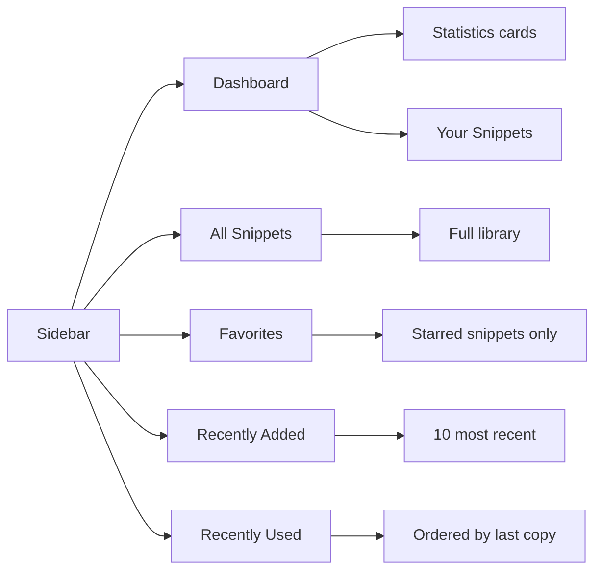
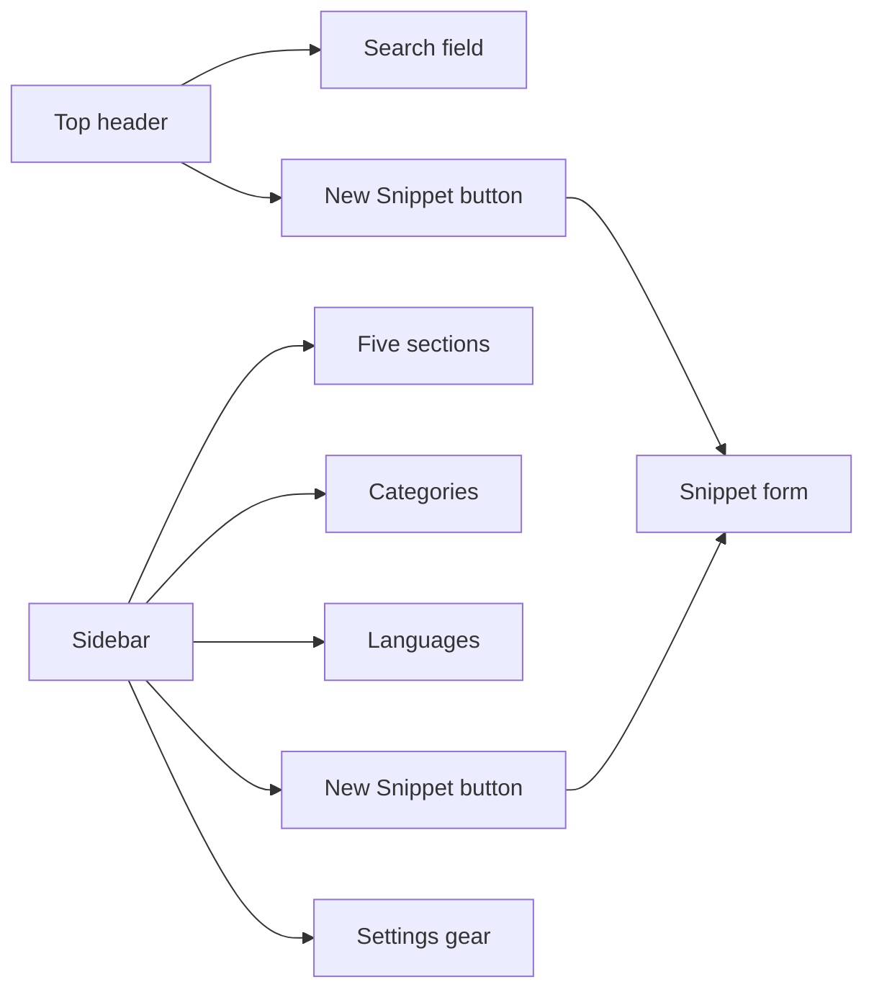
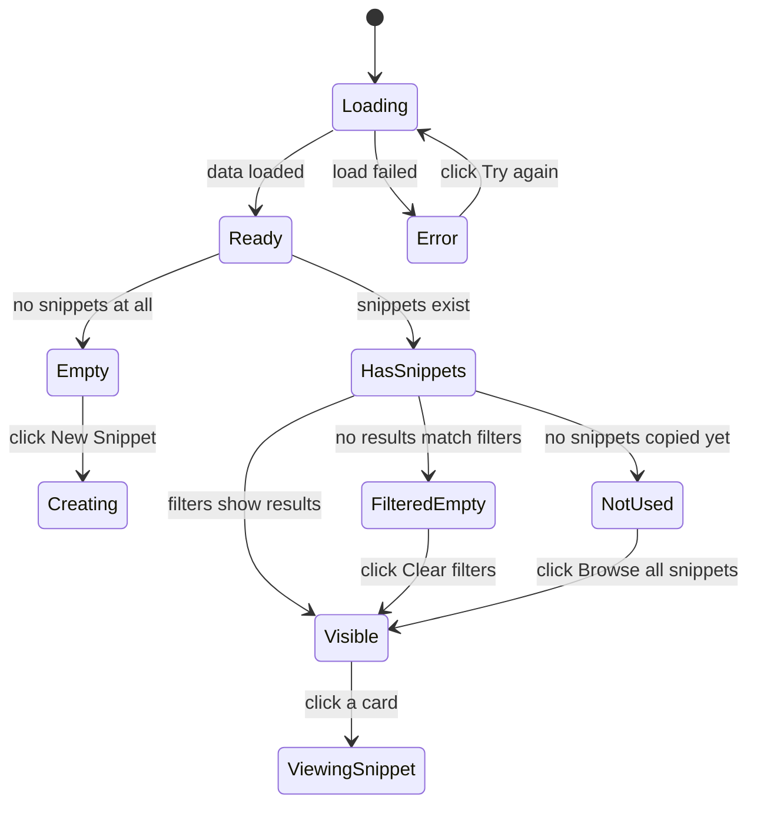

# Dashboard

CodeKnit's dashboard is your home base for managing a personal snippet library. It gives you an at-a-glance view of what you have saved, quick access to common actions, and a clear path into any part of your collection. Whether you are opening CodeKnit for the first time or returning to find a snippet you saved weeks ago, the dashboard is where you start.

## Who the dashboard is for

The dashboard is for everyone who uses CodeKnit. It is especially useful when you want to:

- Quickly check how many snippets you have saved and which languages they cover
- Jump straight to creating a new snippet
- Move between your full collection, favorites, recently added snippets, and recently used snippets
- Get oriented when the library is empty

New users see a friendly welcome message and a guided starting point. Experienced users get immediate visibility into the size and shape of their library before drilling into the detail.

## What you see on the dashboard

When your library is ready, the dashboard greets you with the heading **"Your code, organized."** and a short subtitle: "Save, discover, and reuse your best snippets." Below that, three statistics cards appear:

| Card | What it shows | Helpful hint |
| --- | --- | --- |
| **Total snippets** | Number of snippets in your library | "in your library" |
| **Favorites** | Number of snippets marked as favorite | "starred for quick access" |
| **Languages** | Number of distinct programming languages | The actual language names, or "none yet" |

These cards update automatically as you add, remove, or favorite snippets. They are summaries, not historical records. There is no trend line or change-over-time view.

Below the statistics cards, the dashboard shows the **Your Snippets** section. This area includes the filter bar, the layout toggle, and the snippets themselves in either a grid or a list. For more on how snippets can be filtered, see [Search and Filtering](doc:d4db354c-9033-416f-babe-aaab07cc3975).

Figure: Dashboard overview flow

## Navigating between sections

The dashboard is one of five built-in views, each accessible from the sidebar:

- **Dashboard**, the overview page with statistics cards and the general snippet area
- **All Snippets**, every snippet in your library with no section-specific filtering
- **Favorites**, only snippets you have starred for quick access
- **Recently Added**, your newest snippets, limited to the 10 most recent
- **Recently Used**, snippets you have copied before, ordered by most recently copied

Each section shows a title and a live count of how many snippets are currently displayed. When you switch sections, the snippet area updates to match. The sidebar also includes **Categories** and **Languages** groups, so you can narrow the whole library to a single category or language by selecting one. For more on sidebar organization, see [Snippet Organization](doc:c88b9d7b-71f1-4365-b228-3a4ca18a9db4).

Figure: Section navigation structure

## Searching and filtering from the dashboard

The dashboard provides two places to search your snippets:

- A **search field in the top header** with the placeholder "Search snippets, tags, or code…"
- A dedicated **filter field** above the snippet grid with a more compact "Filter…" placeholder

The filter bar also includes dropdowns for **language**, **category**, **tag**, and **sort order**. When any filter is active, a **Clear Filters** button appears so you can reset everything with one click.

## Switching between grid and list views

The snippet display supports two layouts:

- **Grid**, cards arranged in a responsive column arrangement (two or three columns depending on screen width)
- **List**, cards displayed as full-width rows for easier scanning of longer snippets

You switch between layouts using the grid and list icons at the right end of the filter bar. CodeKnit remembers your choice, so the next time you open the app, the same layout is restored.

## Accessing key actions

Most common actions are one click away from the dashboard:

- **New Snippet**, available as a button in the top header and again in the sidebar footer. This opens the snippet creation form. For details on filling out the form, see [Code Editing](doc:2cbb8fac-e41c-44bf-93bd-7fc333e72aa0).
- **Settings**, a gear icon in the sidebar footer that opens the settings dialog for exporting, importing, or resetting your library. For more on backups and transfers, see [Import and Export](doc:1e956dfa-9562-4730-ba21-e1a0b0316b86).
- **Sidebar toggle**, a menu button that shows or hides the navigation sidebar on smaller screens.

The sidebar footer also identifies your workspace as **"My workspace"** with the note **"Saved on this device"**, reminding you that snippet data lives in your current browser.

Figure: Quick access points

## Understanding the loading, error, and empty states

When the library is still loading, the dashboard shows three placeholder cards instead of snippet content. These are visual skeletons that let you know the app is working.

If loading fails, the dashboard shows an alert label with the message "Couldn't load your snippets" followed by the specific error. A **Try again** button lets you retry loading without refreshing the whole page.

When no snippets exist in your library, the dashboard displays a friendly empty state instead of a blank page. You see a document icon, the heading **"No snippets yet"**, and a message: "Save your first snippet to start building your library." A prominent **+ New Snippet** button takes you directly into the creation form.

If you have snippets but filters hide them all, the empty state changes. You see a search icon, the heading **"No snippets match"**, and a message suggesting you try a different term or loosen your filters. The button changes to **Clear filters** so you can recover your full library quickly.

There is also a specialized empty state for the **Recently Used** section. If you have not copied any snippets yet, you see the heading **"No recently used snippets"** and the message "Copy a snippet to see it here, ordered by most recently copied." A **Browse all snippets** button takes you to the full library.

Figure: Loading, error, and empty state transitions

## What the dashboard does not do

The dashboard is intentionally focused. It provides a summary and a launchpad, not a configurable workspace:

- Statistics cards are **read-only**. You cannot change what they show or rearrange them.
- There are **no customizable widgets**. The dashboard always shows the same three statistics cards.
- Navigation is limited to the **five built-in sections**: Dashboard, All Snippets, Favorites, Recently Added, and Recently Used. You cannot add custom dashboard sections.
- There is **no historical or trend data**. Statistics reflect only your current library.
- The **Recently Added** section shows at most 10 snippets.

New to CodeKnit? Get a tour of the dashboard and sidebar in the [Quick Start Guide](doc:27bdcaf5-0df9-412f-9cd1-5eaf702b8d97).
