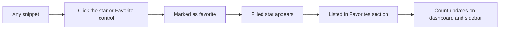
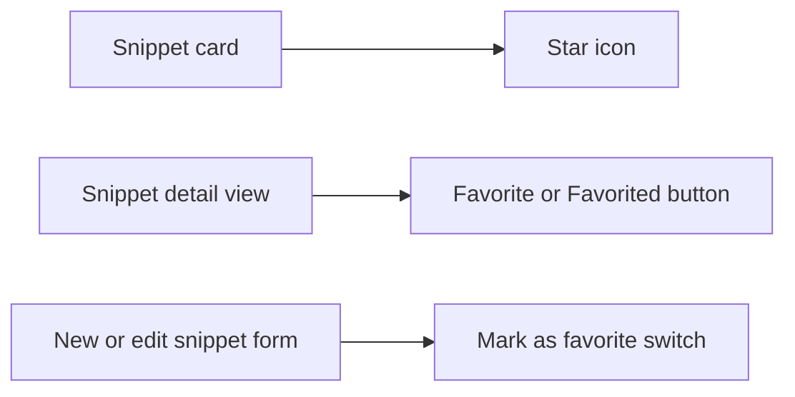
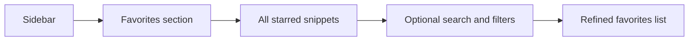

# Favorites management

Favorites help you flag the snippets you rely on most so you can return to them quickly. When a snippet is a favorite, it shows a filled star and appears in a dedicated **Favorites** section in the sidebar. This is especially useful when your library is large and you want to keep your most-used patterns one click away.

Figure: How a snippet moves from ordinary to favorite

## What favorites can do for you

Favorites reduce the effort of finding high-priority snippets. Instead of searching every time, you can open the **Favorites** section and see only the snippets you have starred. The filled star also acts as a visual cue in cards and search results, so favorite snippets stand out immediately.

## Where to add or remove favorites

You can change favorite status from three places:

- On a snippet card, click the star icon. The tooltip says **Add to favorites** when the snippet is not yet a favorite, and **Remove from favorites** when it is.
- In the snippet detail view, select **Favorite** to add the snippet or **Favorited** to remove it.
- While creating or editing a snippet, turn on **Mark as favorite** to save the snippet as a favorite.

On a snippet card, the **More actions** menu is for editing and deleting. Use the nearby star icon to change favorite status.

Figure: Where you can toggle favorite status

## View all favorites

Select **Favorites** in the sidebar to open a focused list of all starred snippets. The sidebar shows a count badge next to **Favorites**, and the main area shows a **Favorites** heading with the number of matching snippets.

While you are in the **Favorites** section, you can still use search, language, category, tag, and sort controls to narrow the list further. If no favorites match your current search or filters, an empty state appears and offers to clear the filters.

Figure: Viewing the favorites list

## See favorite counts

Favorite totals appear in two places:

- On the **Dashboard**, a **Favorites** stat card shows how many snippets you have starred, with the hint **starred for quick access**.
- In the sidebar, a badge next to **Favorites** shows the same running total.

Both counts update as soon as you add or remove a favorite.

## Favorite persistence

Favorite status is saved with your snippet library in your browser on the current device. That means starred items stay starred when you close and reopen the application.

## Boundaries

- Favorites are not created automatically based on how often you use a snippet. You must choose each favorite yourself.
- There are no favorite collections, groups, or folders. The **Favorites** section shows all starred snippets together.
- The **Favorites** section does not separate favorites by language or category, but you can apply the standard search and filter controls while viewing it.
- Changing a favorite does not change your current search or filter selections.

## Related

- [Snippet Management](doc:d875ccc9-b2fb-4c86-82a0-190a6952a4c7)
- [Dashboard](doc:73800e45-b85d-4bd0-9a64-7620aa9bdf7e)
- [Snippet Organization](doc:c88b9d7b-71f1-4365-b228-3a4ca18a9db4)
- [Search and Filtering](doc:2cbb8fac-e41c-44bf-93bd-7fc333e72aa0)
- [Product Overview and Key Concepts](doc:3a2f38ea-1eb7-45d0-91ef-d101d4eb349c)
