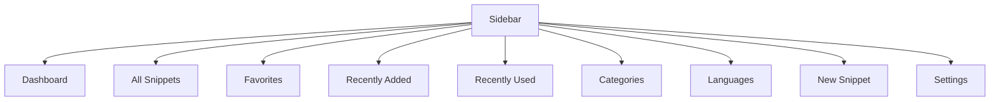
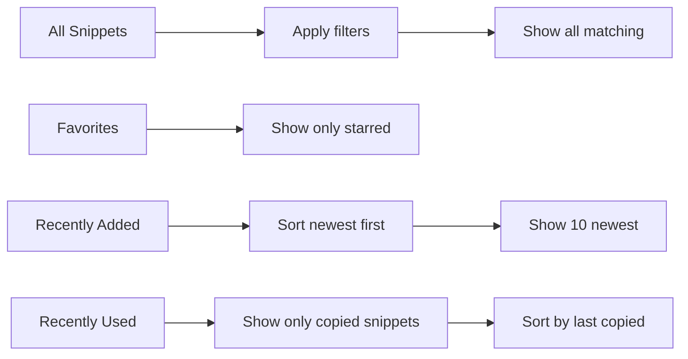
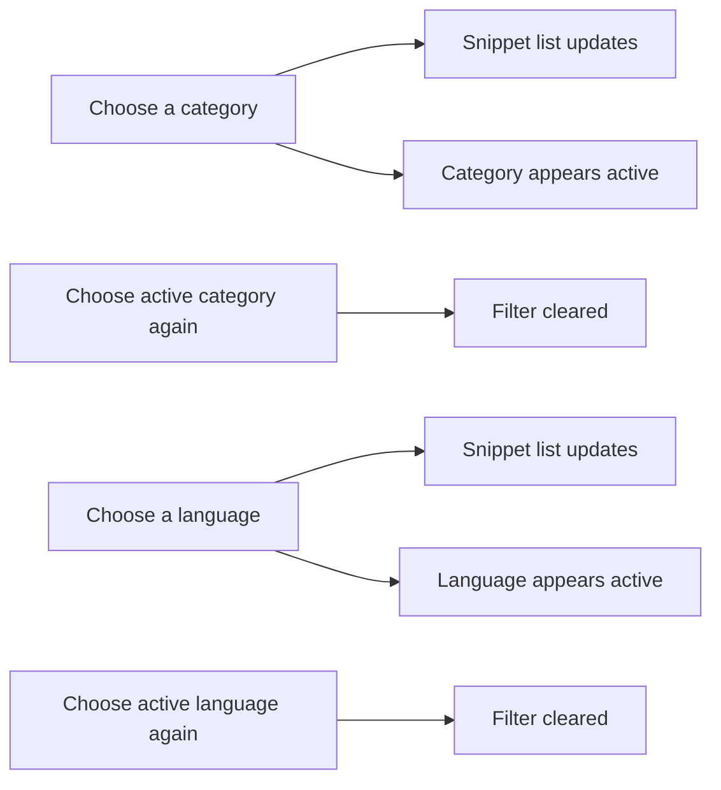
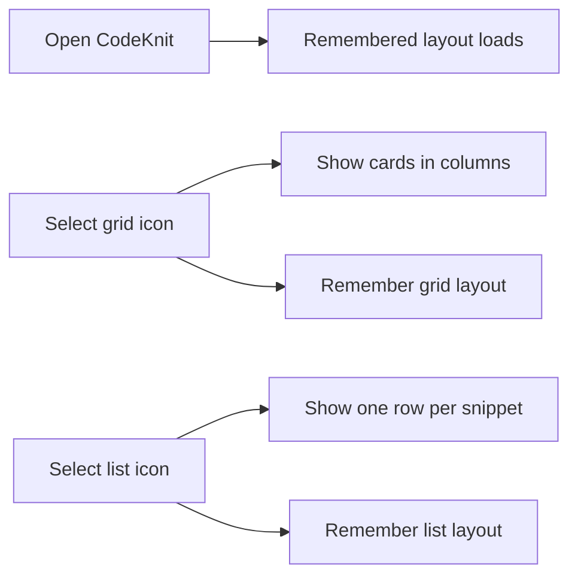
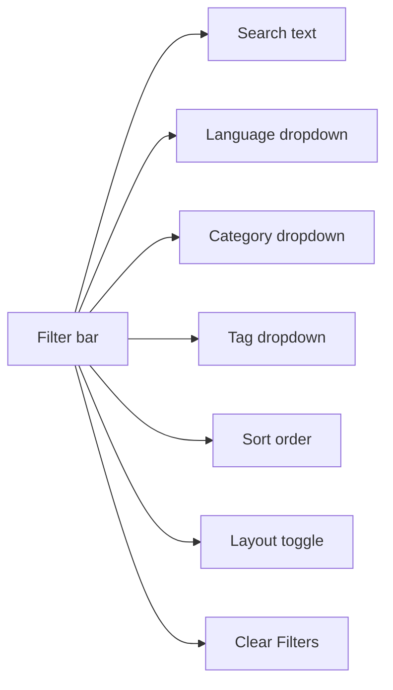
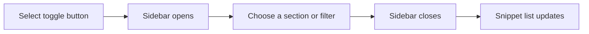
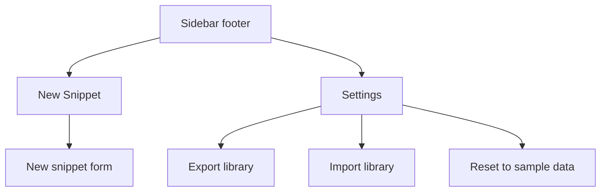
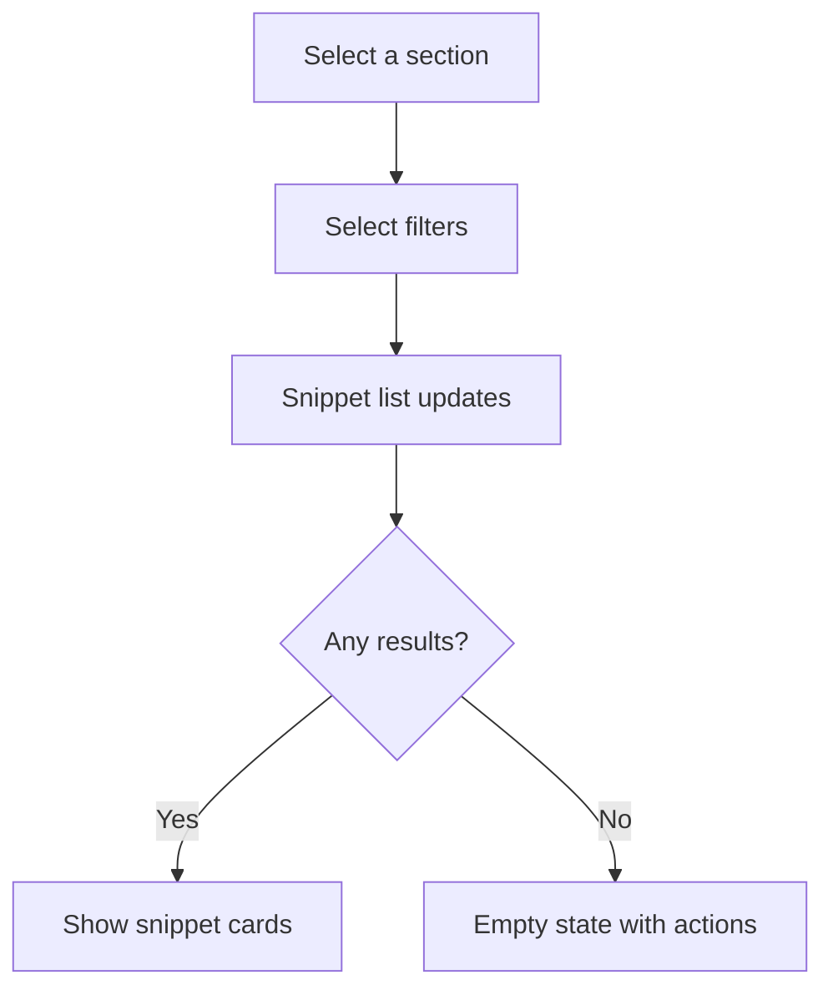

# Navigation and layout modes

CodeKnit gives you several ways to move around your snippet library and control how snippets are displayed. This guide explains the sidebar, the filters, the grid and list views, mobile navigation, and the quick actions for creating snippets or opening settings.

## Sidebar navigation overview

The sidebar is always available on the left side of the screen. It groups all navigation into one place, so you can jump between different views of your library without opening menus.

The sidebar contains:

- **Main sections**: Dashboard, All Snippets, Favorites, Recently Added, and Recently Used
- **Category filters**: one entry per category you have assigned to snippets
- **Language filters**: the supported programming languages
- **Quick actions**: New Snippet and Settings

Figure: Sidebar navigation structure

Each main section shows a label and, where relevant, a badge with the number of snippets in that section. All Snippets, Favorites, and Recently Used show count badges. The active section is highlighted so you always know where you are.

## Main navigation sections

### Dashboard

The Dashboard is your starting view. It shows a headline, "Your code, organized.", and a short summary strip with three numbers: total snippets in your library, how many are starred as favorites, and how many programming languages are represented.

Below the summary, the Dashboard shows the same snippet list as your current filters, under a **Your Snippets** heading.

### All snippets

Select **All Snippets** to see every snippet in your library, subject to any active language, category, tag, or search filters. The count badge shows the total number of snippets before filters are applied.

### Favorites

Select **Favorites** to show only snippets you have starred. The count badge shows how many snippets are currently favorited.

### Recently added

Select **Recently Added** to see your newest snippets. This view sorts snippets by creation date, newest first, and limits the list to the 10 most recent entries. There is no count badge for this section because it is always a top-10 view.

### Recently used

Select **Recently Used** to see snippets you have copied, ordered by the most recent copy. Snippets that have never been copied do not appear in this view. The count badge shows how many snippets you have copied at least once.

Figure: How sections filter the snippet list

## Category and language filters in the sidebar

Below the main sections, the sidebar has two filter groups.

### Category filters

The **Categories** group lists every category used by at least one snippet in your library. Each category shows a folder icon, the category name, and a count of snippets assigned to it.

Selecting a category narrows the snippet list to only snippets in that category. Selecting the active category again clears the category filter and returns to **All categories**.

### Language filters

The **Languages** group lists the supported languages. Each language has a small colored dot that matches the language badge used on snippet cards.

Selecting a language narrows the snippet list to only snippets written in that language. Selecting the active language again clears the language filter.

Figure: Sidebar filter behavior

## Grid and list layouts

The snippet list can be displayed in either a grid layout or a list layout. The toggle for this sits in the filter bar above the snippet list.

- **Grid view** shows snippets as cards arranged in columns. On wide screens, cards appear two or three per row, and each card shows a compact code preview.
- **List view** shows one snippet per row, with the snippet details on the left and a wider code preview on the right. On smaller screens, list view stacks the details above the code preview.

The toggle contains two buttons next to each other: a grid icon and a list icon. The active layout is highlighted. Your choice is remembered on the same device; the next time you open CodeKnit, the same layout appears.

Figure: Choosing between layouts

## Search, tag, and sort tools in the filter bar

Above the snippet list, a filter bar gives you additional controls that work alongside the sidebar:

- **Filter field**: narrows snippets by matching text in titles, descriptions, tags, or code.
- **Language dropdown**: replicates the sidebar language filter, with an **All languages** option.
- **Category dropdown**: replicates the sidebar category filter, with an **All categories** option.
- **Tag dropdown**: filters by tags you have added to snippets.
- **Sort dropdown**: orders results by **Recently Added**, **Oldest First**, or **A–Z**.
- **Clear Filters**: appears whenever any filter is active, and resets the search, language, category, and tag filters in one click while keeping your chosen sort order.

Figure: Filter bar controls

## Mobile sidebar and hamburger toggle

On smaller screens, the sidebar hides to give the snippet list more room. A navigation toggle button appears in the header, next to the search field.

1. Select the toggle button, labeled **Toggle navigation**, to open the sidebar.
2. Choose a section, category, language, or quick action.
3. The sidebar closes automatically after your selection, returning you to the content.

Figure: Opening the sidebar on mobile

## Quick-access buttons

### New snippet

You can create a snippet from two places:

- In the sidebar footer, select **New Snippet**.
- In the header, select **New Snippet** (or the plus icon on small screens).

Both open the new snippet form, ready for you to enter a title, code, language, category, tags, and description.

### Settings

The Settings button sits in the sidebar footer, next to the workspace details. Select **Settings** to open a dialog where you can export your library as a file, import a previously exported library, or reset your data to sample snippets.

Figure: Quick actions in the sidebar

## How filters and sections work together

Section selection and sidebar filters are independent. For example, if you select **Favorites** and then choose the **Python** language filter, you see only Python snippets that are also starred. Selecting **All Snippets** with the same language filter shows all Python snippets, regardless of favorite status.

The **Recently Added** section always sorts by newest and limits results to 10, regardless of the sort dropdown. The **Recently Used** section always sorts by most recently copied and excludes snippets that have never been copied.

If a section or filter combination produces no results, an empty state appears. It explains that no snippets match, and offers a button to clear filters or browse all snippets, depending on the situation.

Figure: Combining sections and filters

## Related pages

- [Snippet Organization](doc:c88b9d7b-71f1-4365-b228-3a4ca18a9db4)
- [Search and Filtering](doc:d4db354c-9033-416f-babe-aaab07cc3975)
- [Favorites Management](doc:b7298781-db09-4ef9-812c-618f0b3e222c)
- [Quick Start Guide](doc:27bdcaf5-0df9-412f-9cd1-5eaf702b8d97)
- [Dashboard](doc:73800e45-b85d-4bd0-9a64-7620aa9bdf7e)
