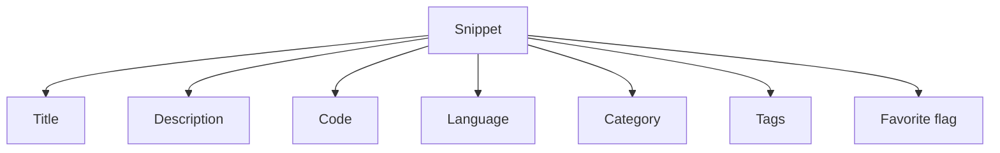
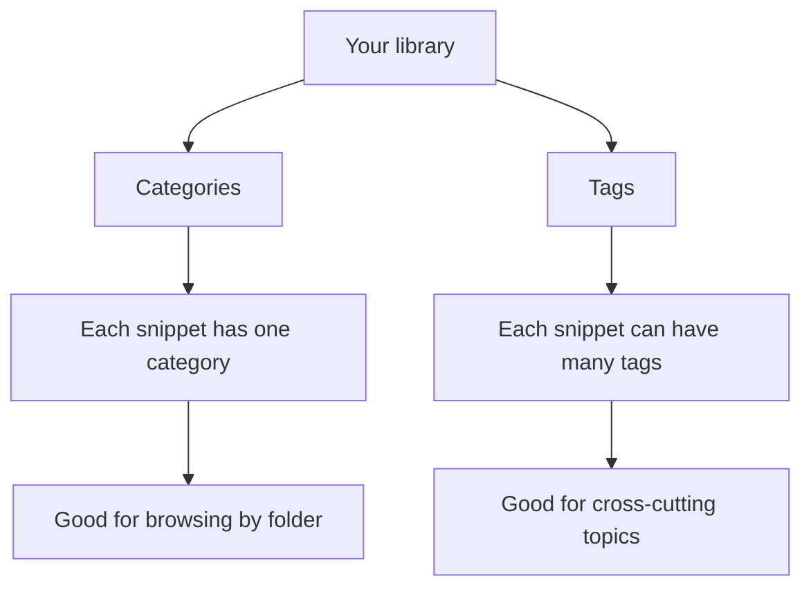
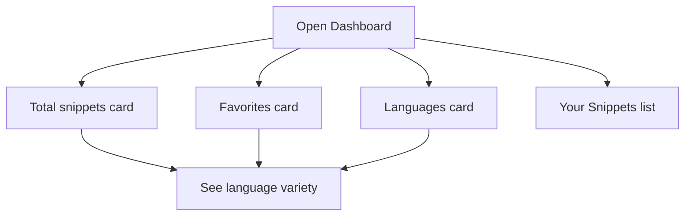
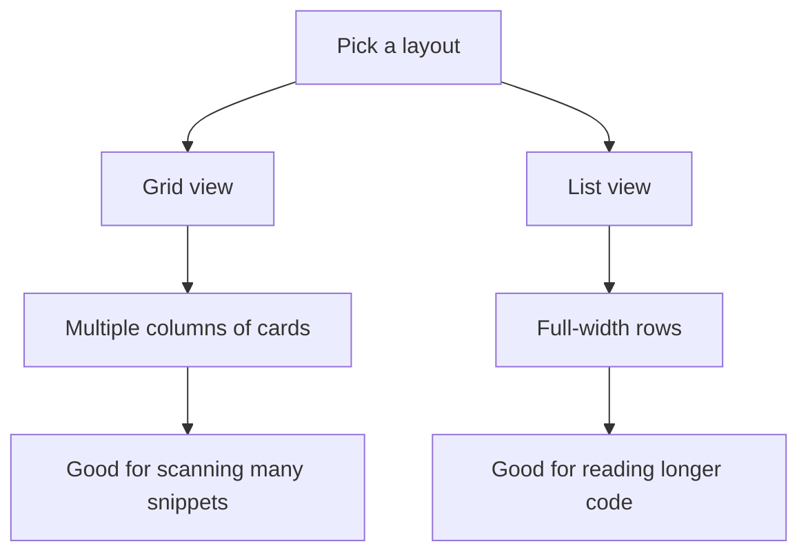
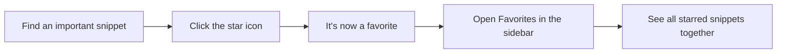
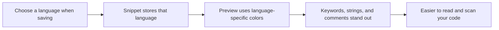
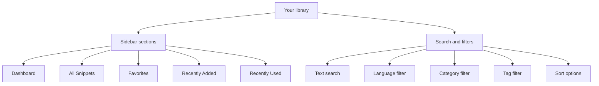

# Product overview and key concepts

CodeKnit is a personal code snippet library that lives in your browser. You save reusable pieces of code, organize them with categories and tags, and quickly find them again when you need them. This guide explains the core ideas that make the library work.

## What is a snippet?

A snippet is a saved piece of code paired with the details that make it easy to find and reuse later. Every snippet in CodeKnit includes:

- A **title** that names it, such as "Debounce utility"
- An optional **description** that explains what it does
- The **code** itself
- A **language** that identifies how the code should be displayed and colored
- A **category** that files it under a broad group
- Optional **tags** for flexible, small labels
- A **favorite** flag that marks it for quick access

Your snippets are stored on the device you're using. Nothing leaves your browser unless you choose to export a backup.

Figure: The parts of a snippet

## Categories and tags: Two levels of organization

Categories and tags work together to make your library browsable.

A **category** is a single container each snippet belongs to. Categories appear in the sidebar with a count of how many snippets they hold. Clicking a category filters the main area to show only snippets in that group. You can choose an existing category when saving a snippet or type a custom one.

**Tags** are smaller, freeform labels. A snippet can have no tags, one tag, or many tags. Tags appear as rounded labels with a`#` prefix. Use tags for cross-cutting ideas that don't fit neatly into one category, for example,`#async`,`#debounce`, or`#react`.

Figure: How categories and tags organize snippets

For practical steps on creating and editing snippets, see [Snippet Management](doc:d875ccc9-b2fb-4c86-82a0-190a6952a4c7). For a deeper look at the metadata fields, see [Understanding Snippet Metadata](doc:0454440c-0145-46fc-910a-1e0a7ef4c962). For how the sidebar organizes navigation, see [Snippet Organization](doc:c88b9d7b-71f1-4365-b228-3a4ca18a9db4).

## The dashboard gives you an at-a-glance view

The **Dashboard** is the first section you see when you open CodeKnit. It provides a high-level summary of your collection through three cards:

- **Total snippets**, how many snippets are in your library
- **Favorites**, how many snippets you've starred for quick access
- **Languages**, how many different programming languages your snippets use, with the names listed below the count

Below the summary cards, the dashboard shows your snippets in the same browsing area used throughout the app, so you can jump straight into reading or reusing code without navigating away.

Figure: What the dashboard shows

To explore the dashboard in detail, see [Dashboard](doc:73800e45-b85d-4bd0-9a64-7620aa9bdf7e).

## Grid and list layout modes

CodeKnit offers two ways to arrange your snippet cards. You switch between them using the toggle in the filter bar.

**Grid view** arranges cards in multiple columns on wider screens. Each card shows the snippet's title, language, category, tags, a code preview, and action buttons. Grid view is ideal for scanning many snippets at once because more cards fit on screen.

**List view** spreads each snippet across the full width of the page. The metadata sits on the left, and a wider code preview sits on the right. List view is ideal for reading longer code without opening a snippet.

Your layout choice is remembered between visits, the next time you open CodeKnit, it uses the view you last selected.

Figure: Choosing a layout

For more on layout and navigation, see [Navigation and Layout Modes](doc:971aeb74-0ca3-46ee-9e46-5b25c15adc24).

## Favorites enable quick access

Favorites are snippets you've starred because they're important or frequently used. You can mark a snippet as a favorite:

- When you create it, using the **Mark as favorite** switch in the form
- From a snippet card, using the **star** icon
- From the snippet detail view, using the **Favorite** button

Once starred, a snippet appears in the **Favorites** section in the sidebar. The sidebar also shows a live count of how many favorites you have, and the dashboard summary includes that same number.

Figure: Favoriting a snippet

For a complete guide to starring and unstarring snippets, see [Favorites Management](doc:b7298781-db09-4ef9-812c-618f0b3e222c).

## Languages and syntax highlighting

Each snippet has a language. CodeKnit supports four languages: **JavaScript**, **Python**, **SQL**, and **Markdown**.

When you save a snippet, the language you choose controls how its code is displayed in cards, the detail view, and the editor. CodeKnit applies language-specific syntax coloring so that keywords, strings, comments, numbers, and variables are visually distinct. This makes code faster to scan and easier to understand at a glance.

Each language also has a colored dot that appears in the sidebar and on language badges, so you can recognize the language of a snippet even before reading its code.

Figure: How language choices affect what you see

To learn more about how code is displayed and highlighted, see [Code Preview and Highlighting](doc:1af35ce8-def3-409e-a761-91543f16f3d9). To learn about writing and editing code, see [Code Editing](doc:2cbb8fac-e41c-44bf-93bd-7fc333e72aa0).

## How the library fits together

The sidebar navigation, search filters, and layout toggle work together as one system. The sidebar switches between high-level views. The filter bar refines what you see within any view. The layout toggle changes how the results are displayed. Favorites and categories are cross-cutting, they add structure that works everywhere.

Figure: The overall structure of your CodeKnit library

## Related pages

- [Dashboard](doc:73800e45-b85d-4bd0-9a64-7620aa9bdf7e), explore the summary cards and default view
- [Snippet Management](doc:d875ccc9-b2fb-4c86-82a0-190a6952a4c7), create, edit, and organize snippets
- [Snippet Organization](doc:c88b9d7b-71f1-4365-b228-3a4ca18a9db4), navigate and filter by sidebar sections
- [Search and Filtering](doc:2cbb8fac-e41c-44bf-93bd-7fc333e72aa0), locate snippets by text, language, category, and tag
- [Understanding Snippet Metadata](doc:0454440c-0145-46fc-910a-1e0a7ef4c962), a deeper look at metadata fields
- [Navigation and Layout Modes](doc:971aeb74-0ca3-46ee-9e46-5b25c15adc24), how to get around and choose between grid and list views
