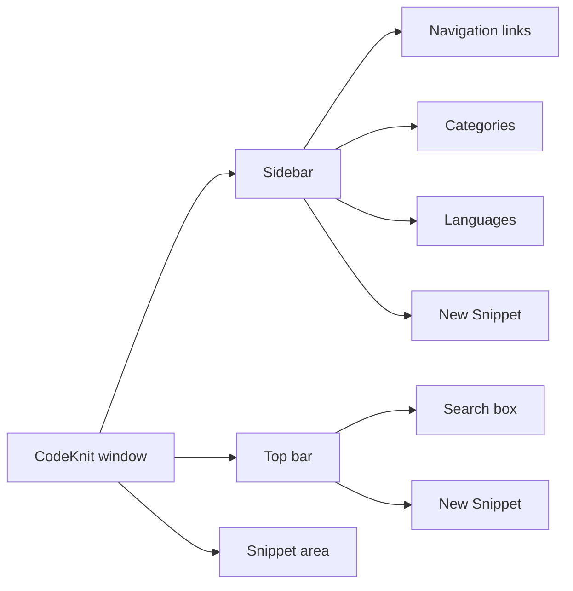
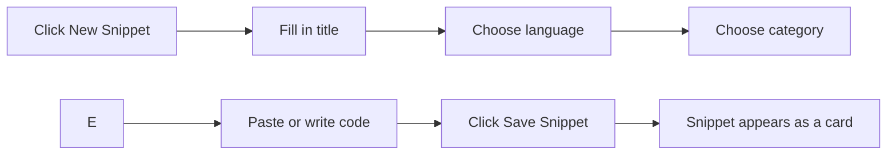

# Quick start guide

This guide gets you up and running with CodeKnit in under five minutes. By the end, you'll know how to create your first snippet, find it again, favorite it, and export a backup of your library.

CodeKnit works entirely in your web browser. Your snippets are saved on the current device, so no account is required to get started.

## Meet your workspace

When you open CodeKnit, you land on the Dashboard. The screen has three main areas:

- **Sidebar** (left): links to each view, your categories and languages, the **New Snippet** button, and the **Settings** button.
- **Top bar**: a search box and another **New Snippet** button.
- **Main area**: where your snippets appear as cards or in a list, below a set of filters.

The Dashboard shows the heading "Your code, organized." with three summary cards: **Total snippets**, **Favorites**, and **Languages**. For a deeper look at the Dashboard, see [Dashboard](doc:73800e45-b85d-4bd0-9a64-7620aa9bdf7e).

Figure: Main workspace areas

### Use the sidebar to move around

The sidebar gives you five views:

- **Dashboard**: your home view with a library summary.
- **All Snippets**: every snippet you have saved.
- **Favorites**: snippets you have starred.
- **Recently Added**: newest snippets first.
- **Recently Used**: snippets you have copied, most recent first.

Below the views, you can click a **category** or a **language** to see only the snippets in that group. The sidebar footer also shows that your workspace is **Saved on this device**.

## Create your first code snippet

When your library is empty, the Dashboard shows a "No snippets yet" message with a **+ New Snippet** button. You can start from there, or use the **New Snippet** button in the sidebar or top bar at any time.

Figure: Creating a new snippet

1. Click **New Snippet** in the sidebar, the top bar, or the empty state.
2. Type a **Title**. This is required, and an error appears if you leave it blank.
3. Add a **Description** (optional) to explain what the code does.
4. In **Language**, pick **JavaScript**, **Python**, **SQL**, or **Markdown**. JavaScript is selected by default.
5. In **Category**, choose an existing category from the list, or select **+ Custom category…** and type your own. Utilities is selected by default.
6. Add **Tags** (optional) to group related snippets.
7. Type or paste your **Code** in the editor. This is required. The editor shows line numbers and colors the code as you type, and pressing Tab indents by two spaces.
8. Optionally, turn on the **Mark as favorite** switch.
9. Click **Save Snippet**.

A confirmation message appears, and your new snippet shows up as a card on the Dashboard. For full details on creating and editing snippets, see [Snippet Management](doc:d875ccc9-b2fb-4
